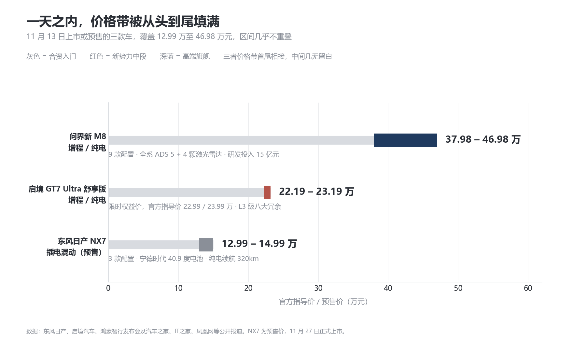
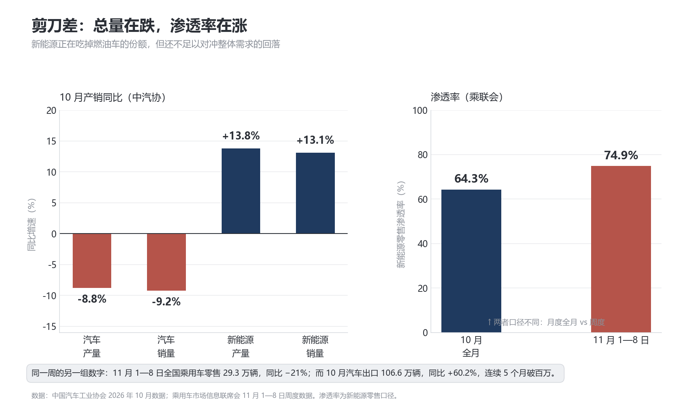
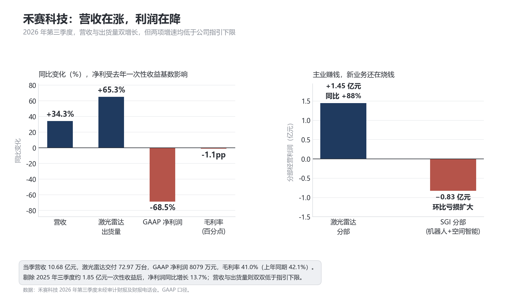

# 国内冲量，海外收缩：24 小时车圈的方向分叉

**一句话结论：11 月 13 日这一天，中国车市在做加法——三款新车、一条新政策、一个技术门槛的下放；跨国车企在做减法——冻结本土投资、召回七十二万辆、供应链利润腰斩。同一时点上，两套体系给出的答案正好相反。**

## 一、三款车，三种打法

**东风日产 NX7** 是合资品牌的一次贴身肉搏。3 款配置，预售价 12.99 万至 14.99 万元，全系标配宁德时代 40.9 度电池、CLTC 纯电续航 320 公里。最值得注意的是日产中国管理委员会主席马智欣的表态：他直接承认"当下销售存在压力"，给出的解法不是降价，而是出口——今年合资公司产品出口至 30 多个国家，明年数量或翻倍。

**当一款 12.99 万起的插混 SUV 已经标配一线电池和智舱，价格战的空间正在耗尽，合资体系只能往海外找增量。**

**启境 GT7 Ultra 舒享版** 走的是另一条路——把 L3 的硬件门槛往下拉。这款由广汽与华为乾崑联合打造的猎装车，增程版限时权益价 22.19 万元、纯电版 23.19 万元（官方指导价 22.99 万和 23.99 万元），两款车共用一套面向 L3 级的整车架构，供电、转向、制动、通信、定位、算力、感知、交互八大系统全链路冗余。启境 CEO 刘嘉铭的判断是"L3 是下一代智能汽车的分水岭"。

**当冗余架构被放进 20 万级车型，L3 就从旗舰车的配置项变成了这个价位的入场券。**

**问界新 M8** 则是有意识的反向操作。售价 37.98 万至 46.98 万元，比老款首发贵了 2 万元；全系标配华为乾崑 ADS 5 与 4 颗激光雷达，增程版 CLTC 综合续航最高 1435 公里。赛力斯累计投入 15 亿元、实现 126 项技术升级；余承东公布问界 M8 上市 19 个月累计交付超 19 万辆。

在价格战仍是行业底色的当下，涨价 2 万是有风险的。赛力斯的表态是"坚定做全球高端品牌，不参与价格战"。这个表态能不能站住，有个比表态更硬的证据：**新 M8 上市 2 小时，大定突破 4600 台。**

三款车价格带从 12.99 万一路铺到 46.98 万，几乎不重叠。这不是巧合，而是当前的结构：**每个价格区间都在被填满，谁也不能靠留白活下去。**

## 二、底色：总量在跌，渗透率在涨

中汽协数据：10 月汽车产销 306.3 万辆和 301.6 万辆，**同比分别下降 8.8% 和 9.2%**；但新能源汽车产销 201.7 万辆和 194 万辆，同比分别增长 13.8% 和 13.1%，**月度新车销量占比首次达到 64.3%**。

出口是另一根支柱：10 月汽车出口 106.6 万辆，同比增长 60.2%，连续 5 个月站上百万辆；1—10 月累计出口 927.1 万辆，同比增长 65.1%。

更近的数据来自乘联会：11 月 1—8 日全国乘用车零售 29.3 万辆，**同比下降 21%**；但新能源零售渗透率冲到 **74.9%**。

两组数字放一起，是一个正在张开的剪刀差：**新能源正在吃掉燃油车的份额，但还不足以对冲整体需求的回落。**这也解释了为什么 11 月 13 日会有三款车挤在同一天：**增量不在大盘里，只在别人的份额里。**

## 三、政策给的是一条新赛道

当天最具结构性意义的一条，不是任何一款车。

11 月 13 日，工信部装备工业一司会同相关部门起草的《汽车改装管理办法（征求意见稿）》开始公开征求意见，反馈截止 12 月 12 日。这是国家层面首个系统性推进汽车改装管理的政策规范性文件。

制度核心是分类管理：一类改装指车身颜色、内外饰等不涉及安全环保性能的改装，车主可自行实施或委托企业开展；二类改装指涉及制动、悬架等安全环保性能的功能性改装，实施企业**须获得整车生产企业授权**。工信部已制定第一批清单共 43 项（一类 29 项、二类 14 项），要求企业建立**"一车一档"**改装档案。据中汽协调研，2025 年国内汽车改装市场规模已超 1500 亿元、同比增长 20%。

这条政策的分量要放在整车利润的背景下看。**当卖车的单车利润被压到几百元，后市场就是唯一还留有定价权的环节。**改装过去长期处在灰色地带——钱一直在花，只是花得没名分。把 43 个项目列成清单、把质保和保险写进条文，本质上是把一笔已经存在的消费从地下搬到台面上，同时给主机厂开了一条新的授权收入通道。

## 四、另一侧：冻结与召回

**梅赛德斯-奔驰**于 **11 月 12 日**（中文媒体 13 日集中报道）宣布，冻结对德国境内生产设施的所有进一步投资，并考虑关停工厂。董事会成员迈克尔·希贝说得直接：鉴于当前成本结构，在德国投资已不可行。人力负责人泽格表示，"我们都希望不惜一切代价避免关闭工厂，但遗憾的是，必须更具体地探讨这一方案"。

真实背景不是笼统的"竞争压力"，而是一场劳资僵持：**工会 IG Metall 要求加薪 5%，奔驰管理层则警告德国劳动力成本"高得离谱"**。据德国之声报道，若成本降不下来，未来新产品可能全部转向海外生产。业绩层面，奔驰 2026 年前三季度全球销量 124.44 万辆、同比下滑 7%。

**宝马北美**同日向 NHTSA 提交召回备案，涉及 **720,796 辆**汽车，编号 26V-733。缺陷是水泵电气连接器密封材料随时间降解，水分可能渗入导致短路，极端情况下起火；涉事车辆多为搭载 N20 或 N26 发动机的 2012 至 2018 年款，熄火停放时同样存在风险。

这里有个材料没提到、但很关键的事实：**这是二次召回。**2024 年 8 月，宝马已因同一个水泵问题召回同一批车（编号 24V608），当时加装挡水板。但后续测试发现连接器本身会变脆开裂，挡水板没解决根本问题。

这改变了新闻的性质。**它不是一次偶发的品控失误，而是一次修复失败后的再次承认**——对一家以工程能力为品牌核心的公司来说，这比 72 万辆这个数字更难解释。

同日据市场监管总局网站，奔驰、宝马、福特、丰田、斯泰兰蒂斯等多家海外品牌集中备案召回，合计超 1.3 万辆。

## 五、供应链：增收不增利

**禾赛科技**三季报是观察智驾供应链真实状态的切片。当季营收 10.68 亿元、同比增长 34.3%，激光雷达交付 72.97 万台、同比增长 65.3%；SGI 业务（机器人动力模组与空间智能平台）营收 9051 万元、环比翻倍，并宣布与京东合作五年内部署超 400 万台机器人及无人车设备。

但利润端相反：GAAP 净利润 8079 万元、**同比下降 68.5%**；毛利率降至 **41.0%**。净利大跌主要来自基数——2025 年三季度禾赛通过处置股权投资及转让知识产权获得约 1.85 亿元一次性收益，剔除后净利润同比是增长的。

真正值得注意的是另一个事实：**这一季营收和出货量双双低于公司指引下限。**CFO 樊鹏在电话会上坦言，今年汽车市场整体表现弱于年初预期。

分业务看，激光雷达分部经营利润 1.45 亿元、同比增长 88%，ET 系列在手订单超 100 万台；但 SGI 分部经营亏损 8288 万元，且较上季进一步扩大。

**智驾供应链的增量故事，正从"卖更多激光雷达"转向"机器人 + 空间智能"，但盈利模型的切换还没完成。**主业增速在放缓，新业务还在烧钱，中间这段过渡期，财报会一直难看。

## 六、结论：分叉会持续

国内这一侧，东风日产用出口翻倍的预期为合资模式找新支点，启境和问界用 L3 架构把智驾竞赛推向更深的水位，改装管理办法为整车利润薄化之后的产业延伸打开了制度空间。三件事的共同点：**都在存量市场里找新的定价权**——出口是新市场，L3 是新门槛，后市场是新赛道。跨国这一侧，奔驰冻结德国投资、宝马二次召回 72 万辆、禾赛毛利率承压，共同提示传统体系的收缩成本与供应链的盈利切换远未完成。

接下来值得跟踪三个节点：**问界新 M8 的交付爬坡**——4600 台是 2 小时数字，真正考验是能否持续；**改装管理办法征求意见期的行业反馈**——43 项清单会不会在执行层面变形；以及**奔驰关厂决策是否会在劳资层面引发进一步反应**——IG Metall 已要求谈判。

---

*事实来源：中汽协、乘联会、工业和信息化部、国家市场监管总局、新华社、德国之声、德新社、路透社、NHTSA、USA Today、Autoweek、禾赛科技财报及电话会、凤凰网、汽车之家、IT之家、第一财经、证券时报等公开报道。NX7 为预售价，11 月 27 日正式上市；启境 GT7 Ultra 舒享版所列价格为限时权益价，官方指导价为 22.99/23.99 万元。*
