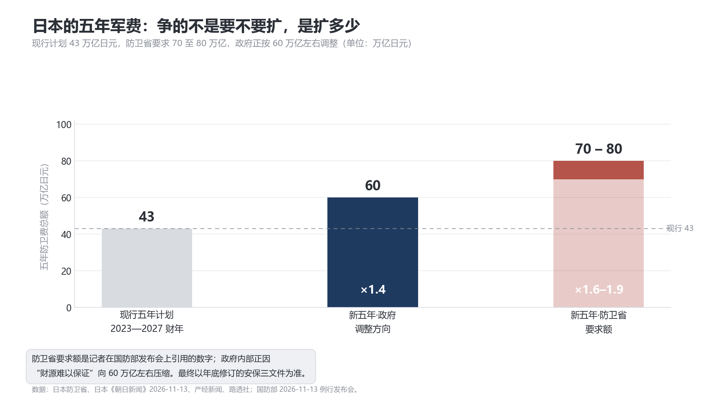
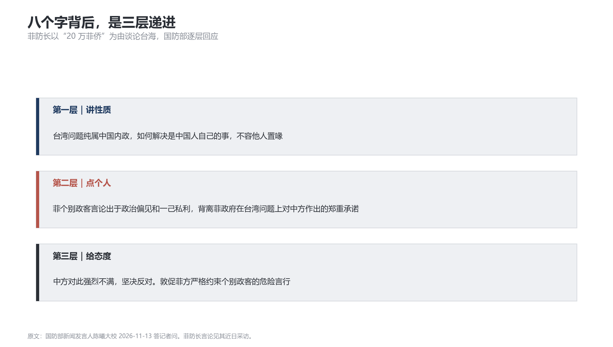
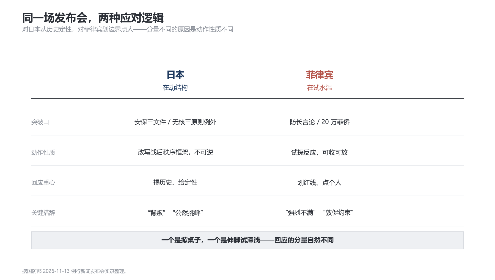

# 同一天，国防部点了两个名字：日本在磨刀，菲律宾在试探

11 月 13 日下午，国防部一场例行发布会，发言人陈曦大校点了两个名字。

一个是日本——"右翼势力公然挑衅战后国际秩序"，核松绑的步子越迈越大。一个是菲律宾——防长拿 20 万菲侨说事，国防部回了八个字：强烈不满，坚决反对。

同一天，两个方向，两种试探。但仔细看，中方的应对方式其实不一样：**对日本，是揭历史、给定性；对菲律宾，是划红线、点个人。**这个区别不是随口说的，里面有权衡。

## 一、日本：不是"防卫"，是"渐进式核松绑"

先说日本。

记者在会上问的是日本新版"安保三文件"。这三份文件年底要修订，目前释放的信号有两条最扎眼：一是拟继续把中国定位为"最大战略挑战"；二是政府正考虑在修订《国家安保战略》时，写入"无核三原则"的例外情况——说白了，就是**允许在紧急情况下把核武器运进日本**。

这里有个数字要摆清楚。日本防卫省要求未来五年（2027 年 4 月起）防卫费达到 **70 万亿至 80 万亿日元**，是现行五年计划约 43 万亿日元的近两倍。但据日本《朝日新闻》11 月 13 日披露，政府内部正在按 **60 万亿日元左右**做最终调整，因为"大幅增税的财源难以保证"——**连日本政府自己都觉得防卫省要得太多。**

这个反差值得留意。它说明日本的军费扩张不是没有阻力，但也说明另一件事：即便被压到 60 万亿，相比现在的 43 万亿仍然是大幅跳升。**争的不是要不要扩，而是一次扩多少。**

国防部的回应没有绕弯子，直接上历史："日本是二战战败国。历史上日本军国主义曾经犯下滔天罪行……日方本应深刻反省侵略历史和所犯罪责。"

然后是一句定性："日本右翼势力却不断编造所谓'中国威胁论'的虚假叙事，黑白颠倒编排'受害者'戏码，加速扩充防卫开支，强化进攻性作战和远程攻击力量，**现在更是妄图实现渐进式核松绑**，种种行径不仅是对自身和平承诺的背叛，更是对战后国际秩序和《不扩散核武器条约》权威性的公然挑衅。"

这段话里，"渐进式"三个字是关键。战后的"无核三原则"——不拥有、不生产、不引进核武器——是日本对外的基本承诺，也是它作为战败国被国际社会接受的前提之一。现在要在文件里开一个"例外"的口子，**这不是一步跨过去，而是一寸一寸挪**。

## 二、菲律宾：拿 20 万菲侨说事，被点了名

再说菲律宾。

菲防长铁欧多洛近日接受采访时称：考虑到有 **20 万菲侨民在台湾生活**，菲律宾正为各种可能情势作准备；中方若试图武力接管台湾，"将是得不偿失的选项"。

这段话的用心不难看出来。**把 20 万侨民摆到台面上，等于给自己预留了一个"人道关切"的介入理由**——好像菲律宾对台海有发言权，是因为那里有它的国民。

国防部的回应分三层，一层比一层重：

第一层讲性质："台湾问题纯属中国内政，如何解决是中国人自己的事，**不容他人置喙**。"

第二层点人："菲个别政客言论出于**政治偏见和一己私利**，背离菲政府在台湾问题上对中方作出的郑重承诺。"

第三层给态度："中方对此**强烈不满，坚决反对**。中方维护主权和领土完整、实现国家统一的意志坚定不移。"

最后一句是要求："敦促菲方严格约束个别政客的危险言行，切实恪守一个中国原则。"

注意"个别政客"这四个字。国防部没有说"菲律宾政府"，而是把矛头精确地落在"个别政客"身上——**这既是留了余地，也是把话说明白了：你们政府是做过承诺的，现在有人违背承诺，你们自己管不管？**

## 三、两种姿态，为什么不一样

把两段放在一起看，中方的应对方式有明显区别。

对日本，重心是**历史和定性**——战败国、军国主义罪行、战后国际秩序、NPT 权威。用的是"背叛""挑衅"这类词，指向的是一个国家方向性的错误。

对菲律宾，重心是**边界和人**——内政不容置喙、个别政客出于私利、敦促约束言行。用的是"不满""反对""敦促"，指向的是具体某个人的具体言论。

这个区别不是随意安排的。**日本是在动结构，菲律宾是在试水温。**

日本修订"安保三文件"、给核武开例外、把军费翻倍，动的是战后秩序的框架，这种动作一旦落地就很难逆转，所以回应必须从根上定性。而菲律宾防长的一番话，本质是一次试探——看中方反应有多大，看能不能把台海问题国际化一点点。对这种试探，回应就得既划清红线，又不把对方政府逼到没有退路。

说白了：**一个是掀桌子，一个是伸脚试深浅，回应的分量自然不同。**

## 写在最后

日本这一侧，文件年底就要修订，核松绑的口子开不开、军费最终定在 60 万亿还是更高，接下来一两个月会见分晓。值得盯的不是它说了什么，而是那份文件里"例外情况"四个字最后怎么写。

菲律宾这一侧，防长的话已经说出去了，接下来要看的是菲政府会不会真的"严格约束"——还是继续让个别人在前面放话、政府在后面解释。

同一天，两个方向。日本在磨刀，菲律宾在试探。有些话不是说说而已，有些账也不是不记。

---

*事实来源：国防部网站 2026 年 11 月 13 日例行新闻发布会实录、新华社、中国新闻网、京报网、澎湃新闻、中国日报、日本《朝日新闻》、产经新闻、路透社等公开报道。文中日本防卫预算 70 万亿至 80 万亿日元为防卫省要求额，60 万亿日元左右为日本政府正在调整的方向，最终数字以年底修订的"安保三文件"为准。*
