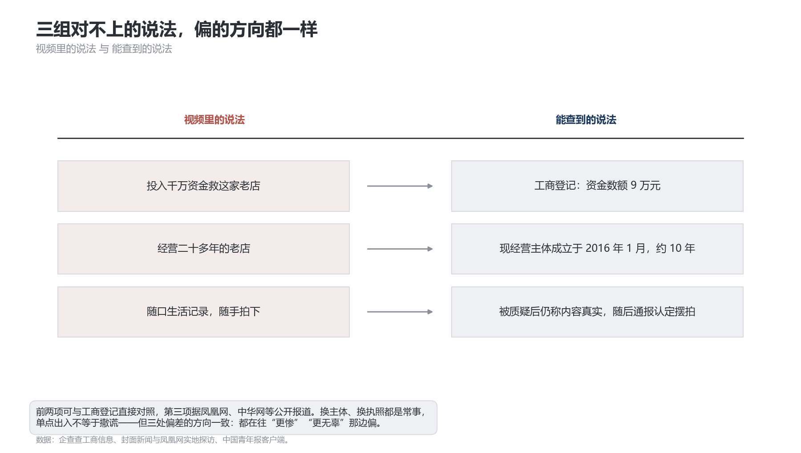
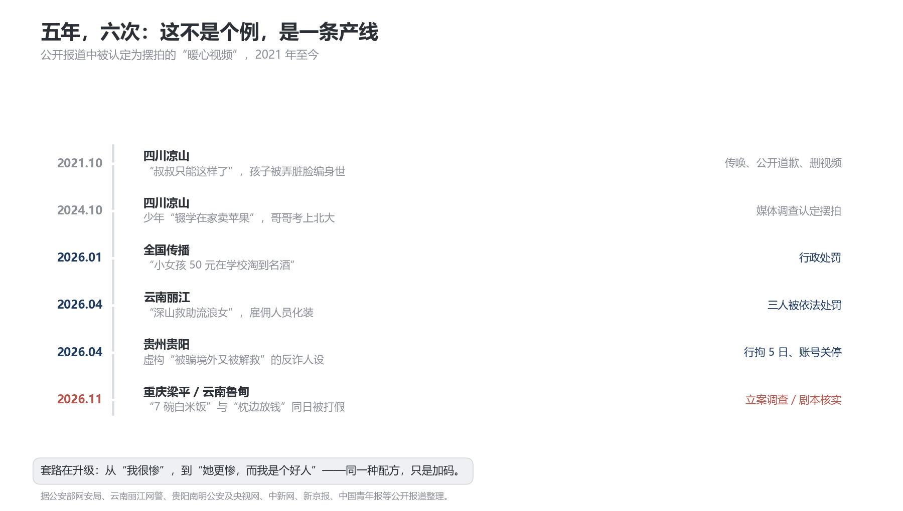

# 你转过的那条"7碗白米饭"，是演的

6 块钱的炒豆芽，7 碗白米饭，一张字条，300 块现金。

你看哭过的那条视频，11 月 12 日晚官方通报了：摆拍，立案。演的人 57 岁，开餐馆的。

最扎心的不是她骗了流量。是下一次真有人吃 7 碗白米饭的时候，评论区第一条可能是："又在演吧？"

## 一、她演得最像的地方，是"都是真的"

先说清楚这条视频为什么能骗到人——它不是那种一眼假的粗制滥造。

记者事后实地探访，店里确实有 6 块钱一份的清炒豆芽，其他菜多在 10 元以上。菜单是真的，店是真的，灶台是真的，那个站在监控画面里的老板娘也是真的。

假的只有一件事：那对母女不是走投无路的人，是被组织来的演员。

这就是"预制正能量"最阴的地方。它不需要你相信全部，它只需要你相信"这家店真的存在"。剩下的，交给五个泪点。

第一个，母亲把 6 块钱的炒豆芽全部推给孩子，自己不动一筷子。母爱，不用一句台词。

第二个，7 碗白米饭。留意这个数字——3 碗不够惨，10 碗不可信，7 碗刚好卡在"可怜"和"也可能是真的"中间。这不像记录，更像配好的剂量。

第三个，后厨免费加菜。第四个，打包袋里的字条和 300 块现金——不留名、不要还、不拍照，分寸拿捏得像真的。

第五个，两人搂肩落泪。一个镜头，完成情绪闭环。

五个节拍，一个不多，一个不少。这条视频不是拍出来的，是排出来的。

## 二、她不是第一次演，只是第一次被抓

反转之后被翻出来的东西，比视频本身更值得看。

今年 5 月，同一个人就发过一条短视频：这家店投入千万资金、每天亏损 5000 元，多名老员工出镜讲难处，呼吁本地市民到店消费"救店"。

而工商登记上是另一套数字。

涉事门店"小牧羊重庆下饭菜"的运营主体是"梁平区益品土菜店"，2016 年 1 月成立，个体工商户，资金数额 9 万元。据企查查信息，她名下关联企业 13 家。

一个说自己砸了千万资金、每天亏 5000 的人，登记的资金数额是 9 万。一个在视频里说"经营二十多年的老店"的人，现经营主体的登记时间是 2016 年 1 月。

这几处说法对不上，不等于她一定在撒谎——个体工商户换主体、老店换执照，都是常事。但方向出奇地一致：全都在往"更惨"那边偏。

这里要说一句公道话：拍视频、做营销，本身不犯法。一家小店想活下去，靠短视频拉客，天经地义。

问题在于那条 5 月的视频没有让她付出任何代价。它带来的是热度，是排队，是"救店"的同情。于是 11 月，同样的配方加了码：从"我很难"，升级成"她更难，而我是个好人"。

第一次撒谎没被追究，第二次就敢往人心最软的地方捅。

## 三、这次翻车，最先动手的是网友

11 月 12 日那份通报里，梁平区拉出的是联合调查组：网信、公安、民政、市场监管，四个部门联合核查。

但在官方介入之前，质疑已经铺开了。网友指出的漏洞都很朴素：真窘迫到只吃白米饭的人，大概率会去更便宜的街边小店；监控角度太正；那对母女此后再没出现过。

中国青年报的报道里还有一个细节：视频爆火后，门店生意上涨，餐厅一度登顶人气榜，甚至有热心市民表示要送两吨大米。

同一天被打假的还有另一起。云南鲁甸"残疾博主探访留守男孩、临走悄悄在其枕边放一沓钱"，当地核实后回应：相关情节按剧本拍摄，拍完给了男孩 100 元。

两起，同一天，同一种配方。这不是某个人的一时糊涂，是一条已经跑顺了的产线。

## 四、真正的账，不在那 300 块

通报的定性很准：为博取关注、吸引流量，编造虚假情节、组织人员摆拍、制作视频发布，误导公众认知，扰乱正常网络公共秩序，已立案调查。

但法律账只是一部分。还有一笔更贵的账，是所有人一起付的。

中新网那篇评论里有一句话，我认为就是这件事的结论："网友付出的情感是真实的，故事里的苦难却是虚构的。"

真实的那部分，才是被拿走的东西。同一篇评论还有一句："善良是社会的稀缺资源，经不起一次又一次的'狼来了'。"

有人会说，不就是一条视频，至于吗。至于。因为信任不是抽象概念，它有一个很具体的表现形式：下一次，当一条真的视频摆在你面前，你的第一反应是什么。

南京有家"零元面馆"，店主刻意躲着流量走，还是有人在猜他图什么。这就是透支之后的余温——不是不信，是下意识地先怀疑一下。

## 写在最后

回到那 7 碗白米饭。

真有人吃 7 碗白米饭的时候，不会有镜头对着她。她不会把菜全推给孩子然后等一个特写，不会有人往她袋子里塞 300 块，更不会有人在结尾搂着她落泪。

她只会安安静静吃完，把剩下的打包，然后走。

我们欠她的不是同情，是别让下一次的评论区第一行，写着"又在演吧"。

---

*事实来源：重庆市梁平区联合调查组 2026 年 11 月 12 日情况通报（"梁平发布"）、中新网 11 月 13 日评论《感动网友的"母女吃7碗白米饭"系摆拍！演出来的"暖心"，凉了谁的心？》、中国青年报客户端 11 月 12 日报道、封面新闻实地探访、企查查工商信息、中国江苏网 11 月 13 日评论。文中"投入千万资金""每天亏损 5000 元""经营二十多年的老店"均为当事人今年 5 月视频中的自述，与工商登记信息存在出入，最终以官方调查结论为准。*
