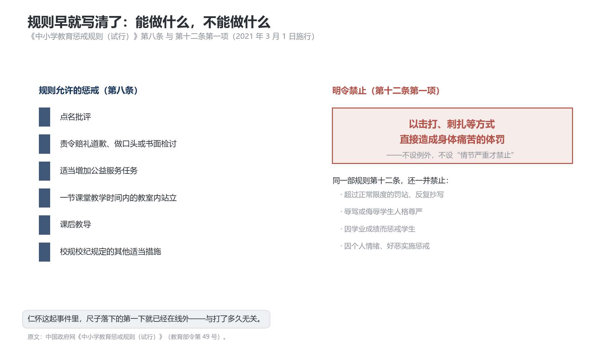
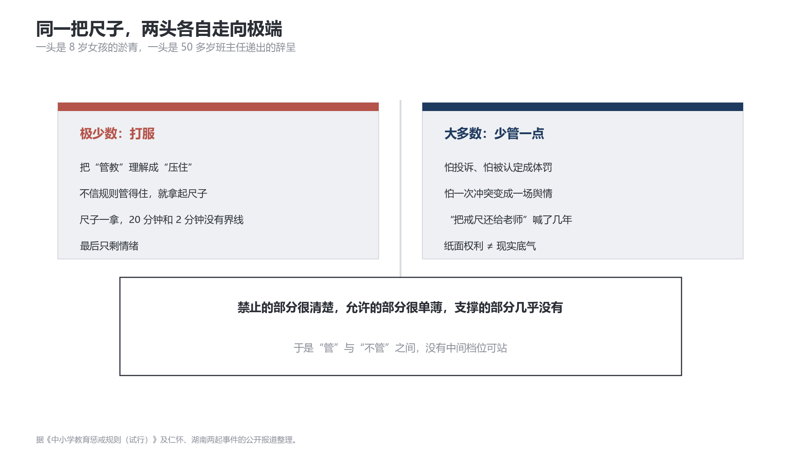
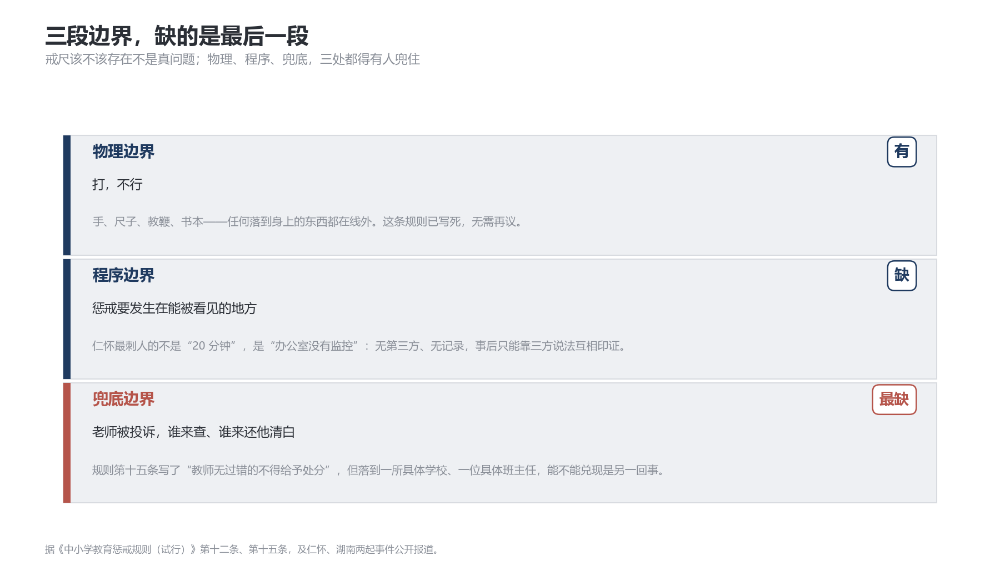

# 一把戒尺，两头都是伤口

11 月 4 日早读课，贵州仁怀第四小学三年级，一个 8 岁女孩忘带语文课本。她先被叫到走廊批评，又被带进办公室。班主任兼语文老师用近 40 厘米长的戒尺打她近 20 分钟，直到孩子倒地抽搐才停。

同一天被热搜带火的还有另一头：湖南一位 50 多岁的班主任，在家长会上哽咽宣布已递交辞呈。导火索是段考前一天，他让上课讲话的学生站到教室外，学生不动，还当众顶了嘴。

一把戒尺，两头都是伤口。问题不是"该不该管"，是"管到什么程度，谁来兜底"。

## 一、这一头：20 分钟，不是惩戒

家长的说法是：影像报告显示右手掌骨干骺端撕脱性骨折，手臂、腿部大面积淤青；当天呕吐恶心，已住院；事后老师曾叮嘱别告诉家里，家长第二天才发现。

11 月 12 日当地回应：涉事王姓老师惩戒不当"情况确实存在"，因该生多次未完成作业且未带课本，被叫到办公室用戒尺教育；教师已停职，教体局、警方介入。

有个细节不能跳过：办公室没有监控。过程仍在核实，最终以官方结论为准。

但有一件事不用等结论：击打是明令禁止的。2021 年 3 月施行的《中小学教育惩戒规则（试行）》第十二条第一项写着，不得"以击打、刺扎等方式直接造成身体痛苦的体罚"。这是"不得"的清单，不是"慎用"的建议。

同一部规则把能做的列得很细：点名批评、责令赔礼道歉、口头或书面检讨、增加公益服务任务、一节课内的教室内站立、课后教导。没有一条叫"用戒尺打"。

定性也就不难：孩子忘了带书，尺子落下的第一下就已成越界；打了 20 分钟，是越界之后还在继续。

## 二、那一头：一句顶嘴，压弯的不止一个人

那位老教师在家长会上的讲述，比"辞职"两个字重。他每天五点多起床到校，坚持到学生最后一节课结束才走；那天在讲台上"狂怒"，进了办公室才崩溃大哭。

还有一句被反复引用："我是全校唯一一个愿意当班主任的。"

这句才是重点。它不是一个人的心理脆弱，而是一个岗位的供给出了问题——愿意干的人，少到只剩一个。杭州有老师转发了这段视频，又默默删了：想说话，但不敢说。

## 三、两头之间：塌掉的是中间那一段

对老师这边，规则写得很清楚：不能打。第十二条八项禁止，白纸黑字，没有争议空间。

对老师那边，规则也写了能做什么，但只到"课后教导""一节课内站立"。再往上，面对一个反复讲话、当众顶嘴的学生，班主任手里还有什么？没写。学校支不支持、出了事谁担，也没写。

禁止的部分很清楚，允许的部分很单薄，支撑的部分几乎没有。

于是两头各自走向极端。少数老师把管教理解成"打服"——仁怀这位不是不懂规则，是不信规则能管住学生。可尺子一旦拿起，20 分钟和 2 分钟之间就没有界线，只剩情绪。

多数老师则选择少管一点。2024 年 8 月中央文件明确写了"维护教师教育惩戒权"，媒体反复说"把戒尺还给老师"。可纸面上的权利，不等于现实里的底气。怕投诉、怕被认定体罚、怕冲突变舆情，那就少说一句。

夹在中间的，是那个 8 岁女孩身上的淤青，和那位老教师红了的眼睛。

## 四、边界问题，其实是三个

戒尺该不该存在？这个问法偏了。真正要定的是三件事。

**物理边界。** 打，不行。这条规则已写死。手、尺子、教鞭、书本，任何落到身上的东西都在线外。

**程序边界。** 仁怀这事最刺人的不是"20 分钟"，是"办公室没有监控"。惩戒发生在没有第三方、没有记录的空间里，事后只能靠三方说法互相印证。如果惩戒必须发生在能被看见的地方，很多事根本不会发生。这不是不信任老师——那位老教师若有一份记录证明他全程没动手，也不必哽咽。

**兜底边界。** 最缺的一块。老师按规则管了学生、被家长投诉，谁来查、多久给结论、查清后怎么恢复名誉？规则第十五条写着"教师无过错的，不得给予处分"，条文有，落到一所具体学校能不能兑现，是另一回事。

那位老教师辞职，本质上不是抗议学生，是在说：我按规则做了，没人给我兜底。

## 写在最后

仁怀那位老师已停职，警方介入，怎么处理有法律管着。这一头不需要再愤怒一次，需要结论公开。

湖南那位老师的辞呈递出去了。有人说当众辞职不妥，让家长心里打鼓——这话有道理。但一个教了半辈子书的人，选择在几十位家长面前哽咽，说明他已不指望被听见。

那把戒尺不该是打人的工具，也不该是一句空话。它该是一条线：线内，老师敢管；线外，谁都不能碰。

线画了，线内的地没铺平，线外的墙没砌起来。

最后那个问题还是得留给所有人：**如果戒尺该存在，它的边界由谁来定，又由谁来保证不被越过？**

---

*事实来源：澎湃新闻、中国新闻周刊、凤凰网、观察者网 2026 年 11 月 12 日关于贵州仁怀第四小学事件的报道及仁怀市教体局、当地权威部门回应；新京报、经济观察网、杭州网、封面新闻 11 月 12—15 日关于湖南班主任家长会递辞呈事件的报道；《中小学教育惩戒规则（试行）》（教育部令第 49 号）第八至十二条、第十五条原文，见中国政府网；《中共中央 国务院关于弘扬教育家精神加强新时代高素质专业化教师队伍建设的意见》（2024 年 8 月）。仁怀事件细节以家属陈述与媒体转述为主，涉事办公室无监控，最终以官方调查结论为准。*
