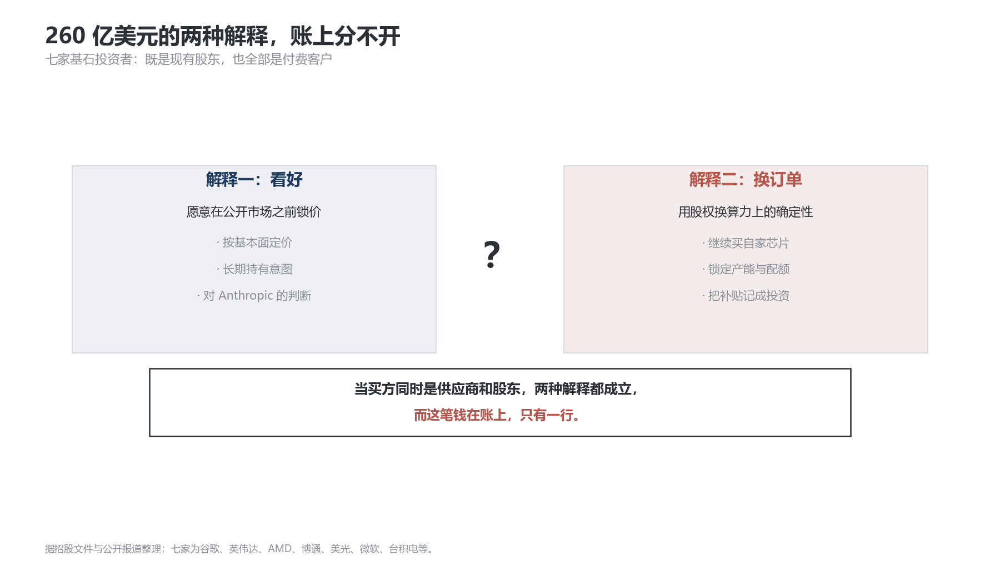
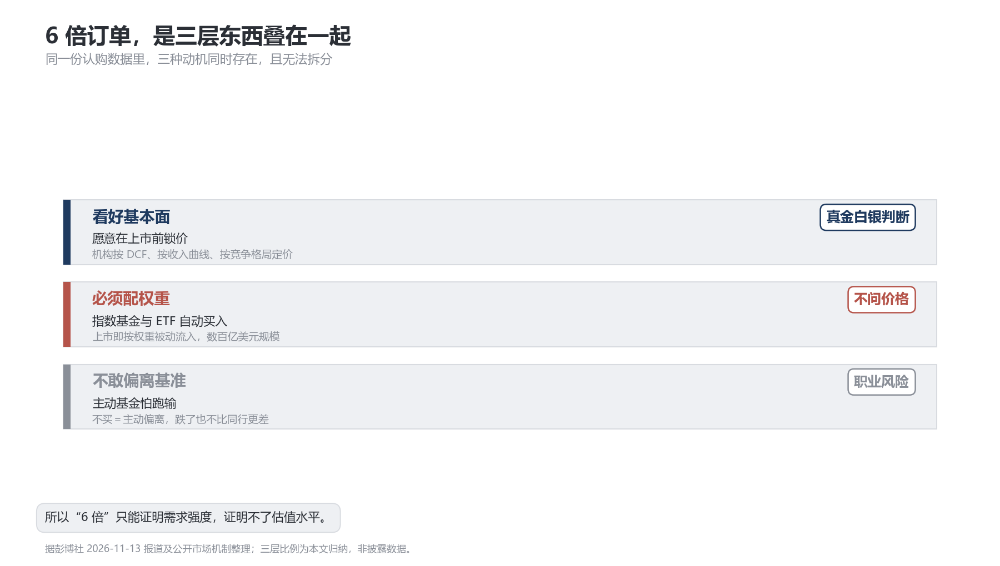
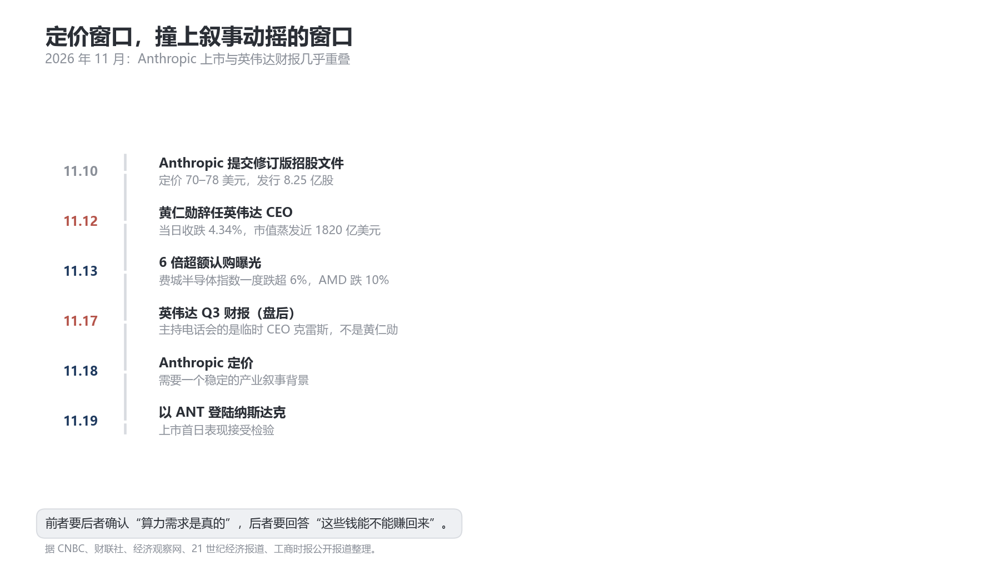

# 史上最大 IPO：6 倍订单里，有多少是"必须买"

11 月 13 日，彭博社报了一个数字：Anthropic 的 IPO 已吸引到约 6 倍于发行量的认购订单。

按每股 70 至 78 美元、发行 8.25 亿股算，公开募资最高约 644 亿美元；加上七家机构 260 亿美元的非公开配售，合计最高约 904 亿美元，超过 SpaceX，是史上最大的一次 IPO。11 月 18 日定价，11 月 19 日以"ANT"登陆纳斯达克。

6 倍是一个会被反复引用的数字。但把它当"市场用真金白银投票"，就跳过了一个问题：**这 6 倍里，有多少是判断，有多少是必须买。**

## 一、那 260 亿，是谁的钱、买的是什么

先看不是公开市场的那部分。

谷歌、英伟达、AMD、博通、美光、微软、台积电等七家，承诺在上市后立即合计注资 260 亿美元。这七家有一个共同点：**既是 Anthropic 的现有股东，也全部是它的付费客户。**

这句话拆开看，有三种可能的解释。

第一种：他们真的看好，愿意在公开市场之前锁价。
第二种：他们需要这家公司继续买自己的算力、用自己的芯片，所以用股权换订单上的确定性。
第三种：两家都成立，而且分不开。

问题恰恰在于第三种——**当买方同时是供应商和股东，这笔钱既是对未来的定价，也是对当下的补贴，两者在账上分不开。**

这不是 Anthropic 独有的问题。整个 AI 基础设施的融资结构都在往这个方向走：算力厂商同时当贷款人、供应商、渠道商和股东。区别只在于，Anthropic 这次把这套结构搬到了 IPO 的台面上。

## 二、6 倍的成分：指数基金的"必须买"

第二个"必须买"来自更机械的地方。

一家公司进入主要指数，被动指数基金和 ETF 就得按权重买入，不问价格、不问估值。上市初期，这类资金会带来数百亿美元的自动流入。

对主动型基金经理，这就变成一道选择题：**不买，就是主动偏离基准。** 万一它涨了，你跑输；万一它跌了，你至少"和大家一样"。

这个压力与"这家公司值多少钱"无关。它衡量的是职业风险，不是企业价值。

所以那 6 倍订单里，至少叠着三层东西：看好基本面的、必须配权重的、怕偏离基准的。**三者混在同一个数字里，谁也没法拆开。** 彭博的报道里还有一句容易被忽略——银行告诉投资者，Anthropic 会优先照顾现有股东，一些买家的配售会低于预期。6 倍的需求对应的不是 6 倍的供给，而是更严重的拿不到货。

## 三、"太关键、不能失败"——这句话本身就是信号

前美国银行股票资本市场负责人给这笔交易的定性是"太关键、不能失败"（too big to fail 的变体）。

这句话值得停一下。

一笔 IPO 的叙事，正常应该是"这家公司值多少钱"。当它滑向"这场上市不能输"，定价反映的信息含量就要打折——因为价格不再只由估值决定，还由"失败代价太高"决定。

而这个代价是真实的：史上最大 IPO 如果首日破发，受伤的不只是 Anthropic，还有整个 AI 融资链条的信心。**于是所有参与者——承销商、基石投资者、指数基金、监管——都有动机让它"先站住"。**

这不是阴谋，是激励。但它确实意味着：**上市首日的价格，证明不了这家公司值 1.4 万亿。**

## 四、同一周，另一个信号来自英伟达

更麻烦的是时间点。

Anthropic 定价的窗口，几乎和英伟达的财报重合。美东时间 11 月 17 日盘后，英伟达公布 2027 财年第三季度财报——而主持电话会的，不再是执掌公司 33 年的黄仁勋，而是临时 CEO、CFO 科莱特·克雷斯。

11 月 12 日黄仁勋辞职，当天股价收跌 4.34%，市值蒸发近 1820 亿美元。随后费城半导体指数一度跌超 6%，AMD 单日跌 10%，博通跌 4%。一周下来，英伟达累计跌近 13%。

连锁反应不只在股价上。黄仁勋数月前亲自参与设计的 5000 亿美元算力融资平台，据 Odaily 报道，自他离任以来未促成任何一笔交易，负责该项目的银行业人士已被重新部署；Anthropic 的 IPO 投资、Figure AI 追加的 10 亿美元、Nscale 逾 50 亿美元信贷担保等多笔在谈交易，前途都变得不确定。

接任者克雷斯风格保守，此前曾多次否决黄仁勋力推的交易。市场对英伟达能否继续扮演"AI 中央银行"这个角色，正在重新定价。

**这就形成了一个很别扭的搭配：一个需要稳定产业叙事来定价的 IPO，撞上一个叙事本身正在动摇的窗口。** 前者需要后者给出"算力需求是真的、还在涨"的确认；而后者这份财报要回答的，恰恰是"这些钱能不能赚回来"。

## 写在最后

Anthropic 大概率会顺利上市。6 倍订单、史上最大、基石锁仓，这些都是硬支撑。

但"顺利上市"和"定价正确"是两件事。

真正值得记下来的不是 904 亿这个数字，是它被凑出来的方式：**一家公司的估值，同时由它的客户、它的供应商、必须配权重的指数基金、和一群不敢不买的基金经理共同决定。**

这套结构在上涨时是加速器，下跌时是放大器。它现在运转良好，但它的良好运转，不构成对这家公司价值的证明。

11 月 18 日定价之后，第一个真问题不是"涨了多少"，而是——**六个月后解禁，那 260 亿还锁得住吗。**

---

*事实来源：彭博社 2026 年 11 月 13 日关于 Anthropic IPO 获约 6 倍超额认购的报道（经路透、中新经纬、工商时报等转述）；Anthropic 修订版招股文件（11 月 10 日提交）披露的发行区间、股数与估值；CNBC、金融时报关于定价时间与估值目标的报道；Odaily、财经杂志、工商时报关于黄仁勋离任及 5000 亿美元融资平台停滞的报道；财联社、经济观察网、21 世纪经济报道关于费城半导体指数与英伟达财报窗口的报道。"太关键、不能失败"为前美国银行股票资本市场负责人的公开定性，经媒体转述。*
