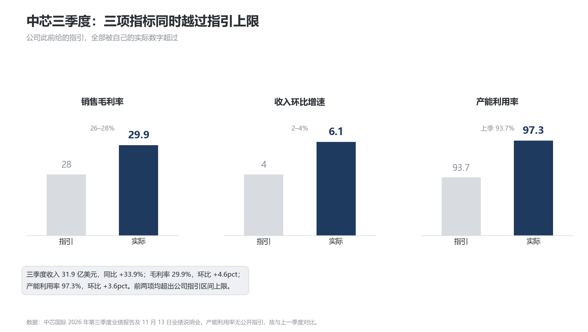
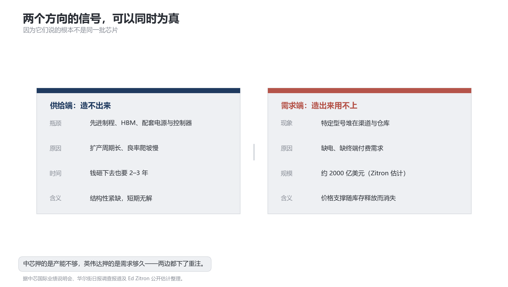
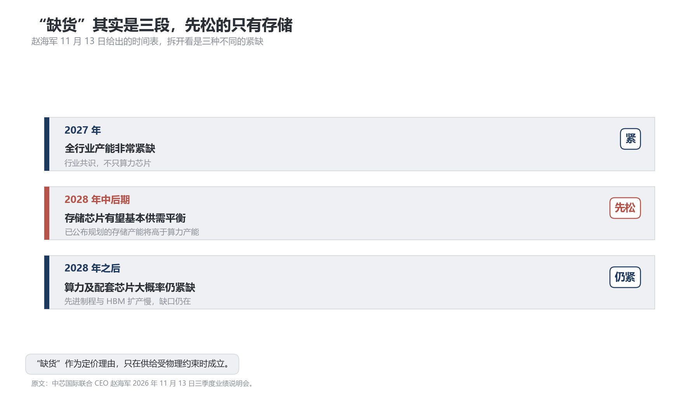

# 缺货到 2028，和 2000 亿美元 GPU 躺在仓库

11 月 13 日，中芯国际业绩会上，联合 CEO 赵海军给了一个很具体的时间表：

市场普遍预期 2027 年算力相关芯片供给仍偏紧；到 2028 年中后期，存储芯片供需有望趋于平衡，但算力和配套芯片大概率仍维持紧缺。

同一天，另一条消息指向相反方向。《华尔街日报》刊出调查报道：英伟达在黄仁勋任内，通过数千亿美元计的信贷担保与股权投资，为买不起芯片的 AI 初创公司和中小云厂商垫钱，让它们回头买自家 GPU。报道引用的数据显示，其最近一个季度总担保承诺已达 5300 亿美元，上一季度是 1840 亿美元。

一边是"紧缺持续到 2028"，一边是"大量芯片堆在仓库"。这两句话可以同时为真吗？可以。但它们同时为真，意味着"缺货"这个词已经不能再当价格支撑用了。

## 一、中芯这份财报，好得有点扎眼

先把数字摆清楚。

三季度销售收入 31.9 亿美元，环比增长 6.1%，同比增长 33.9%——此前指引是环比增长 2% 至 4%，实际落在上限之上。毛利率 29.9%，环比提升 4.6 个百分点，指引区间是 26% 至 28%，同样超上限。产能利用率 97.3%，销售晶圆 303 万片，同比增长 21.4%。

赵海军的解释是：客户对 BCD、专用存储、Controller 这类 AI 配套芯片的提拉速度，比三个月前的预期更快。

还有一个数字值得单独拎出来：中国区收入占比从去年同期的 86.2% 升到 90.8%，美国区降到 7.8%，欧亚区 1.4%。

这不是一句"国产替代"能概括的事。它同时说明两件相反的事：**需求端在向国内集中，供给端的外部通道在收窄。**一个地区的收入占比逼近 91%，既是市场选择，也是被选择的结果。

## 二、"紧缺到 2028"说的是哪一种紧缺

赵海军那个判断，容易被读成一句笼统的看多。其实它分了三段。

第一段，2027 年，全行业产能非常紧缺——这是行业共识，不只是算力芯片。

第二段，2028 年中后期，存储芯片有望达到基本供需平衡。理由是：到那时，行业已公布规划的存储产能规模，将高于算力及配套芯片的产能。

第三段，也是关键的一段：即便存储松了，**算力和配套芯片大概率仍然紧缺。**

三段连起来读，说的是结构性瓶颈，不是全面缺货。先进制程、HBM、配套的电源与控制器，扩产周期长、良率爬坡慢，钱砸下去也要两三年才见产能；存储扩产快，所以它先松。

这个区分很重要。因为"缺货"作为定价理由，只在**供给受物理约束**时成立。

## 三、另一条线：5300 亿美元的担保

《华尔街日报》那篇报道的核心，不是"英伟达投资初创公司"——那早已不是秘密。是它给出的规模：单季担保承诺从 1840 亿涨到 5300 亿美元。

报道还原的链条是这样：超大规模云厂商转向自研芯片后，英伟达此前向台积电预付巨额订单换来的芯片"像雪崩一样袭来"。若直接流入市场，GPU 价格会暴跌。于是英伟达用资产负债表给 AI 初创和中小云厂商输血，让它们拿这笔钱回头买 GPU。

黄仁勋私下承认过"雪崩"这个说法。而临时 CEO 克雷斯曾在内部力阻这套被批评为"循环融资"的做法，并把一笔涉 OpenAI 的 2500 亿美元担保砍到约 1250 亿。

需要说清楚边界：这是《华尔街日报》基于内部文件与知情人士的调查报道，英伟达长期否认"循环融资"的说法，报道所述动机未获官方证实。而 5300 亿这个数字，与 10-Q 文件里的担保口径一致。

## 四、两件事怎么同时为真

答案是：它们指的不是同一批芯片。

中芯说的是**先进制程和 HBM 的结构性瓶颈**——这一类确实紧，扩产要时间，短期无解。

报道说的是**特定型号在渠道和终端需求之间的错配**——芯片造出来了，但没有足够的电、没有足够的付费用户把它跑起来。分析师 Ed Zitron 此前的估计是，至少价值 2000 亿美元的英伟达 AI GPU 因缺电或终端需求不足闲置在仓库。

一个是"造不出来"，一个是"造出来了用不上"。两者可以并存，而且并不矛盾。

但问题在于，市场在过去两年里，把这两件事混成了一个词：缺货。**而"缺货"这个词，同时被用来解释涨价、解释估值、解释为什么要抢。**

一旦拆开看，定价逻辑就要重新分工：物理瓶颈支撑的是长期供给溢价；渠道错配支撑的是短期价格，且这个支撑会随着库存释放而消失。

## 写在最后

赵海军还说了另一句话，比时间表更值得留意：人工智能需求有望拉长半导体上行周期，增长结构与周期形态随之变化。

这句话的意思是，这一轮可能不是传统的"缺货—扩产—过剩"三年周期。如果 AI 需求真能持续拉长上行期，那现在的紧缺就是真的；如果不能，那 5300 亿担保换来的就是一堆需要减值的库存。

**两边都押上了重注。中芯押的是产能不够，英伟达押的是需求够久。**

11 月 17 日英伟达那份财报，会先回答后半个问题。而前半个问题——2028 年到底松不松——要等两年才知道答案。

---

*事实来源：中芯国际 2026 年第三季度业绩报告及 11 月 13 日业绩说明会（联合 CEO 赵海军发言），据第一财经、IT之家、经济观察网、21 世纪经济报道、东方财富网报道；《华尔街日报》2026 年 11 月 13 日关于英伟达循环融资的调查报道（经新浪财经、赢政天下、N 环球等转述），其中担保承诺 5300 亿美元与 10-Q 文件口径一致，报道动机未获英伟达官方证实；Ed Zitron 关于 2000 亿美元 GPU 闲置的估计经媒体转述。英伟达 2027 财年第三季度财报定于美东时间 11 月 17 日盘后发布。*
