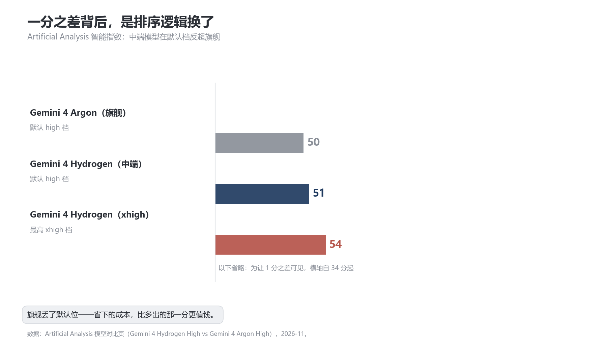
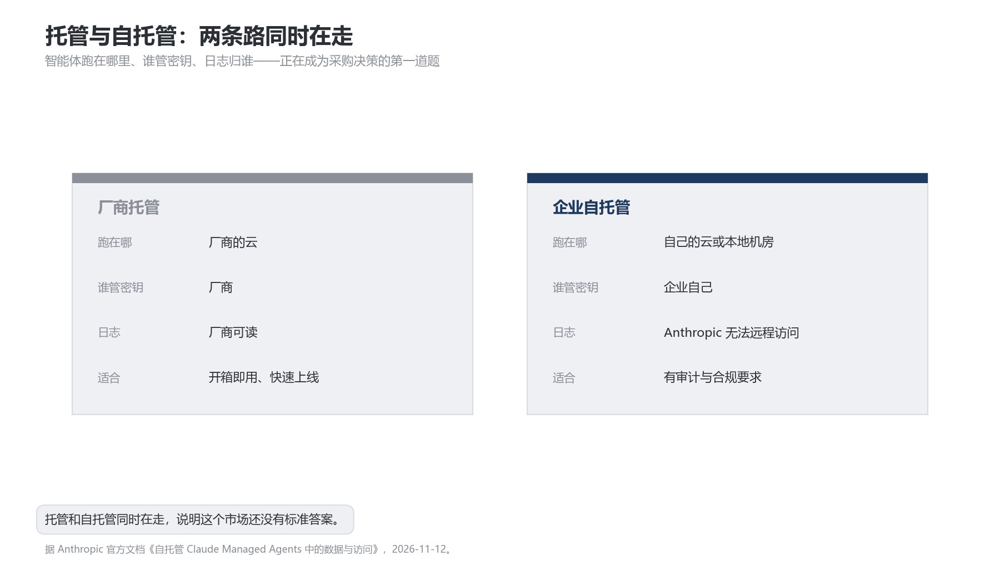
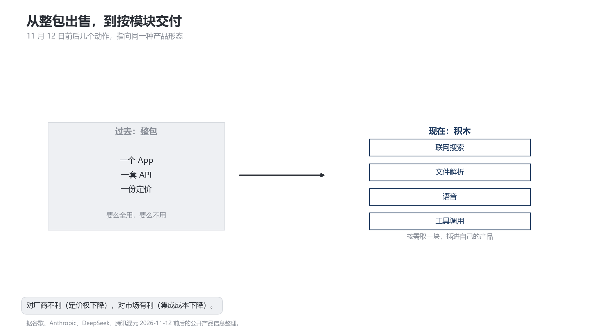

# 谷歌让"便宜的那个"接管搜索，Anthropic 把智能体交还给企业

11 月 12 日，谷歌发布 Gemini 4 Hydrogen，并完成 Google 搜索 AI 模式的全量底座切换——不是给订阅用户，是给所有人。

同一天，Anthropic 开放 Claude Managed Agents 自托管版本私有测试。

两件事看着不相关，其实指向同一个判断：**这一轮竞争的重点，正在从"谁最强"移到"谁能用得起、谁能管得住"。**

## 一、51 分压过 50 分，这不是小事

先说谷歌。

在第三方机构 Artificial Analysis 的智能指数上，Hydrogen 在默认的 high 档拿到 51 分，超过了自家旗舰 Argon 的 50 分；新加的 xhigh 档能到 54 分。

一分之差，看着微不足道。但一款定位"日常编码与消费级应用"的中端模型，在自己的产品序列里反超了旗舰——**这件事的意义不在分数，在排序。**

谷歌还给了一组对照：同设置下，Hydrogen 的任务完成速度是上一代 3.8 Flash 的 2.5 倍；Terminal-Bench 4.1 从 18.2% 提到 57%。API 定价每百万输入 Token 1.5 美元。

把价格和分数放在一起，逻辑就清楚了：**用不到旗舰的成本，做旗舰九成的事。** 对搜索这种每天要处理几十亿次请求的场景，这个性价比不是"更好"，是"唯一可行"。

同场推出的 Orchestrator 更能说明问题——它能在同一会话里自动切换 Carbon 和 Hydrogen，官方称省 24% 配额、快 19%。**用户不再选模型，系统替你选。** 这意味着模型之间的竞争，从"谁的榜分高"变成"谁的单位任务成本低"。

## 二、自托管：把钥匙交出去

再说 Anthropic。

Claude Managed Agents 的自托管版本进入私有测试。企业可以在自己的云上或本地服务器上运行智能体，自己管凭证、管会话记录，自己决定模型请求发往哪里。

Anthropic 官方文档里写得很直白：使用自托管时，你负责运维那台服务器、它的数据库，以及工作器里运行智能体 shell 和文件工具的沙箱；**只有当推理提供商是 Claude API 时，服务器才会连回 Anthropic**，而且 Anthropic 无法远程访问服务器或其日志。

这句话的分量，比"支持私有部署"重得多。它等于把三样东西交出去：**密钥、日志、数据流向。**

为什么这件事在这个时间点发生，值得想一想。过去一年，企业客户对智能体的顾虑一直不是"够不够聪明"，而是"它跑在哪里、谁能看见它做了什么"。一个能读文件、能调接口、能连续执行多步任务的智能体，本质上是把一套权限交给了外部服务。

把它搬回自己的机房，等于把审计权拿回来。

这与前一段时间 Kimi Hosted Agents 的方向正好形成对照：托管和自托管两条路同时在走。说明这个市场还没有标准答案——**有人要开箱即用，有人要钥匙在手。**

值得注意的是 Anthropic 文档里的另一句提醒：自托管服务和托管服务 API 相同，但"不会从托管服务复制任何内容，包括会话历史记录"，迁移过去要重新创建智能体、技能和 vault。这句话透露了它的目标客户——不是刚起步的小团队，是已经在用托管版、现在因为合规或审计要求必须搬回去的大企业。**愿意承担这次迁移成本的人，才是它真正想卖的人。**

## 三、其余几个动作，指向同一件事

把当天其他几条放在一起看，方向更清楚。

Runway 开源机器人模型 Praxis-1，Apache 2.0 授权，登顶 RoboLab-120 同类榜首。DeepSeek 开放全家桶应用 API，联网搜索、文件、语音都能独立调用，开发者可以 1:1 复刻一个完整的 DeepSeek App。腾讯混元发布实时语音模型 Hy Realtime，新增 Agentic 工具调用和唱歌能力。

这三件事的共同点是：**把能力拆成可单独调用的模块。**

过去两年模型厂商的比赛是"我的总分比你高"。现在的比赛是"我的哪一块能被你直接插进你的产品里"。搜索是一个模块、文件解析是一个模块、语音是一个模块——开发者不必吞下一整个 App，只要拿走需要的那一块。

这和谷歌把 Hydrogen 定为默认模型，是同一个逻辑的两种表现：**能力不再整包出售，而是按需切分。**

还有一个细节能看出这套逻辑的成熟度。DeepSeek 开放的是"全家桶应用 API"，措辞是"1:1 复刻完整 App"——它把自家产品的每一层都拆开卖，等于承认了一件事：**别人不一定要做我的竞品，他可能只想在自己的产品里用上我的一块能力。** 腾讯给 Hy Realtime 加上 Agentic 工具调用，也是同一个意思——语音不再只是"能听会说"，而是能自己调工具去办事。

从"卖模型"到"卖积木"，这个转变对厂商其实不利：定价权会下降，客户粘性会变弱。但它对市场有利，因为集成成本降下来了。

## 写在最后

四件事，一个方向：**AI 正在从"展示能力"进入"承担成本"。**

谷歌的选择是承认旗舰不必是默认，能用得起的那个才该铺到最大量的场景。Anthropic 的选择是承认企业对"谁管钥匙"的敏感，把控制权让出去换信任。DeepSeek 和腾讯的选择是承认开发者不想被绑定，把能力切碎。

这三条路的共同前提是：模型能力本身的差距，正在缩小到不足以支撑溢价。

那么接下来的竞争靠什么？靠三样东西——**单位成本、可控性、集成成本。**

这三样都不性感，都上不了发布会头条。但它们是这一轮真正决定谁活下来的东西。

---

*事实来源：谷歌 2026 年 11 月 12 日 Gemini 4 Hydrogen 发布及 Google 搜索 AI 模式切换（据 36 氪、ppc.land、Artificial Analysis 模型页）；Anthropic 官方文档《自托管 Claude Managed Agents 中的数据与访问》及 11 月 12 日产品公告（claude.com）；Runway Praxis-1、DeepSeek 应用 API、腾讯混元 Hy Realtime 的公开产品信息。Artificial Analysis 分数为第三方机构口径，谷歌官方引用数据与之一致。*
