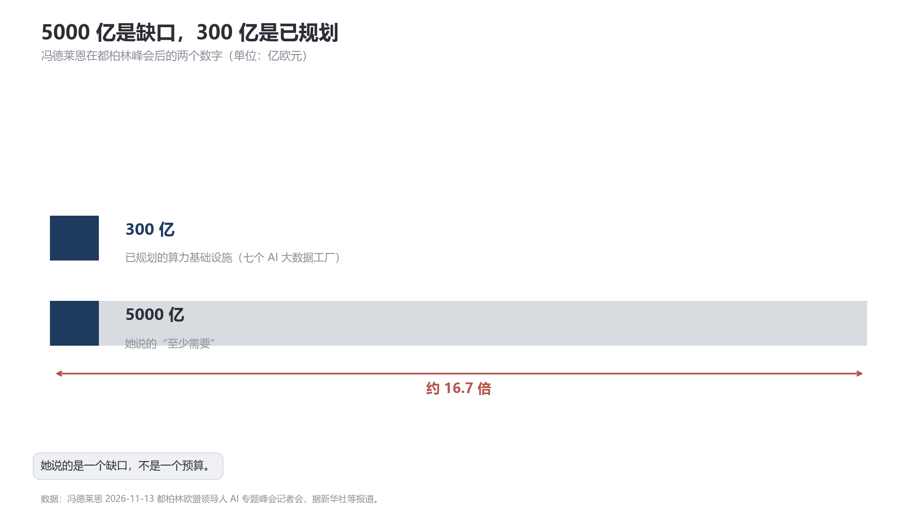
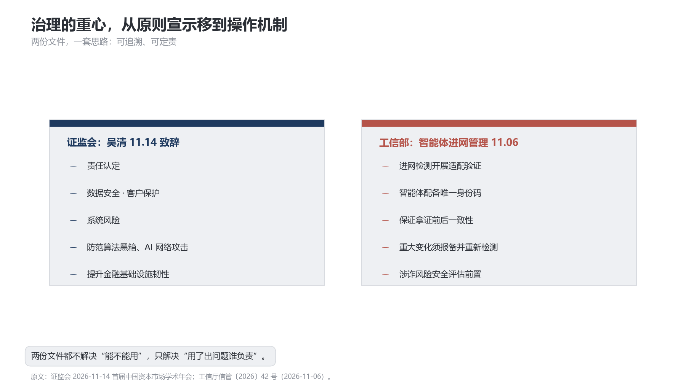
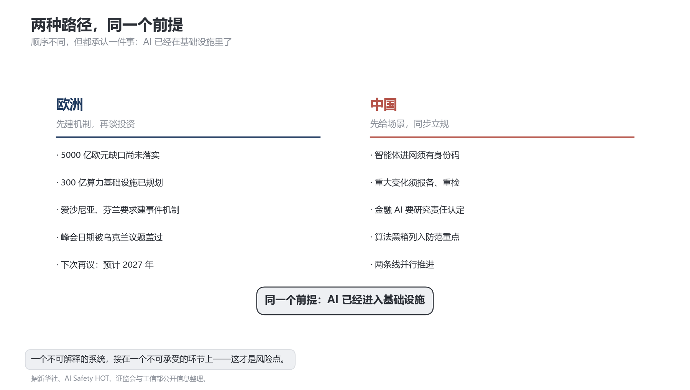

# 欧洲谈 5000 亿，中国谈谁来担责

11 月 13 日，欧盟领导人在都柏林开了第一次 AI 专题峰会。

冯德莱恩在会上说，欧洲至少需要投入 5000 亿欧元才能保持 AI 竞争力，并宣布将提出技术主权融资提案。同一场会上，爱沙尼亚和芬兰在联合信函里呼吁：建立欧盟层面的严重 AI 安全事件应对机制。

第二天，中国证监会主席吴清在一场学术年会上讲的是另一套话：加快研究责任认定、数据安全、客户保护、系统安全，有效防范算法黑箱、AI 网络攻击，提升金融基础设施韧性。

一边在谈钱，一边在谈责。这不是两条不相干的新闻，是同一个问题的两种回答。

## 一、都柏林：钱和风险在同一张桌子上

先看欧洲。

会议是非正式的，讨论"如何用 AI 提升欧洲竞争力"。冯德莱恩的说法是：欧洲有领先的产业、深厚的制造业传统、科研专长和大量有价值的工业数据，要把这些优势转化为全球领导力。她还提到，欧盟正规划建设七个 AI 大数据工厂，预计动员约 300 亿欧元用于算力基础设施。

请注意这两个数字的关系：5000 亿是"至少需要"，300 亿是"已规划"。**差了十六倍以上。** 她说的是一个缺口，不是一个预算。

更值得注意的是同一场会的另一半。爱沙尼亚和芬兰的联合信函提了两件事：建立欧盟层面的严重 AI 事件应对机制，建设独立评估前沿模型安全风险的欧洲能力。

潜台词是：**你可以投资 AI，但得先有出事后能查、能停、能追责的能力。** 据报道，这封信的背景是今年夏天发生过多起自主智能体失控、攻击企业系统的事件。如果是这样，这个诉求不是预防性的，是事后补课。

但这场峰会被乌克兰议题盖过了。欧洲理事会主席科斯塔预计 2027 年再议 AI。

**一个"至少 5000 亿"的缺口，一个"下次再议"的时间表。** 这就是欧洲当下的状态：知道要花钱，也知道要建机制，但两件事都还没排上具体日程。

## 二、北京：从"要不要发展"到"谁来担责"

再看中国这边。

吴清的表态里，有一个句式变化值得留意。他先讲"资本市场既要积极适应新技术变革，在估值定价、信息披露等方面加强制度研究"，然后话锋一转：又要"深入研究人工智能对生产力和生产关系重塑在资本市场的传导映射"。

落点在后面那串词：责任认定、数据安全、客户保护、系统风险、算法黑箱、AI 网络攻击、金融基础设施韧性。

这串词的共同特征是：**它们都不是"发展"问题，是"出事之后怎么办"的问题。** AI 给的投资建议错了谁担责，算法歧视怎么界定，交易系统嵌了 AI 被攻击算不算系统性风险——这些都不解决"能不能用"，只解决"用了出问题谁负责"。而恰恰是后者，决定了前者能不能真正推开。

一个可以对照的细节：工信部 11 月 6 日印发的《关于加强智能体终端设备进网管理的通知》，要求预置智能体的手机、平板、可穿戴设备在进网检测中开展适配验证，智能体要配备唯一身份码，终端企业须保证拿证前后的一致性，发生重大变化的要报备并重新检测。

这份文件和吴清的表态是同一套思路：**给智能体一个身份证，让它可追溯；给变化一个报备义务，让它可追责。** 治理的重心，正从"鼓励发展"移到"可追溯、可定责"。

## 三、两种路径，一个共同的前提

把都柏林和北京放在一起，会看到两种不同的顺序。

欧洲是**先建机制，再谈投资**——至少在爱沙尼亚和芬兰的版本里是这样：要投前沿模型可以，但得同时建事件应对机制和独立评估能力。

中国是**先给场景、同步立规**——智能体进网要身份码，金融 AI 要责任认定，两条线并行。这是"边跑边划界"的路。

两条路看起来相反，其实共享同一个前提：**AI 已经进入基础设施，不再是实验室里的东西。**

这个前提一旦成立，治理对象就从"内容"变成了"系统"——过去管说了什么，现在管怎么决策、出了事谁兜、能不能停。**"算法黑箱"和"金融基础设施韧性"出现在同一句话里，说的正是这件事：一个不可解释的系统，接在一个不可承受的环节上。**

## 写在最后

回到那两个数字和那串词。

欧洲说至少需要 5000 亿欧元，中国说要想清楚责任怎么分。这两句话不矛盾，但回答的是不同阶段的问题：一个是"钱够不够"，一个是"兜不兜得住"。

难的地方在于，这两件事必须同时做。钱投下去，系统就跑起来，跑起来就会出事，出了事得有机制接住。**如果机制建设慢于投资落地，那 5000 亿买来的不只是能力，还有风险。**

冯德莱恩说 5000 亿是"至少"，吴清说责任认定要"加快研究"。两个词都带着紧迫感，但都还没到"已经解决"。

2027 年欧洲再议 AI 时，中国这边的进网管理和责任认定大概已经跑了一年多。到那时回头看，这两种顺序哪个更有效，会有一个比较具体的答案。

---

*事实来源：新华社都柏林 2026 年 11 月 13 日电（欧盟领导人非正式会议）；欧盟委员会主席冯德莱恩会后记者会表态，据新华社、AI 产品库等报道；爱沙尼亚与芬兰联合信函内容据 AI Safety HOT 等转述；证监会主席吴清 2026 年 11 月 14 日在首届中国资本市场学术年会开幕式上的致辞（据证监会发布、第一财经、界面新闻、中国证券报）；工业和信息化部办公厅《关于加强智能体终端设备进网管理的通知》（工信厅信管〔2026〕42 号，2026 年 11 月 6 日发布）。峰会与年会日期相差一日，文中分别标注。*
