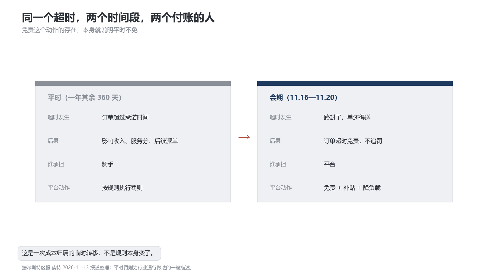
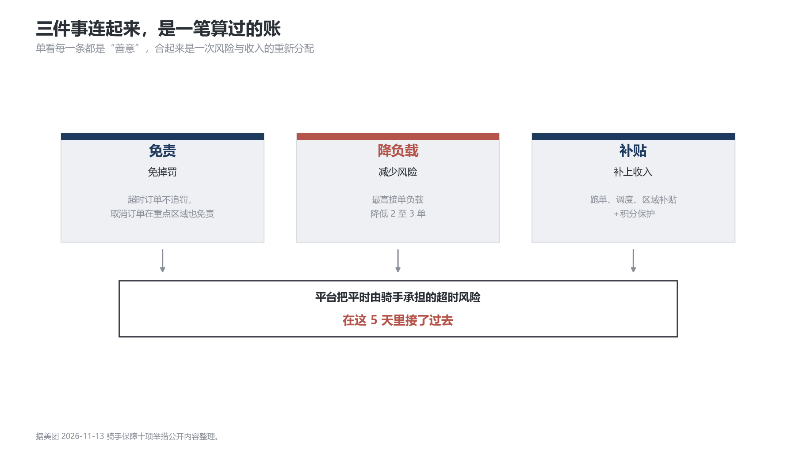
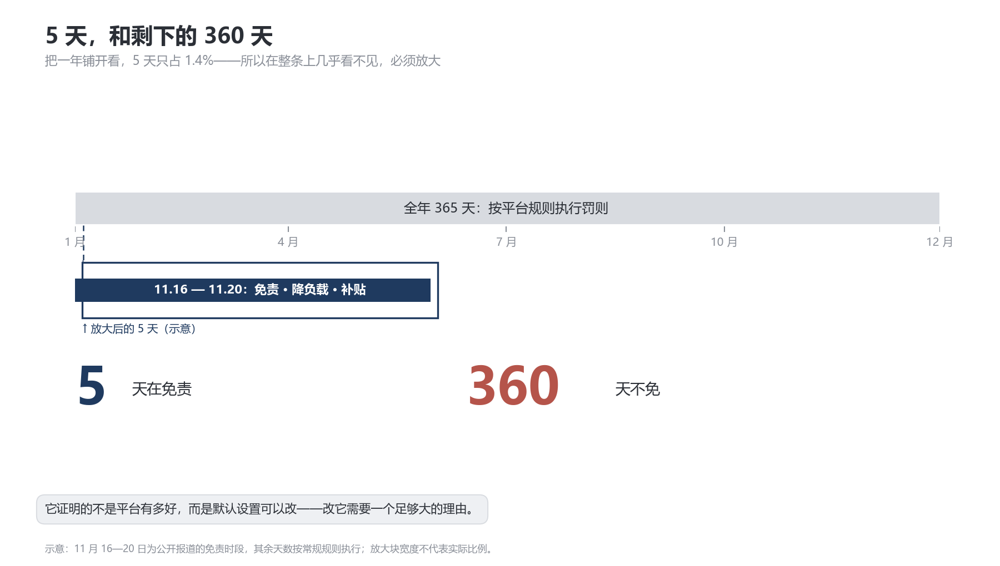

# 超时免责那 5 天，平台把一笔一直由骑手付的账，自己接了

11 月 13 日，美团在深圳推出骑手保障十项举措。最抓眼的一条是：**11 月 16 日至 20 日，全城骑手超时订单免责。**

背景是 APEC。亚太经合组织第三十三次领导人非正式会议 11 月 18 日至 19 日在深圳召开。17 日至 19 日每天 7 时至 22 时，以临海大道、桂湾一路、深南大道等 13 条道路为边界的区域内，部分道路分时、分段临时管控；18 日 16 时至 22 时、19 日 6 时至 14 时，深南大道、沙河西路等 9 条道路及相邻路口还将适时限制通行。

路封了，单还得送。于是有了这条免责。

多数人看到的是"体面"。但"免责"这两个字本身，藏着一个更值得问的问题。

## 一、"免责"反证了平时不免

如果超时本来就不需要承担后果，就不存在"免责"这个动作。

所以这条通知的第一层信息不是"平台体贴"，而是：**另外 360 天里，超时是有代价的，而且这个代价主要由骑手承担。**

具体规则各平台不同，方向却一致——超时会影响收入，影响服务分，影响后续派单。骑手怕的从来不是晚到几分钟，是那几分钟之后的一连串反应。

这也是为什么在骑手群体里，"超时免责"的分量远重于"发一件新工装"。工装是形象，免责是钱。

## 二、这 5 天，账换了个人付

配套动作更值得看。

光免责不够。路封了，单量下降，跑得少，收入还是会掉。所以美团同时给了跑单补贴、调度补贴、区域补贴，还开了积分保护，写明"骑手不因各类场景损失已有权益"。

还有一条容易被忽略：**最高接单负载降低 2 至 3 单**。这是主动减负，但减负的直接后果是单位时间收入下降，所以才必须有补贴来填。

三件事连起来，是一笔算过的账：**免责免掉罚、降负载降低风险、补贴补上收入。** 平台把平时由骑手承担的超时风险和收入波动，在这 5 天里接了过去。

这是一次成本归属的临时转移。

## 三、真正的问题：这套机制为什么只开 5 天

这才是这条新闻的信息量所在。

它证明了一件事：**"免责 + 降负载 + 补贴"这套组合是可以执行的。** 系统支持得了，调度扛得住，账也算得过来。11 月 16 日能开，11 月 21 日就关——不是做不到，是没有理由做。

平时的理由是什么？是时效。是 30 分钟送达的承诺，是用户点开 App 看到的倒计时，是平台之间比谁更快。这套压力层层传导，最后落在骑手的那几分钟上。

会期把这套逻辑暂时按住了。因为这几天的首要目标不是"最快"，是"最稳"。目标一变，罚则可以免，负载可以降，补贴可以加。

**真正变动的不是平台的能力，是平台的优先级。**

## 写在最后

不必把这件事读成"良心发现"，也不必读成"作秀"。它就是在特殊目标下的一次资源重排，而且做得相当完整。

但正因为做得完整，那个问题才更清楚：**如果这套机制可行、有效、成本可控，它为什么只能存在于一场会议的 5 天里？**

11 月 20 日之后，免责会撤，补贴会停，负载会调回去。那 5 天像一次对照实验，它证明的不是平台有多好，而是——**默认设置是可以改的，只是改它需要一个大到足够的理由。**

---

*事实来源：深圳特区报·读特 2026 年 11 月 13 日报道《美团在深圳推出骑手保障十项举措 组建服务专班保障配送服务》；深圳市公安局《关于 2026 年 APEC 领导人非正式会议期间实施部分区域临时交通管控措施的通告》（11 月 13 日发布）；新浪财经、东方财富同日报道。"超时影响收入、服务分与派单"为行业通行做法的一般描述，各平台具体规则不同，本文未引用具体罚则条款。*