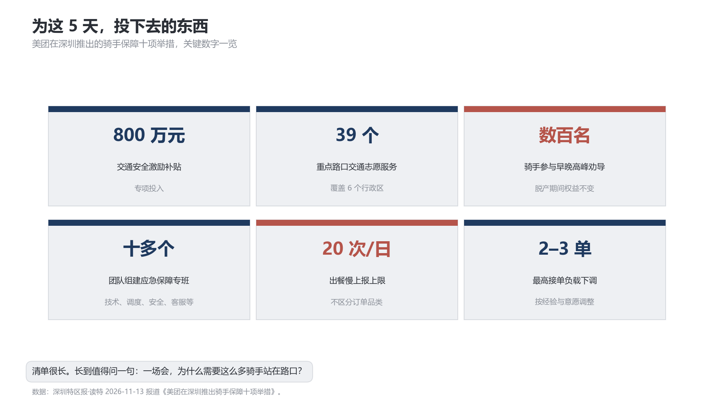
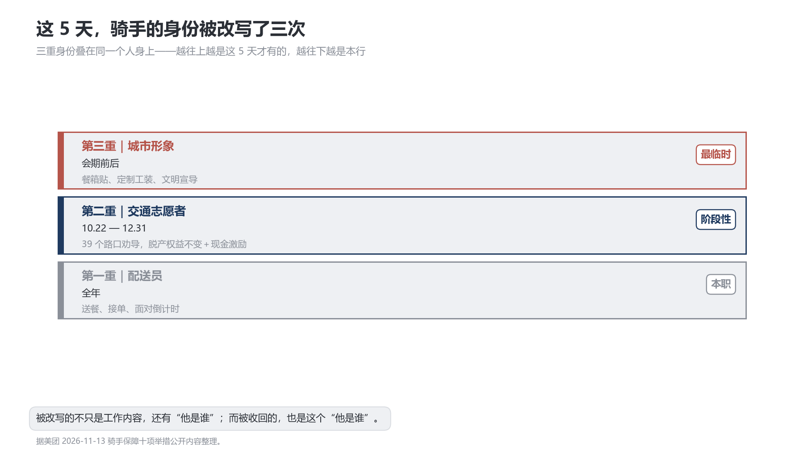
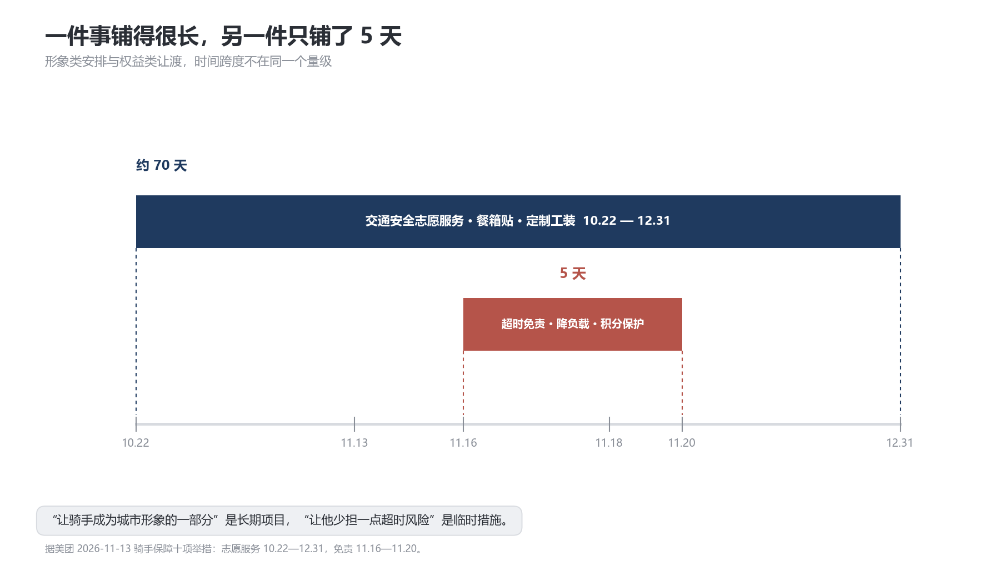

# 为了一场会，深圳把 39 个路口交给了骑手

先把数字摆出来。

APEC 第三十三次领导人非正式会议 11 月 18 日至 19 日在深圳召开。为这 5 天，美团在深圳投了这些东西：

10 月 22 日至 12 月 31 日，在全市 6 个行政区 39 个重点路口开展交通安全志愿服务，数百名骑手在早晚高峰参与交通宣导和秩序劝导；交通安全激励补贴专项投入超过 **800 万元**；罗湖、福田、南山的骑手餐箱上要贴文明宣导贴，还要免费发放新款定制工装；总部与深圳业务团队组建应急保障服务专班，技术、产品、调度、安全、客服、区域应急运维等**十多个团队**驻守一线。

再加上配送侧的：全城超时免责、出餐慢上报扩容到每日 20 次、最高接单负载降 2 至 3 单、跑单与调度及区域补贴、积分保护。

这份清单很长。长到值得问一句：**一场会，为什么需要这么多骑手站在路口？**

## 一、这 5 天，骑手的身份被改写了三次

第一重是配送员，本行，不用多说。

第二重是交通志愿者。39 个路口、早晚高峰、上路劝导。美团给的条件是：脱产参加期间"日常跑单权益不变"，另有现金激励和评优机会。这一点安排得算周正——不能让人做公益还倒贴收入。

第三重是城市形象。餐箱贴、定制工装、文明宣导——这些不产生任何配送效率，只产生"被看见"的效果。

三重身份叠在一起，骑手在这 5 天里不只是"送餐的人"，还是**这座城市向外界展示秩序与温度时，站在最外层的那批人。**

## 二、这笔投入，受益方不止一个

800 万补贴、数百人脱产、十多个团队驻守，不是小数目。

谁受益？城市得到秩序——会议期间路口有人劝导，交通更顺，观感更好。平台得到形象——这是一次"我们在配合城市"的公开表达。骑手得到补贴、工装、免责，以及"权益不因脱产受损"的承诺。

三方都拿到了东西，这是一次成立的合作，不必怀疑诚意。但也不必高估它的稳定性。

## 三、会期之后，那三重身份还剩几重

这是我最想问的。

交通志愿服务的时间范围是 10 月 22 日到 12 月 31 日，比会议本身长得多。这说明它不是应景动作，是提前铺开的长期工程，值得肯定。

但"超时免责"只到 11 月 20 日。"最高接单负载降低 2 至 3 单"只发生在"会议相关保障时段"。"积分保护"也绑定在这几天。

于是出现了一个不对称：**形象类的投入周期长，权益类的让渡只有 5 天。**

这不算批评，是个观察。它说明在这套安排里，"让骑手成为城市形象的一部分"是长期项目，"让骑手少承担一点超时风险"是临时措施。

## 写在最后

一场国际会议，把一座城市最日常的运力系统临时调成了"保障模式"。这套模式跑得挺顺：路口有人、餐箱有贴、超时有免、负载有降。

它顺便证明了一件事：**这套系统完全有能力跑得慢一点、稳一点、体面一点。**

问题在于，会议是有结束时间的。11 月 19 日之后，路口不需要劝导了，餐箱贴会旧，工装会脏。骑手还会继续在那 39 个路口之间穿行，继续面对倒计时。

那时"城市形象"这个身份会被收回去，剩下的还是配送员。

**被看见是好事。但比被看见更重要的，是那 5 天里被承认的东西——超时该免责、负载该有上限、脱产该有保障——能不能不跟着会议一起结束。**

---

*事实来源：深圳特区报·读特 2026 年 11 月 13 日报道《美团在深圳推出骑手保障十项举措 组建服务专班保障配送服务》（记者闻坤）；深圳市公安局《关于 2026 年 APEC 领导人非正式会议期间实施部分区域临时交通管控措施的通告》。文中 800 万元为美团"交通安全激励补贴专项投入"，39 个路口、6 个行政区、十多个团队、每日 20 次上报、降低 2 至 3 单负载均据上述报道。*