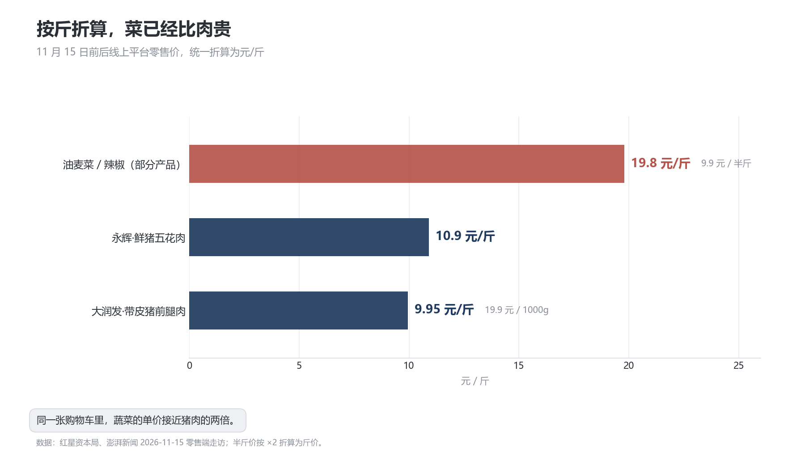
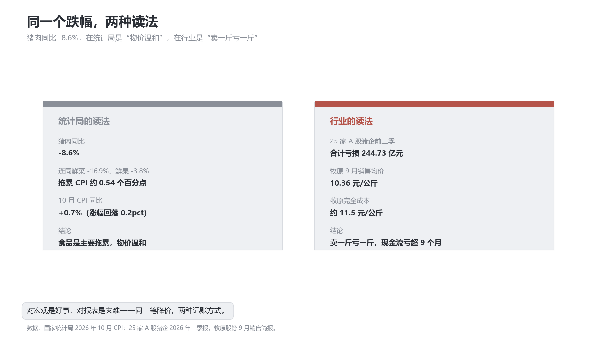
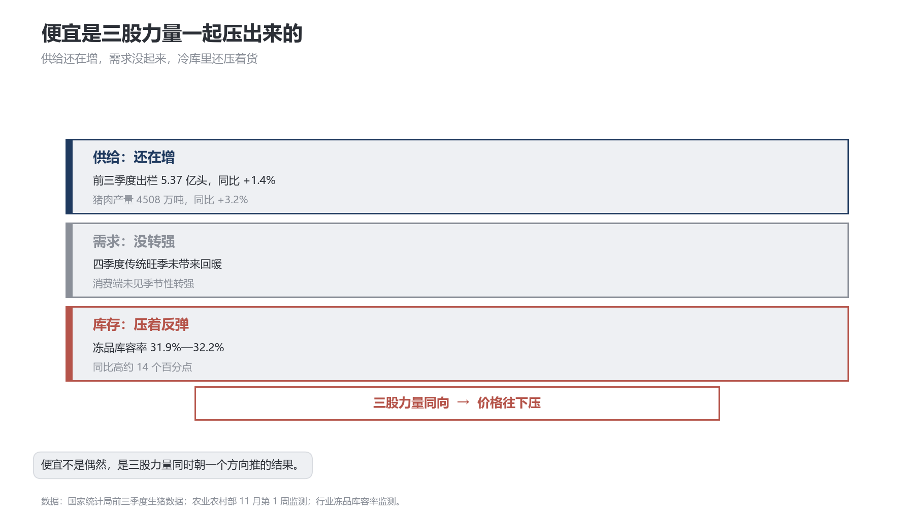

# 猪肉比青菜便宜，这笔账记在谁头上

11 月的菜市场，5 块钱能买到比拳头还大的一块瘦肉。同一时间，青椒也要 5 块一斤。一盘青椒肉丝端上来，肉和配菜的价格差不多。

线上也一样：永辉的鲜猪五花肉一斤 10.9 元，而油麦菜、辣椒的部分产品半斤 9.9 元——按斤折算，菜已经比肉贵。

这不是错觉。11 月 9 日，全国外三元生猪均价 8.63 元/公斤，创下年内最低，也是近十年最低。此前的最低点是今年 4 月中旬的 8.77 元。进入 11 月，全国猪肉平均批发价 14.81 元/公斤。贵州、湖北、陕西、新疆四省份的最低报价已跌破 4 元/斤，局部进了"3 元区"。

社交平台上问得最多的一句话是："这个价格对吗？"

价格是对的，市场给的。但便宜不是凭空来的。

## 一、便宜的另一面，写在别人的报表里

猪肉便宜，是因为猪多，而且卖不动。

猪多到什么程度？前三季度全国生猪出栏 5.37 亿头，同比增长 1.4%；猪肉产量 4508 万吨，同比增长 3.2%。供给还在增，价格自然往下走。

卖不动，10 月的 CPI 给了个侧写：猪肉价格同比下降 8.6%。连同鲜菜 -16.9%、鲜果 -3.8%，三项合计把 CPI 拉低了约 0.54 个百分点。10 月 CPI 同比只涨 0.7%，涨幅比 9 月回落 0.2 个百分点，食品是主要拖累。

对宏观来说，这叫"物价温和"。对养猪的人来说，同一个数字是另一句话。

25 家 A 股猪企前三季度合计归母净利润亏损 244.73 亿元，同比由盈转亏。牧原、温氏、新希望三家龙头合计亏 168.48 亿元，第三季度单季全部同比转亏。牧原 9 月销售均价 10.36 元/公斤，而它的完全成本约 11.5 元/公斤——卖一斤亏一斤。

按行业测算，一头 120 公斤的标猪出栏，账面亏损 400 多元。全行业现金流亏损已超过 9 个月。

## 二、你在菜场省下的，是他们在报表上亏的

把两组数字并排放，会看到一件很简单的事：**消费者省下的钱，和养殖户亏掉的钱，是同一笔钱的两面。**

不是阴谋，就是价格机制。但它有个前提——得有人愿意继续亏。

这个前提正在松动。三季度末，全国能繁母猪存栏 3602 万头，同比减少 433 万头、降幅 10.7%，环比减少 178 万头。这是正常保有量 3750 万头的 96.0%，**两年半以来第一次实质性跌破调控红线。**

母猪少了，10 个月后的肥猪就会少。按这个节奏，2027 年二季度商品猪出栏将明显收缩。

所以现在是"最后的便宜"吗？也未必。还有三样东西在压着反弹：出栏均重 125.42 公斤（同比偏高，说明有压栏）、冻品库容率 31.9%—32.2%（同比高约 14 个百分点，库存压顶）、行业平均 PSY 提升到 28 左右（母猪少了，但每头产出更多，减量被吃掉一块）。

## 三、真正该担心的不是"肉便宜"

肉便宜本身是好事。对一个月要买十几次猪肉的家庭，一斤便宜几块钱，是实实在在的支出减少。

值得担心的是另一件事：**如果便宜持续得足够久，养猪的人会消失。**

中小养殖户没有规模企业的融资能力。连续亏 9 个月，很多人已经在退。而退出去的人，不会因为明年价格涨了就立刻回来——猪舍空了、贷款断了、人走了。

规模企业在扛，中小户在退。这个结构变化，比价格本身更值得记录。

## 写在最后

那句"这个价格对吗"，其实问得很准。

价格是对的。但它不是免费的。它现在记在 25 家上市猪企的亏损报表上，记在牧原每公斤倒挂一块多的成本差上，记在那些已经清栏离场的人身上。

**便宜是好事。但当一个便宜需要别人持续亏损来维持时，它就不是福利，是转移。**

而这笔转移，总有到期的一天。

---

*事实来源：第一财经 2026 年 11 月 9 日《猪价创 10 年新低，资金博弈周期拐点》；农业农村部 11 月第 1 周（11 月 2—8 日）监测数据（活猪 10.11 元/公斤、猪肉批发均价 15.01 元/公斤、同比低 16.7%）；国家统计局 2026 年 10 月 CPI 及解读（猪肉同比 -8.6%，与鲜菜、鲜果合计影响 CPI 下降约 0.54 个百分点）；国家统计局前三季度生猪数据（出栏 5.37 亿头、猪肉产量 4508 万吨、三季度末能繁母猪 3602 万头）；中国商报、新浪财经关于 25 家 A 股猪企前三季度亏损 244.73 亿元的统计；红星资本局、澎湃新闻 11 月 15 日零售端走访。*