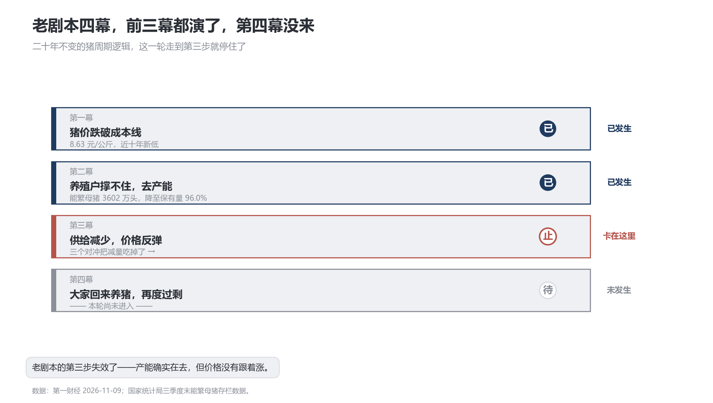
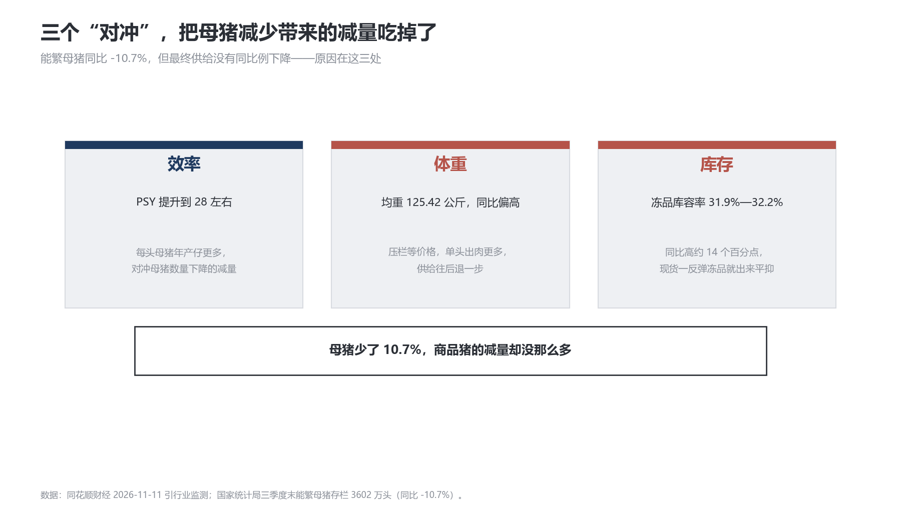
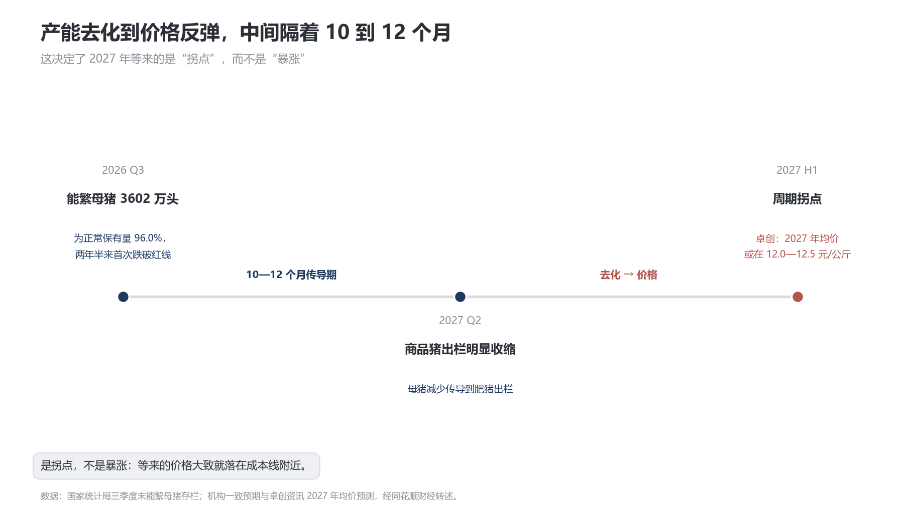

# 这一轮猪周期，剧本失灵了

猪周期有一本老剧本，演了二十年。

第一幕，猪价跌破成本线。第二幕，养殖户撑不住，杀母猪、去产能。第三幕，供给减少，价格反弹。第四幕，大家又回来养猪，供给过剩，价格再跌。

亏一年，赚三年。过山车。

这一轮，前三幕都演了。第四幕没来。

## 一、该发生的都发生了

猪价确实跌穿了成本线。11 月 9 日，全国外三元生猪均价 8.63 元/公斤，创近十年新低。牧原 9 月销售均价 10.36 元/公斤，低于它约 11.5 元/公斤的完全成本。全行业现金流亏损超过 9 个月。

产能也确实在去。三季度末全国能繁母猪存栏 3602 万头，同比减少 433 万头、降幅 10.7%，环比减少 178 万头，为正常保有量 3750 万头的 96.0%——两年半来首次实质性跌破调控红线。

按老剧本，接下来该是供给收缩、价格回升。

但价格还在跌。

## 二、三个"对冲"，把减量吃掉了

第一个是效率。行业平均 PSY（每头母猪每年提供的断奶仔猪数）已提升到 28 左右。母猪少了 10.7%，但每头产出更多，最终商品猪的减量被削掉一大块。

第二个是体重。10 月样本企业生猪交易均重 125.42 公斤，同比偏高。这意味着养殖户在压栏——养得更大再卖，单头出肉更多。这是典型的"等价格"行为，结果却把供给往后推、把单头重量加上去，反而压住了价格。

第三个是库存。冻品库容率 31.9%—32.2%，同比高约 14 个百分点。冷库里堆着大量白条肉，现货一有反弹迹象，冻品就出来平抑。

再加上需求端：猪肉消费没有明显转强，四季度传统旺季也没带来回暖。用行业里那句更直白的话说——**不是猪太多，是吃猪的人变少了。**

## 三、于是从"过山车"变成了"慢撒气"

这才是这一轮真正的变化。

过去是暴涨暴跌，一年定生死。现在是缓慢下探，长期贴着成本线磨。

卓创资讯的预测是：2027 年生猪年均价或在 12.0 到 12.5 元/公斤——这个价格差不多就在成本线附近。也就是说，即便到了明年，行业等来的可能不是"翻身"，而是"不亏"。

传导周期也支持这个判断：能繁母猪有 10 到 12 个月的传导期，对应 2027 年二季度商品猪出栏才会明显收缩。机构比较一致的看法是 2027 年上半年见到周期拐点。**是拐点，不是暴涨。**

## 四、产业在熬，资本在赌

有个反差挺值得看。

现货端在创新低，资本市场却在涨。申万生猪养殖指数 11 月以来累计上涨 8.4%，资金开始博弈产能去化后的周期反转。

这不算错。股价买的是预期，不是当下。但它也说明一件事：**这一轮的赢家不会是"赌对行情"的人，而是"成本够低"的人。**

当价格长期贴着成本线，谁把完全成本压到 11 元以下，谁就能活；压在 12 元的，只能等。所以行业里真正在打的仗不是等涨价，是降成本——降料肉比、提 PSY、减人工。

## 写在最后

猪周期没有死，它只是换了脾气。

以前是过山车，亏一年赚三年，赌的是胆量。现在是慢撒气，可能亏两年、微赚一年，拼的是成本。

对消费者，这意味着便宜可能还会持续一段时间。对养猪的人，这意味着那个"熬到涨价就翻身"的老经验，第一次不管用了。

剧本还在，只是第四幕被删掉了。

---

*事实来源：第一财经 2026 年 11 月 9 日《猪价创 10 年新低，资金博弈周期拐点》；界面新闻、东方财富关于三季度末能繁母猪存栏 3602 万头（同比 -10.7%、为正常保有量 96.0%）的报道，数据源为国家统计局；同花顺财经 11 月 11 日《"卖也是死，留也是死"：8 块 6 的猪价，养猪人还能熬到明年吗？》关于 PSY 28、均重 125.42 公斤、冻品库容率及卓创资讯 2027 年均价预测；农业农村部 2026 年 5 月将能繁母猪正常保有量由 3900 万头下调至 3750 万头（中国政府网）。*