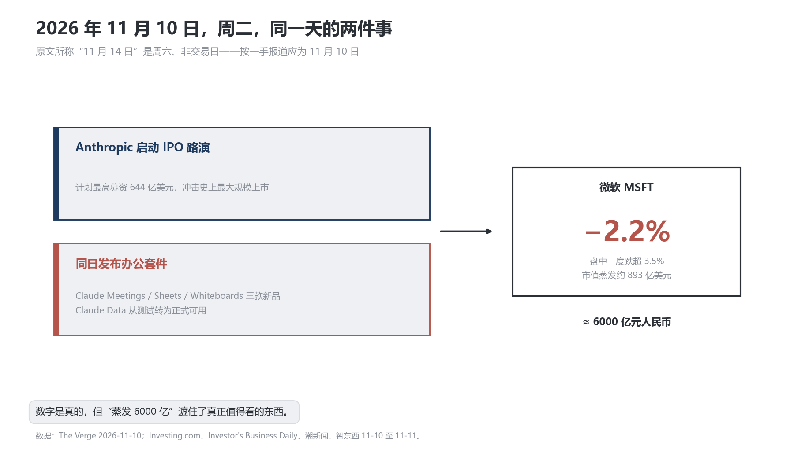
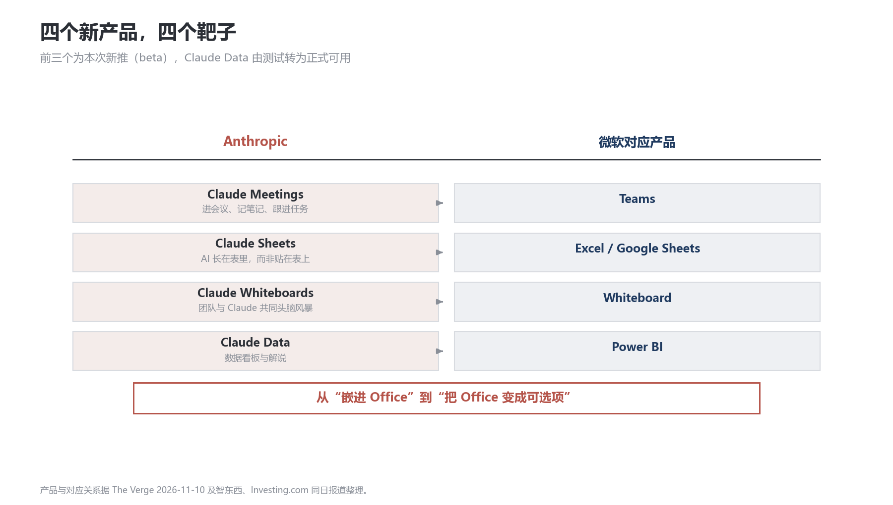
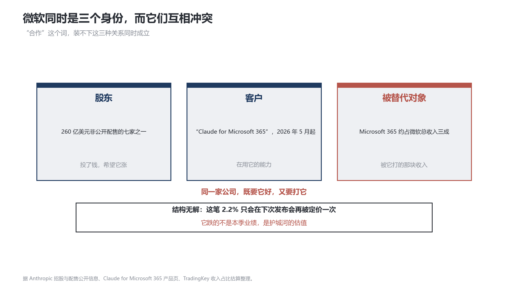

# 微软蒸发 6000 亿，跌的不是业绩

先纠正一个流传很广的日期。

"当地时间 11 月 14 日，微软市值一夜蒸发 6000 亿"——11 月 14 日是周六，美股不开市。真实时间是 **11 月 10 日，周二**。

那天，Anthropic 在旧金山办了一场发布会。据 The Verge 报道，它推出三款新工具：Claude Meetings（作为可见参与者进会议、记笔记、跟进任务）、Claude Sheets（对标 Excel 和 Google Sheets）、Claude Whiteboards（协作白板）；同时宣布 Claude Data 从测试转为正式可用。

消息出来，微软盘中一度跌超 3.5%，收盘收窄到 2.2%，市值蒸发约 893 亿美元——按当时汇率折人民币约 6000 亿。

数字是真的。但"蒸发 6000 亿"这个说法，遮住了真正值得看的东西。

## 一、同一天，它做了两件互相矛盾的事

11 月 10 日，Anthropic 正式启动 IPO 路演，计划最高募资 644 亿美元，冲击史上最大规模上市。

同一天，它发布了直插 Microsoft 365 腹地的产品。

Microsoft 365 大约占微软总收入三成。而微软是 Anthropic 的股东，也是它的客户——今年 5 月起，Claude 就以 "Claude for Microsoft 365" 的形式活在 Excel、Word、PowerPoint、Outlook 里。

**一家公司，在向投资人推销自己的当天，攻击了自己最大的锚定投资人的现金牛。**

这不是失误。The Verge 写得很直接：Anthropic 正承受着在 IPO 前提高收入和产品使用率的巨大压力。

压力来自一个简单的事实：如果 Claude 只做"Office 里的 AI 插件"，它的天花板就是微软给它的那个位置——一个功能，不是一个平台。而一个功能，撑不起 1.3 万亿美元的估值。

## 二、真正变的不是股价，是关系

这次发布的性质，比跌幅重要得多。

过去两年，Claude 在办公场景里的角色是"增强"：帮你写文档、生成公式、总结邮件。它住在微软的房子里，交房租，也帮房子升值。今年 5 月那次整合，本质是"我进你的门"。

11 月 10 日之后，它开始盖自己的房子。

Claude Sheets 不是"Excel 里加一个 AI 按钮"，是独立的表格产品，AI 长在表里，不是贴在表上。配套的交互连接器更能说明问题：HubSpot、Adobe、Atlassian 的应用可以直接嵌进 Claude，用户不必切标签页。

**把别人的工具嵌进自己——这是平台的动作，不是插件的动作。**

从"增强既有软件"到"替代既有软件"，这一步跨过去，关系就变了。微软可以接受一个帮 Office 增值的伙伴，不能接受一个把 Office 变成可选项的对手。

## 三、2.2% 是重新定价，不是判决

再说回那个数字。

893 亿美元听着惊人，但微软市值约 4 万亿美元，2.2% 只是一次警告。过去五个交易日，微软累计跌 2.4%——市场在犹豫，不是在逃跑。

分歧也很清楚。Stifel 的分析师认为，凭借企业客户整合深度和安全治理能力，Microsoft 365 的增长短期内不会受实质影响。这话有道理：企业换办公套件的成本极高，不是"有个更好的表格"就能换的。

但市场反应也有道理：买股票买的是五年后的现金流。如果 AI 真能绕开 Office，那条"稳定收租"的曲线就得重画。

**所以 2.2% 跌的不是这个季度的业绩，是护城河的估值。**

## 写在最后

这件事最值得记的，不是 6000 亿，而是一个还没解的结构：

微软同时是 Anthropic 的**股东**、**客户**、和**被替代对象**。三个身份同时成立，"合作"这个词就不够用了。

Anthropic 也一样。它一边要微软的钱和云，一边要微软的市场。它必须在路演当天证明自己不需要微软——哪怕这会得罪微软。

这种关系没有先例，也没有稳定的解。它只会在下一次发布会、下一份财报里，被重新定价一次。

---

*事实来源：The Verge 2026 年 11 月 10 日《Anthropic has its own AI-powered office suite now》（记者 Hayden Field）；Investing.com、Investor's Business Daily、潮新闻、智东西 11 月 10—11 日关于微软股价与产品的报道；财联社 11 月 13 日引 Stifel 分析师观点；TradingKey 关于 Microsoft 365 约占微软总收入三成的估算；Claude for Microsoft 365 产品页（2026 年 5 月）。原文所称"11 月 14 日"为周六、非交易日，本文按一手报道更正为 11 月 10 日。*