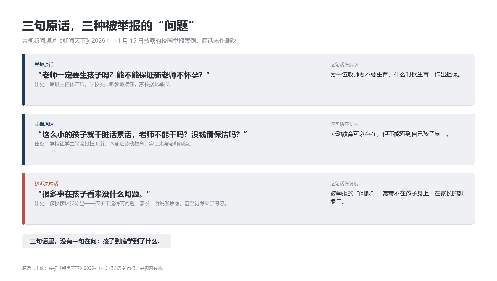
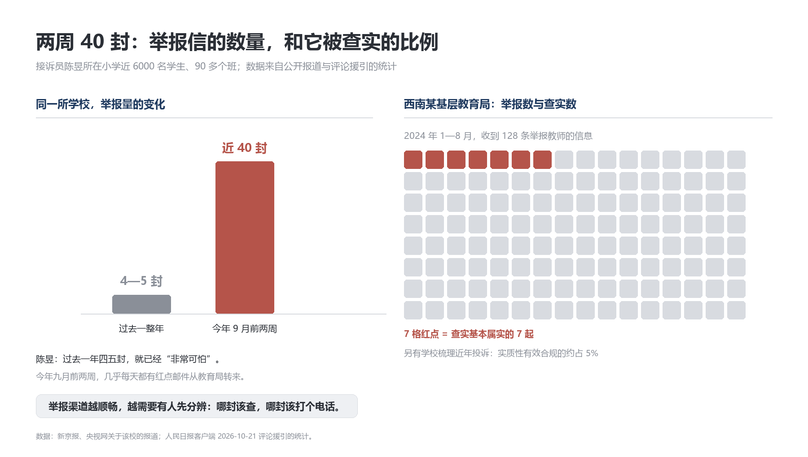
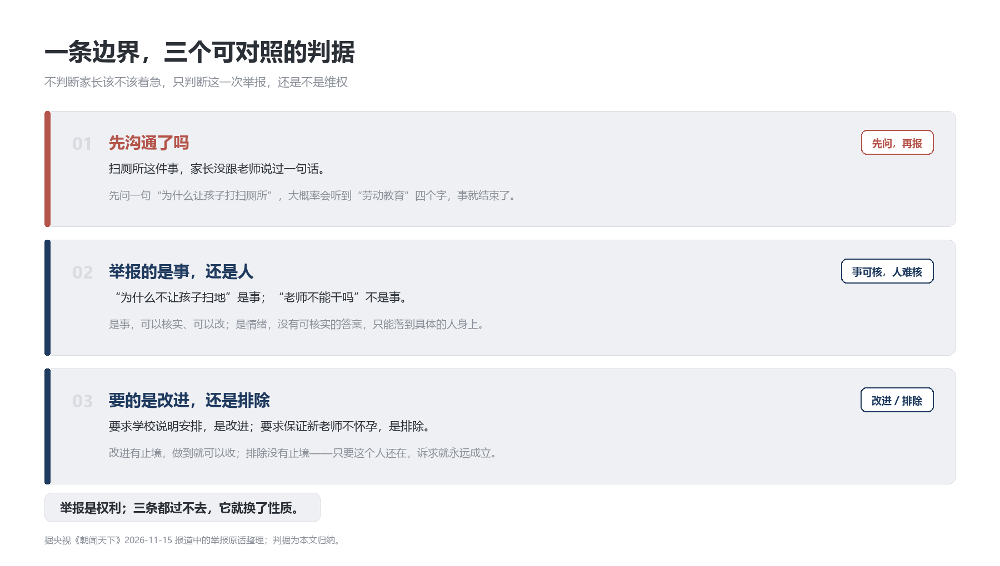

# 老师一定要生孩子吗

11 月 15 日，央视《朝闻天下》讲校园举报乱象，摆出来的不是道理，是几句原话。

第一句：“老师一定要生孩子吗？能不能保证新老师不怀孕？”背景是原班主任休产假，学校安排新教师接任，有家长据此举报。

第二句，同一所学校：“这么小的孩子就干脏活累活，老师不能干吗？没钱请保洁吗？”起因是学校让学生轮流打扫厕所，本意是劳动教育，家长没跟老师沟通，直接举报。

第三句不是举报内容，是接诉员的话。这所小学的接诉员陈昱，之前是班主任。她说：“很多事在孩子看来没什么问题。”但家长一听说，就焦虑，甚至觉得受了侮辱。

## 一、不是孤例

陈昱今年九月的前两周，收到近 40 封举报信。全校近 6000 名学生、90 多个班。

人民日报客户端 10 月 21 日一篇评论援引的统计更直接：有学校梳理近年投诉，实质性有效合规的约占 5%；西南某基层教育局 2024 年 1—8 月收到 128 条举报教师的信息，查实基本属实的 7 起。

所以问题不是“家长变坏了”。大多数举报是误会，是信息没同步上：家长不知道那间厕所是劳动教育的一部分，只知道自己的孩子在里面刷地。

## 二、荒诞在哪

“能不能保证新老师不怀孕”这句话，语法上是请求，逻辑上是不可能。

怀孕不是失职，产假不是旷工，是法定权利。老师休产假、学校派新老师接任，是正常的人事安排，不是需要向家长报备并担保的服务变更。

它真正冒犯人的地方不是荒唐，是把一位教师的生育计划，写成了一个需要被提前排除的风险项。

## 三、但举报本身是权利

举报是监督渠道，是家长在孩子真受伤害时，唯一不必看老师脸色的那条路。体罚、校园餐、安全，靠的都是它。

问题不在举报，在于它成了沟通的第一选择，而不是最后选择。

## 四、边界怎么划

三个可以对照的问题。

**先沟通了吗。**扫厕所这事，家长跟老师一句话都没说过。如果先问一句“为什么让孩子打扫厕所”，大概率会听到“劳动教育”四个字，事就结束了。

**举报的是事，还是人。**“为什么不让孩子扫地”是事，可以核实、可以改；“老师不能干吗”不是事，是情绪，没有可核实的答案，只能落到具体的人身上。

**要的是改进，还是排除。**要求学校说明安排，是改进；要求保证新老师不怀孕，是排除。改进有止境，做到就可以收；排除没有止境——只要这个人还在，诉求就永远成立。

央视的落点是“家校共育，核心是育人，是双向协同，不是单向摊派”，要“守护好学校和一线教师正常履职的空间”。

双向协同这四个字，两头都管：学校不能把自己该干的事摊给家长，家长也不能把该由专业判断的事收回到自己手里。

## 写在最后

举报这条渠道，设计出来是为了让弱者不被捂住嘴。用得好，它是保护；用过头，它就成了另一种压制，只不过压的是讲台上那个人。

陈昱说，得知被举报的那一刻，先是惊讶，再是茫然，最后是心寒。

一个老师心寒之后会怎么上课，才是这件事真正要问的。

**举报是权利。但用到哪一步，就不再是维权，而是要求别人为你的焦虑让路？**

---

*事实来源：央视新闻频道《朝闻天下》2026 年 11 月 15 日“关注校园举报乱象”报道（举报原话、央视定调）；新京报、央视网对该校的报道及接诉员陈昱陈述（9 月前两周近 40 封举报信、全校近 6000 名学生 90 多个班、过去一年四五封）；人民日报客户端 2026 年 10 月 21 日评论《一有分歧就举报，老师还怎么教孩子》援引的统计（有学校实质性有效合规投诉约占 5%；西南某基层教育局 2024 年 1—8 月 128 条举报、查实基本属实 7 起）。*
