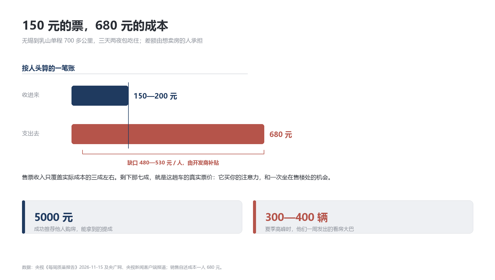
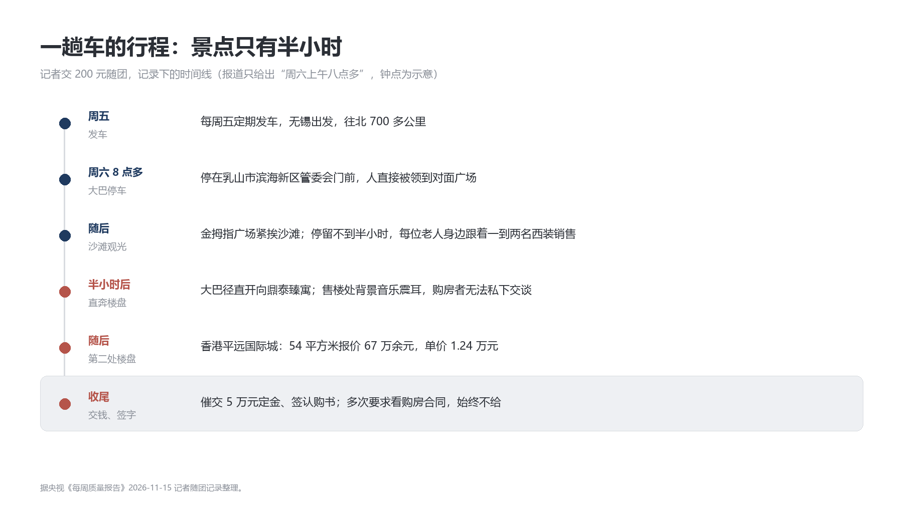
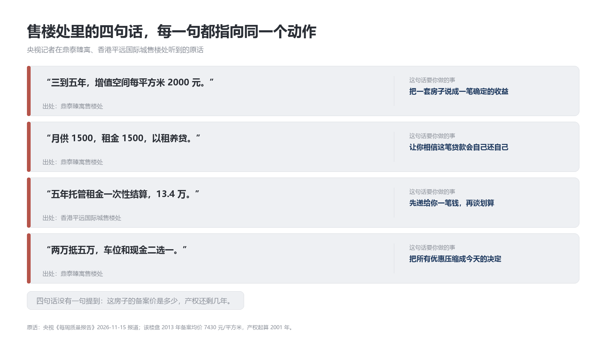

# 200 元的团费，680 元的成本

上周五，一辆大巴从无锡出发，往北开 700 多公里，目的地是山东威海乳山。车上坐的是中老年人，报名费一人 150 元，夫妻同行 200 元，三天两夜，包吃住。

这是央视《每周质量报告》11 月 15 日的调查。记者交了 200 元，上了这辆车。

## 一、一笔不可能成立的账

无锡到乳山单程超 700 公里，往返一千四百多公里，加三天两夜吃住，200 元不可能覆盖。

销售说得坦白：这是开发商补贴的，实际费用一人 680 元。

客源主要靠"老带新"，成功推荐别人购房能拿 5000 元提成。夏天高峰时，他们一周发三四百辆大巴。

所以这不是旅游。旅游是花钱买一段经历；这个是花钱买一个被人推销的座位，差价由想卖房的人出。

## 二、周六上午的行程

周六上午八点多，大巴停在乳山市滨海新区管委会门前。销售把人领到马路对面的金拇指广场，广场紧挨着沙滩。

这半小时里，几乎每位老人身旁都跟着一到两名穿深色西装的销售，嘘寒问暖。

沙滩上待了不到半小时，销售就催着上车。大巴径直开向"鼎泰臻寓"。

## 三、售楼处里的四句话

进门第一件事是背景音乐，震耳。声音一大，购房者之间就没法私下说话。

然后是话术。

"三到五年，增值空间每平方米 2000 元。"房子还没住，先给一个确定的涨幅。

"月供 1500，租金 1500，以租养贷。"两个数字刚好相等，不是巧合。

"五年托管租金一次性结算，13.4 万。"先给你一笔钱，再跟你谈划算。

"两万抵五万，车位和现金二选一。"所有优惠最后都指向同一个动作：今天签字。

配合话术的还有布景：单元楼门口摆着新家电，电梯里"刚赶集回来"的老业主，还有两位 60 多岁、极力称赞房源的老业主。

## 四、先交钱，后看合同

看完第二个楼盘"香港平远国际城"，销售催着交 5 万元定金、签认购书。记者几次要求看购房合同，对方始终不提供，只拿出一本别的业主的不动产权证。

正常流程恰恰相反：网签备案合同范本应在售楼场所公示，供购房人查阅。"先交钱、后看合同"这几个字本身就是信号。

那本产权证上写着，这块地的使用权从 2001 年 10 月 21 日到 2071 年 10 月 20 日。70 年产权，到手时已经过去 25 年。

江苏丹阳的张女士走完了全程。今年 8 月，她签下 50.6 平方米的一套，原价 60 多万，减完托管费和团购优惠，成交 41 万；签完字，销售把纸质合同全部收走。同小区同栋同面积的毛坯二手房，市价不到 9 万。

## 五、曝光之后

11 月 15 日节目播出当天，无锡文旅部门联合市场监管、公安及属地开展现场核查；乳山连夜成立专项工作组，核查"鼎泰臻寓""香港平远国际城"。

核查需要时间，但有件事不用等。

家里老人要是报了这种价位的团，先问一句：行程单上有没有"参观""看房""项目推介"这几个字。

## 写在最后

200 元买不到三天两夜的吃住行。它买到的是另一样东西：一个坐在售楼处里的人，和一段没人录音的承诺。

一车人里，多数不会买。可只要有几个人签了字，这趟车就赚回来了。

**票是 150 元，成本是 680 元。中间那 530 元是谁替你付的，他想要什么？**

---

*事实来源：央视《每周质量报告》2026 年 11 月 15 日《"低价游"背后的"买房陷阱"》及央广网、央视新闻客户端同日报道（团费 150 元／夫妻 200 元、实际成本一人 680 元、推荐成交提成 5000 元、夏季一周三四百辆大巴、金拇指广场停留不足半小时、售楼处话术与布景、拒不出示合同、产权年限 2001—2071、张女士 41 万元购房与同款二手房不足 9 万元）；无锡、乳山两地 11 月 15 日现场核查通报。*
