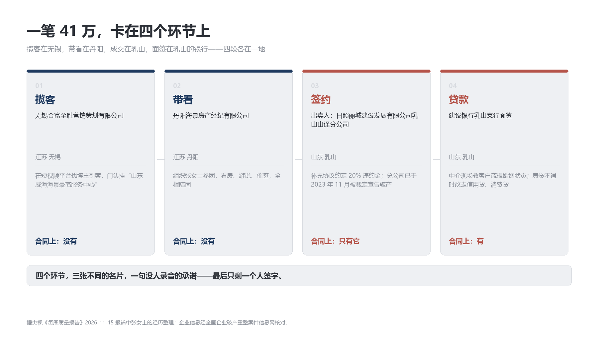
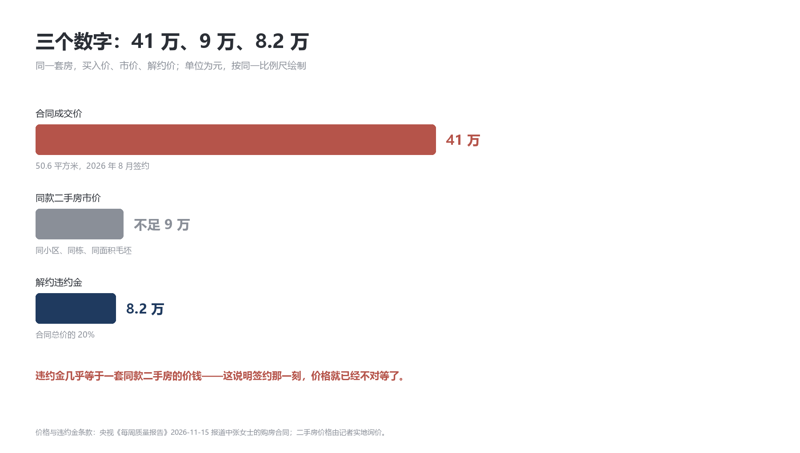
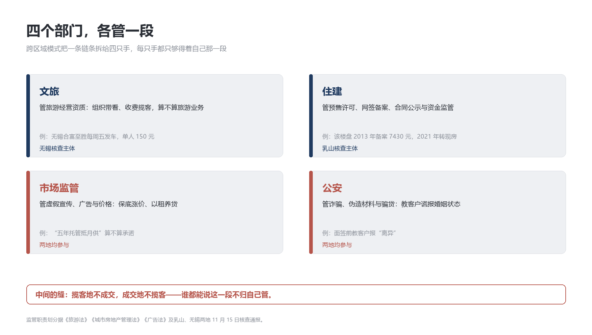

# 41 万买的房，为什么退不掉

11 月 15 日，央视《每周质量报告》曝光乳山低价看房团。江苏丹阳的张女士今年 8 月花 41 万元，买下"香港平远国际城"一套 50.6 平方米的海景房。同小区、同栋、同面积的毛坯二手房，市价不到 9 万元。

她要退房。开发商说，按补充协议，买受人原因退房须经出卖人同意，并按总价 20% 支付违约金——8.2 万元。

从 8 月到现在，她跑了售楼处、住建局、市场监管局，得到的答复是“已由别的公司接手”“符合规定”，以及沉默。

这笔钱退不掉，不是因为哪一方特别坏，是因为它被拆成四段，每段都能说"不归我管"。

## 一、合同三个月后才到手

签约时，销售说合同都是统一版本、没必要看，催她赶紧签。字签完，合同当场被收走。

直到 11 月 4 日，她才拿到合同原件——距离签约将近三个月。

自己签的字，三个月后才看到内容。后面的麻烦都从这一步开始。

## 二、卖方是谁

合同上的出卖人是"日照丽城建设发展有限公司乳山山译分公司"。全国企业破产重整案件信息网可查：其总公司 2023 年 11 月已被法院裁定宣告破产。卖房时销售只字未提。

楼盘底细也经不起查：2013 年取得预售许可，备案均价 7430 元/平方米；2021 年转现房后备案价没更新，合同单价 8100 多元。

## 三、许诺的人不在合同里

"酒店每年固定返租 3 万元，覆盖月供"——这句话，合同里没有。

她找到售楼处，销售主管回答：托管去找酒店，不归销售部管。

央视记者在售楼处听到的是同一套：保底涨价、以租养贷、五年托管抵月供。贷款走不通时还能"备用方案"——走信用贷、消费贷；面签前，中介教她谎报婚姻状态："只有说离异或丧偶，才能办个人贷款。"

## 四、管的人分在两地

揽客的在无锡（"无锡合富至胜营销策划有限公司"），带看的在丹阳（"丹阳海景房产经纪有限公司"），成交和贷款面签都在乳山。

央视的定性是："异地揽客、本地成交的跨区域模式，恰恰暴露了属地监管与源头治理之间的盲区。"

文旅管旅游经营资质，住建管预售备案，市场监管管虚假宣传，公安管诈骗。四只手各管一段，中间那条缝正好是这趟车开过去的地方。

## 五、连夜核查，能查出什么

11 月 15 日曝光当天，无锡文旅联合市场监管、公安及属地现场核查；乳山成立专项工作组，对"鼎泰臻寓""香港平远国际城"核查。

能查的：带看是否具备旅行社资质，宣传是否虚假，预售是否公示，有没有教客户造假。

难查的：口头承诺。返租、涨价、托管，全在嘴上，纸上的一句没有。

## 写在最后

乳山法院 2022 年公布的数据：2021 年该院受理涉海景房案件 1397 件，占全院案件总量的 10.67%。一个县级市法院，一年十分之一的案子是海景房。

这些案子里，多数人手里都有一份自己签的合同，和一段没有录音的承诺。

提醒就四句：不看合同不签字；定金不当场交；口头承诺写进补充协议；团费明显低于路费的"旅游"，先问行程里有没有看房。

**一份没看过的合同，一个已经破产的卖方，一句没人录音的承诺——这三样凑齐，该由哪一段的监管来拆？**

---

*事实来源：央视《每周质量报告》2026 年 11 月 15 日《"低价游"背后的"买房陷阱"》及央广网、央视新闻客户端同日报道（张女士 41 万元购房、合同原件延迟近三个月、出卖人总公司 2023 年 11 月被裁定破产、2013 年预售许可与 7430 元备案均价、20% 违约金即 8.2 万元、同款二手房不足 9 万元、教客户谎报婚姻与信用贷方案、乳山法院 2021 年涉海景房案件 1397 件占 10.67%）；无锡、乳山两地 11 月 15 日现场核查通报。*
