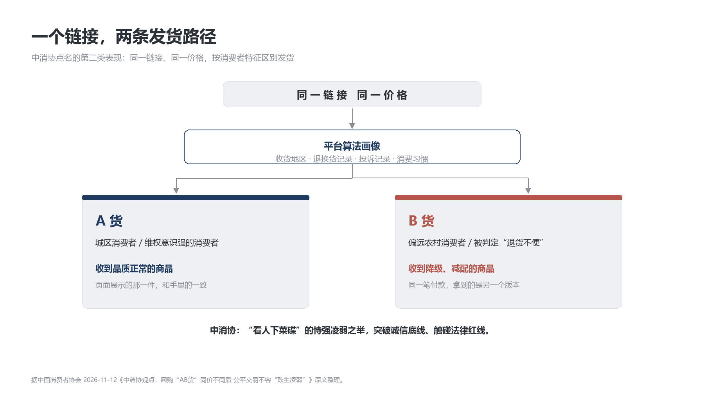
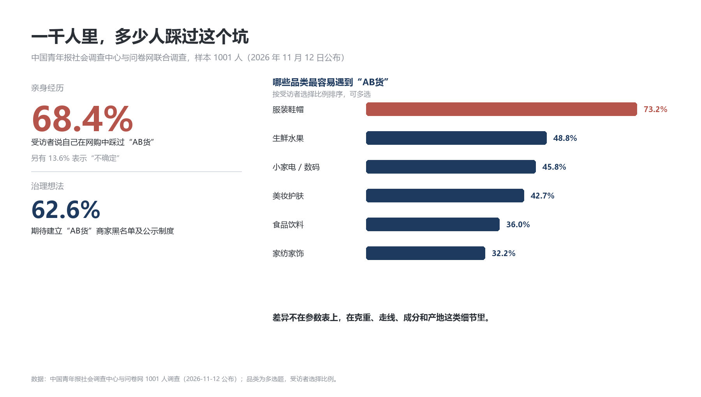
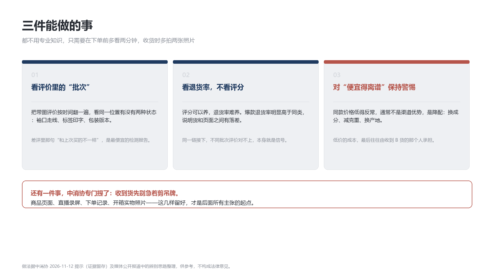

# 同一个链接，两种货

同一个页面，同一个价格，同一笔付款。河南的宋羽在两个平台的官方旗舰店各买了一件同款冲锋衣，差几十块钱。收到货，颜色差不多，面料手感不同，吊牌上的名称也不同。她把两件都发给客服，回答是"委托方不一致，不是 AB 货"。

要不是买了两件，这事永远不会被发现。

11 月 12 日，中国消费者协会就网购"AB货"公开发声，定性"同价不同质"，一句话概括："公平交易不容'欺生凌弱'"。11 月 14 日，央视报道了这件事。

## 一、"AB货"到底是什么

中消协的定义：同一链接、同一价格，针对不同消费者发送品质明显不同的商品。

两种表现。一种是展示 A、发出 B——页面和直播间里是好的那件，寄到你手上的不是。另一种更冷：对偏远农村消费者定向发 B 货，因为"退货不便、维权成本高"；对城区或维权意识强的消费者，发 A 货。

中消协的原话是"看人下菜碟"的恃强凌弱之举，"看似精明，实则突破诚信底线、触碰法律红线"。

## 二、差别不是运气，是标签

区别发货的前提，是先判断谁好欺负：收货地区、退换货记录，平台用算法画像，筛出"退货不便""维权意识弱"的那一批。

这已经不是"批次"能解释的事了。中消协点得很明：利用个人信息做自动化决策、区别分配商品品质，可能违反《个人信息保护法》第二十四条，同时侵害知情权、自主选择权和公平交易权。

## 三、为什么很难发现

差异藏在细节里：面料成分、克重、走线，或者干脆是不同产地的替代件。穿用一段时间才发现，那时吊牌早剪了。

中国青年报 1001 人的调查里，68.4% 踩过；服装鞋帽被 73.2% 的人排在第一，后面是生鲜水果、小家电。据湖南省市场监管局，今年已受理相关投诉举报 70 余件。

举证更难。对外经贸大学法学院苏号朋教授说：品质差异多在用料做工，缺乏判定标准，商家用"批次不同""仓库发错"就能把主观欺诈包装成客观差错；而检测费用，可能比商品本身还贵。

于是多数人算了一笔账：退货、退款、再投诉，时间成本高于那几十块。

## 四、三件能做的事

**看评价里的"批次"。** 把带图评价按时间翻一遍，找同一位置的两种状态——袖口走线、标签印字、包装版本。差评里那句"和上次买的不一样"，是最便宜的检测报告。

**看退货率，不看评分。** 评分可以养，退货率难养。爆款退货率明显高于同类，说明货和页面之间有落差。

**对"便宜得离谱"保持警惕。** 同款价格低得反常，通常不是渠道优势，是降配。

中消协还有一条建议：收到货先别急着剪吊牌，商品页面、下单记录、开箱实物拍照留好——这是所有主张的起点。

## 写在最后

这件事真正让人不舒服的，不是"我买到了差货"，是"我被判断为不值得发好货"。

算法知道你住在哪、退过几次货、投诉过没有，据此决定给你哪一箱。你以为是运气，其实是排序。

中消协把话说得很硬。但"不容欺生凌弱"要落地，得有证据、有受理、有处罚——三样缺一样，"下次给您发好的"就还是一句客服话术。

**同一个链接，两个人下单，收到的货不一样。那"同价"这两个字，到底是在跟谁讲？**

---

*事实来源：中国消费者协会 2026 年 11 月 12 日《中消协观点：网购"AB货"同价不同质 公平交易不容"欺生凌弱"》（定义、两种表现、消费者权益保护法第二十条与第二十三条、个人信息保护法第二十四条、算法推荐管理规定第二十一条）；央视 2026 年 11 月 14 日报道；中国青年报社会调查中心与问卷网 1001 人调查（68.4% 踩过坑、服装鞋帽 73.2%、生鲜水果 48.8%、小家电数码 45.8%、62.6% 期待建立商家黑名单，苏号朋观点）；湖南省市场监督管理局 2026 年 8 月公开报道（今年受理相关投诉举报 70 余件）。*
