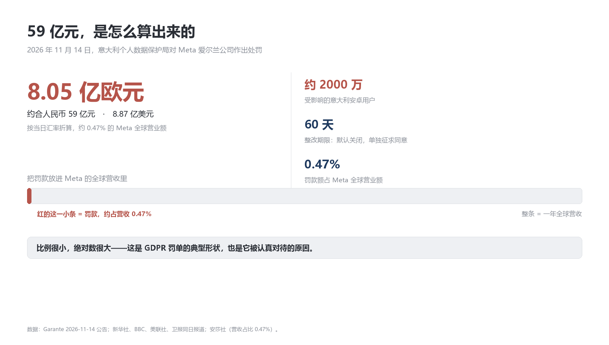
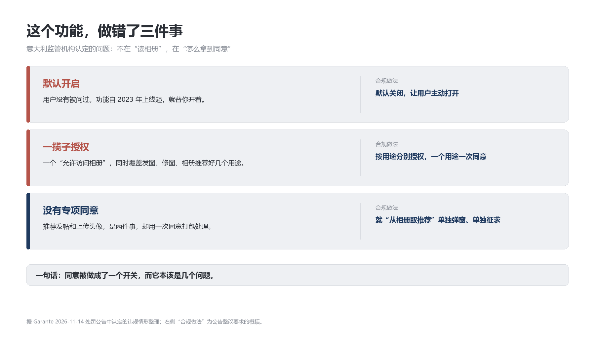
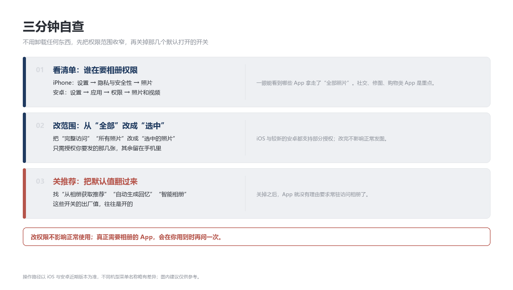

# 你的相册里有什么

你的手机相册里有什么？孩子的照片、身份证正反面截图、体检报告、快递单、银行卡。

11 月 14 日，意大利个人数据保护局对 Meta 爱尔兰公司开出 8.05 亿欧元罚单，约合人民币 59 亿元。理由只有一条：通过安卓版 Facebook 应用，读取了用户手机里的照片、视频和元数据，事先没拿到"专项同意"，也没说清楚。

## 一、它读的不是"数据"，是相册

涉事功能叫"浏览 Facebook 时从相册获取推荐"，2023 年上线。你刷信息流，它从你相册里挑照片和视频，作为"可以发的内容"推给你。

调查认定两件事：这功能默认开启；相册权限是用一个通用授权拿到的，没有为这个用途单独征求同意。涉及意大利约 2000 万安卓用户。

处罚要求 60 天内整改：该功能必须默认关闭，并且就这个用途单独征求同意。

罚款看着吓人，其实只占 Meta 全球营业额的 0.47%。Meta 已表示要上诉。

## 二、为什么"相册"比"数据"更刺人

因为相册是唯一一份你不设防的档案。

聊天记录可以斟酌，相册不会。里面有你家门牌、孩子学校、体检单上的指标、身份证正反面。照片还带元数据——拍摄时间、机型、位置。

平台要的从来不是某一张照片，是"这个人是谁、在哪、跟谁、什么时候"。这四件事凑齐，比任何问卷都准。

## 三、问题不在"读"，在"怎么读"

App 读相册本身不违法。修图、聊天、发帖都要读。意大利这次认定的问题，可以归成三条：

默认开启——你没选，它先替你开了。

一揽子授权——一个"允许访问相册"，同时覆盖发图、修图、推荐好几个用途。

没有专项同意——推荐发帖和上传头像，是两件事，却用一次同意打包。

换句话说，"同意"被做成了一个开关，而它本该是几个问题。

## 四、三分钟能做的事

**看一眼清单。**iPhone：设置 → 隐私与安全性 → 照片。安卓：设置 → 应用 → 权限 → 照片和视频。

**改范围。**把"完整访问／全部照片"改成"选中的照片"。iOS 和较新的安卓都支持只授权几张。

**关掉自动推荐。**应用里"从相册获取推荐""自动生成回忆""智能相册"这类开关，默认值往往是开的。

## 写在最后

这张罚单最值得记住的，不是 59 亿，是整改要求里那两句话：默认关闭，单独同意。

它等于官方承认了一件事：这家公司有能力把功能做得更规矩，只是没做。

你手机里装着几十个 App，多数不会有人替你罚它们。那个开关，只能自己去关。

**你上一次打开"照片"权限列表，是什么时候？**

---

*事实来源：意大利个人数据保护局（Garante per la protezione dei dati personali）2026 年 11 月 14 日处罚公告及新闻稿（涉事功能"浏览 Facebook 时从相册获取推荐"、2023 年上线、默认开启、单一授权覆盖多用途、约 2000 万意大利安卓用户、60 天内默认关闭并单独征求同意）；新华社 11 月 14 日罗马电、BBC、美联社、卫报同日报道；安莎社（ANSA）关于罚款约占 Meta 全球营业额 0.47%、Meta 拟提起上诉的报道。*
