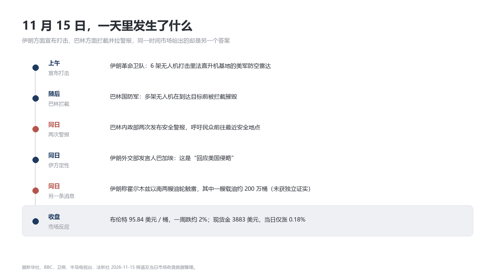
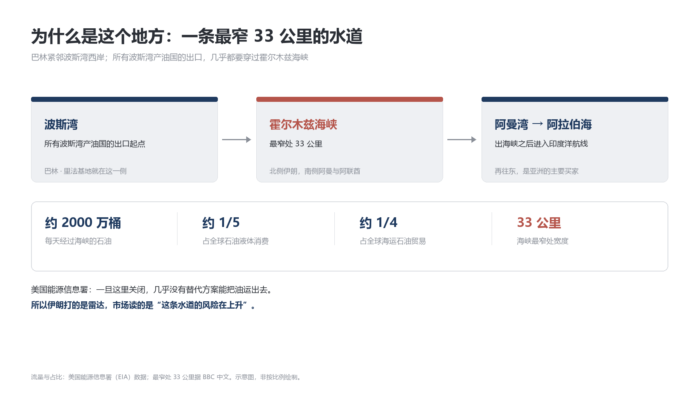
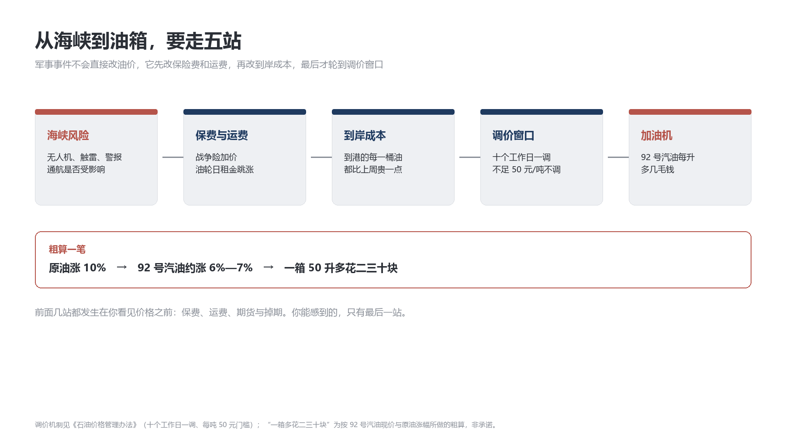

# 雷达被炸，油价没跳

11 月 15 日，伊朗伊斯兰革命卫队宣布，用 6 架无人机打击了巴林里法直升机基地的美军防空雷达。巴林国防军说，多架无人机在到达目标前被拦截摧毁；内政部一天发了两次安全警报，让民众前往最近的安全地点。伊朗外交部发言人的说法是"回应美国侵略"。

同一天，伊朗方面还称霍尔木兹海峡以南有两艘油轮触雷爆炸，其中一艘是载油约 200 万桶的超级油轮。这个说法截至报道时没有得到独立证实。

三天之内，这是伊朗第二次声称打击巴林境内的美军目标。

## 一、炸了雷达，油为什么没跳

按常识，这种消息该把油价顶上去。实际没有。

布伦特原油收在 95.84 美元附近，一周还跌了约 2%；现货黄金当天只涨 0.18%，报 3883 美元/盎司，当周累计跌了约 4.6%。

原因不复杂：雷达不是油井。这一轮打击没有碰掉任何一桶出口产能，市场加的是"风险溢价"，不是"供应缺口"。

这两件事差得很远。风险溢价是保险费涨价，供应缺口是油真的运不出来。到目前为止，市场只给了前者。

## 二、为什么所有人都在看那个海峡

巴林很小，但它旁边是霍尔木兹海峡。

每天约 2000 万桶石油从这里过，约占全球石油液体消费的五分之一、全球海运石油贸易的四分之一。最窄处只有 33 公里。沙特、伊拉克、科威特、阿联酋、卡塔尔的出口，几乎都得走这一条。

美国能源信息署的说法很直白：一旦这里关闭，几乎没有替代方案能把油运出去。

所以伊朗打的是雷达，市场读到的是另一句话：这条水道的风险在上升。

## 三、这跟你的油箱怎么连上

链条很长，但每一环都能说清：海峡风险上升 → 战争险保费与运费上涨 → 到岸成本上升 → 国内成品油调价。

国内油价每十个工作日调一次，涨跌幅不到每吨 50 元就不调。所以海峡那边"响"一下，不会第二天就出现在加油机上；但如果风险溢价持续，两三轮调价之后就会。

粗算一笔：原油涨 10%，92 号汽油大约涨 6%—7%，一箱 50 升多花二三十块。

这数字不大，但它是唯一一个你能切身感到的部分。前面那些环节——保费、运费、期货、掉期——都发生在你看见价格之前。

## 四、接下来看三个信号，不看表态

**布伦特能不能连续站上 100 美元。**单日冲高是情绪，连续站稳才是定价。

**战争险保费和油轮运费。**这两项涨，说明船东真的在躲，而不是交易员在猜。

**霍尔木兹的通航有没有实际中断。**报道里的"触雷""爆炸"，需要船级社、保险市场和官方通报交叉确认。

## 写在最后

这次的画面很有冲击力：无人机、防空警报、超级油轮。但价格给出的回答很冷静——市场暂时认为，这只是那个地方又一次"响"。

真正该记住的不是这次涨没涨，是传导路径已经摆在那儿了。那条水道上每响一次，风险溢价就往上垫一层；垫到某一层，才会翻过调价窗口，变成你加油时多掏的几十块。

**雷达被炸，油价没动。是市场太迟钝，还是我们在为一件还没发生的事提前付钱？**

---

*事实来源：伊朗伊斯兰革命卫队 11 月 15 日声明、巴林国防军总司令部声明与内政部警报、伊朗外交部发言人巴加埃表态（新华社德黑兰、利雅得电，11 月 15 日）；BBC、卫报、半岛电视台、法新社同日报道（6 架无人机、拦截情况、三天内第二次、油轮触雷说法未经独立证实）；布伦特与现货黄金价格：11 月 14—15 日市场收盘数据（布伦特 95.84 美元/桶、周跌约 2%；现货金 3883 美元/盎司、当日 +0.18%、当周约 −4.6%）；霍尔木兹海峡流量与占比：美国能源信息署（EIA）数据，约 2000 万桶/日、占全球石油液体消费约五分之一、海运石油贸易约四分之一、最窄处 33 公里；国内成品油调价机制见《石油价格管理办法》（十个工作日一调、每吨 50 元门槛），"一箱多花二三十块"为按 92 号汽油现价与原油涨幅做的粗算。*
