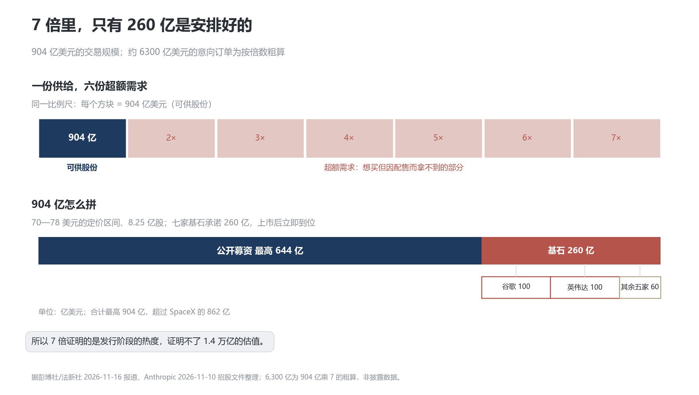
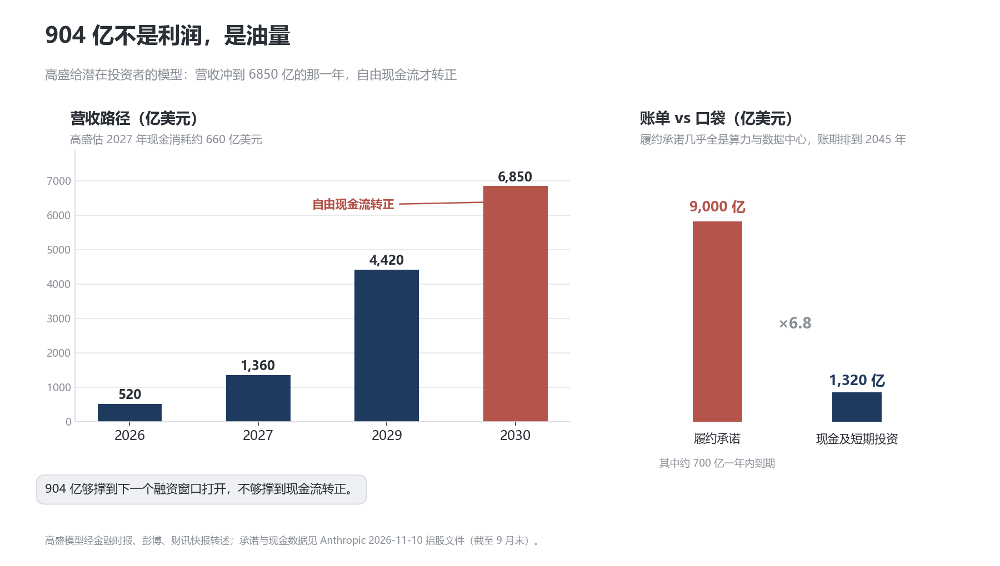
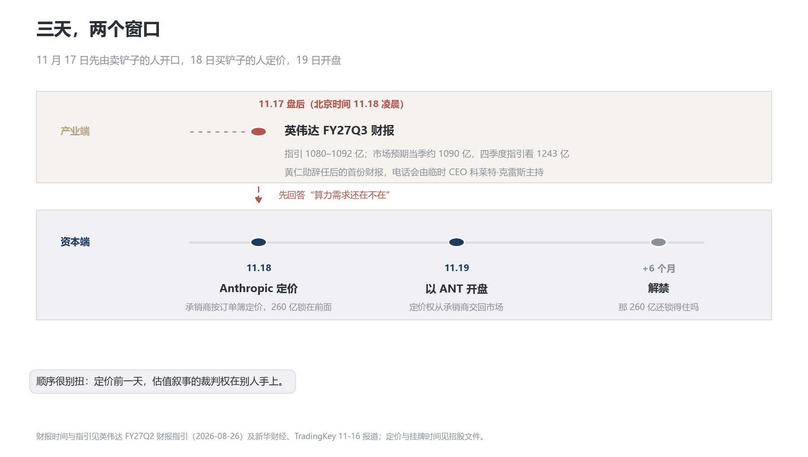

# 7 倍认购，1.4 万亿美元：倒计时握在英伟达手里

11 月 16 日，彭博社把 Anthropic 的认购数字更新了一档：订单已接近可供股份的 7 倍。四天前，这个数字还是 6 倍。

发行价 70 至 78 美元，8.25 亿股，公开募资最高 644 亿美元；加上七家机构 260 亿美元的非公开配售，合计最高 904 亿美元，超过 SpaceX，是史上最大的一次 IPO。11 月 18 日定价，11 月 19 日以"ANT"登陆纳斯达克，完全稀释估值 1.4 万亿美元。

而美东时间 11 月 17 日盘后——北京时间 11 月 18 日凌晨——英伟达发布 2027 财年第三季度财报。两个日子只差一天。

## 一、7 倍，是四天里涨上去的一档

11 月 11 日路演刚启动，彭博的说法还是"数倍"；11 月 12 日变成 6 倍；11 月 16 日，接近 7 倍。

四天里多出来的这一档，不是基本面变了。没有新产品，没有新客户，没有新的财务数据。变的是时间——定价日越近，下单越像一次表态。

按最高募资 904 亿粗算，7 倍意味着约 6300 亿美元的意向订单。这个数字不能被当成 6300 亿现金在场外排队：认购可以撤、可以缩，配售比例由承销商定。它衡量的是"想买的人有多少"，不是"最后成交多少"。

## 二、260 亿，是被安排好的底

真正撑住这笔交易的，不只是那 7 倍。

七家科技公司在上市后立即合计注资 260 亿美元，其中谷歌、英伟达各 100 亿。这七家有个共同点：既是 Anthropic 的现有股东，也几乎全是它的付费客户——买它的模型，也卖它算力。

所以这 260 亿的性质，和公开市场的订单不一样。**公开市场的 6 倍多是判断，这 260 亿是结构。** 有它锁在前面，后面的钱才敢按 1.4 万亿的估值下注。

## 三、904 亿买不来现金流

把招股文件翻到承诺那一页，气氛会变。

Anthropic 披露的履约承诺约 9000 亿美元，几乎全部是算力与数据中心，账期一直排到 2045 年，其中约 700 亿一年内到期。而截至 9 月末，公司持有的现金及短期投资约 1320 亿美元。

高盛的模型更直接：2026 年营收约 520 亿，2027 年 1360 亿，2029 年 4420 亿，2030 年 6850 亿——**自由现金流到 2030 年才转正**。而 2027 年的现金消耗，高盛估到约 660 亿美元。

于是 904 亿的性质清楚了：它不是终点，是油量。按这个烧法，它够撑到下一个融资窗口打开，不够撑到现金流转正。

## 四、11 月 17 日，英伟达先开口

把日程排一遍：

11 月 17 日盘后，英伟达 FY27Q3 财报。公司自己的指引是 1080 亿至 1092 亿美元，市场预期约 1090 亿、同比增长约 91%；真正被盯的是四季度指引能不能摸到 1243 亿。这是黄仁勋辞任后的第一份财报，电话会由临时 CEO、CFO 科莱特·克雷斯主持。

11 月 18 日，Anthropic 定价。11 月 19 日，开盘。

顺序很别扭：**先由卖铲子的人回答"需求还在不在"，再由买铲子的人决定自己值多少钱。** 而英伟达这份财报要回答的，恰恰是市场最不放心的一句——这些钱，多久能赚回来。

## 写在最后

7 倍认购说明的是发行阶段的需求，它证明不了上市后的价格。上市之后，定价权从承销商手里交回市场，市场只问两件事：

英伟达的财报，能不能把"算力需求还在涨"再确认一次；以及那套"客户投钱、公司买算力、算力再变成收入"的循环，能不能再转一圈。

第一件事，11 月 18 日凌晨见分晓。第二件事，要等到六个月后解禁。

**倒计时的钟，不在 Anthropic 手里。**

---

*事实来源：彭博社 2026 年 11 月 16 日关于 Anthropic IPO 认购接近 7 倍超额认购的报道（法新社、鉅亨網、Yahoo 奇摩股市转述），以及 11 月 12 日"约 6 倍"、11 月 11 日"数倍"的先后报道；Anthropic 2026 年 11 月 10 日修订版招股文件披露的发行区间（70—78 美元）、股数（8.25 亿股 A 类普通股）、定价与挂牌时间（11 月 18 日定价、11 月 19 日纳斯达克，代码 ANT）；七家基石投资者合计 260 亿美元非公开配售，谷歌、英伟达各 100 亿美元；招股文件披露的履约承诺约 9000 亿美元（几乎全部为算力与数据中心，期限至 2045 年，约 700 亿一年内到期）与截至 9 月末约 1320 亿美元现金及短期投资；高盛向潜在投资者展示的预测模型（2026 年营收约 520 亿、2027 年 1360 亿、2029 年 4420 亿、2030 年 6850 亿美元，2030 年自由现金流方转正，2027 年现金消耗约 660 亿美元），经金融时报、彭博、财讯快报转述；英伟达 2027 财年第三季度财报时间（美东 11 月 17 日盘后）与营收指引 1080 亿—1092 亿美元，四季度市场预期约 1243 亿美元、当季市场预期约 1090 亿美元，见新华财经、TradingKey、鉅亨網报道；临时 CEO 科莱特·克雷斯主持电话会，据 CNBC、财经杂志、工商时报报道。7 倍对应的约 6300 亿美元意向订单，为按最高募资额乘倍数所做粗算，非披露数据。*
