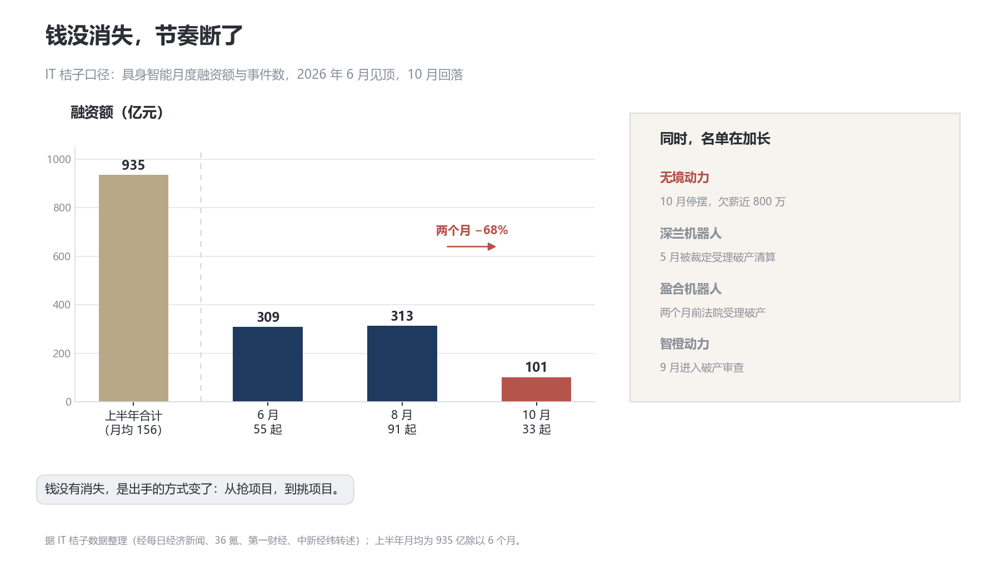
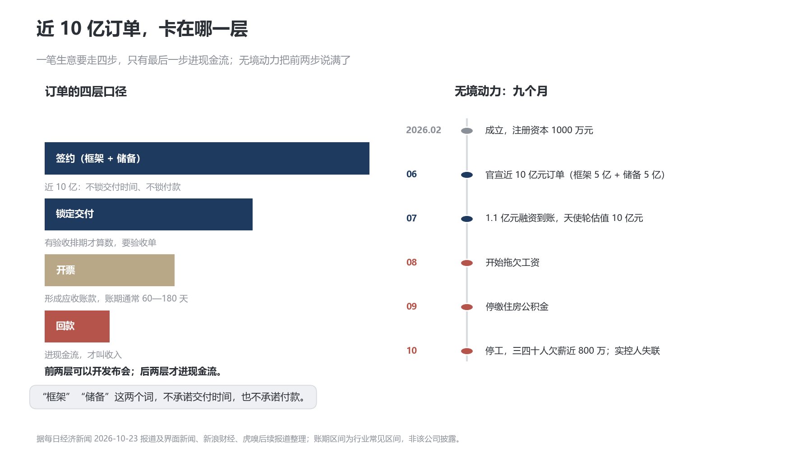
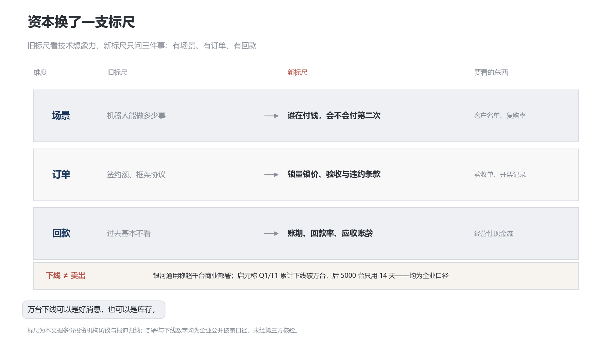

# 10 亿订单救不了 800 万欠薪

10 月，IT 桔子统计的具身智能融资只有 33 起、约 101 亿元。四个月前是另一幅景象：6 月单月 55 起、309 亿元。

同样是这家机构的数据，今年上半年这条赛道融资总额 935 亿元，是去年同期的 5 倍。第三季度，按第一财经的不完全统计，还有 185 起、333 亿元。

然后曲线拐了。

## 一、钱没消失，节奏断了

把几个数字排在一起，落差就出来了：6 月 309 亿、8 月 313 亿，8 月的事件数甚至是全年最高的 91 起；到了 10 月，33 起、101 亿。两个月，金额跌掉近七成。

一级市场的说法更直白：投资人不"上头"了。多家机构把策略往回缩——更愿意投早期、单笔更小，对"商业化短期难落地"的成长期项目明显收手。

钱不是没了，是出手的方式变了。**从抢项目，到挑项目。**

## 二、10 亿订单的那家公司，欠了 800 万

南京无境未来动力科技，2026 年 2 月 11 日成立，注册资本 1000 万元。它的时间表足够漂亮：

6 月，官宣拿下近 10 亿元订单——其中与多家央企签的近 5 亿元是框架订单，另外近 5 亿元被称作"储备订单"。7 月，1.1 亿元融资到账，天使轮估值 10 亿元。

然后 8 月起拖欠工资，9 月停缴住房公积金，10 月停工。三四十名员工，累计欠薪近 800 万元。实际控制人崔小飞被员工指称联系不上，公司法定代表人已于 10 月 12 日变更。CEO 袁海辉对媒体的回应是：他也联系不上实控人。

从区级基金招商的样板，到劳动仲裁庭，中间只隔了一个秋天。

问题不在"订单"本身，在这两个词上：**框架、储备。**它们不承诺交付时间，也不承诺付款。近 10 亿里没有一分钱是已经收到的。

## 三、订单叙事失效，是因为口径可以拉得很长

一笔生意在账上要走四步：签约（可以是框架）→ 锁定交付 → 开票 → 回款。任何一步都能被算进"订单"，但只有最后一步进现金流。

无境动力把前两步说满了，第三步之后是空的。这就是媒体说的"口径剪刀差"：**同一句"拿下 10 亿订单"，在发布会和审计报告里指的不是同一件事。**

出问题的不止它一家。深兰机器人，估值曾达 140 亿元，今年 5 月被上海浦东法院裁定受理破产清算；盈合机器人，成立十个月时估值最高 5 亿美元，两个月前法院发布了破产受理公告；泳池清洁机器人公司智橙动力，9 月进入破产审查。

## 四、资本换了一支标尺

旧标尺是技术想象力：参数、演示、融资额。新标尺只有三个词——**有场景、有订单、有回款。**

有场景，问的是谁在付钱、会不会付第二次；有订单，问的是锁不锁量、锁不锁价、有没有验收和违约条款；有回款，问的是账期多长、回款率多少、应收账龄什么样。

落到尽调上，就是文件里开始出现客户名单、验收单、复购数据，而不只是技术白皮书。

## 五、万台下线，不等于万台卖出

还有一层更容易被误读：量产。

银河通用对外称已有超千台商业部署；启元称 Q1、T1 累计下线破万台，其中后 5000 台只用了 14 天。这两个数字都是企业披露口径。

下线是产能数字。14 天造出 5000 台，说明供应链和产线跑通了，这是硬本事；但它不说明有人为它付第二次钱。**万台下线可以是好消息，也可以是库存。**

## 写在最后

出清不全是坏事。把"订单叙事"换成"回款叙事"，这条赛道才算真正开始做生意——估值会难看一段时间，但至少账是真的。

真正该记住的不是哪家公司停了，是那句被反复使用的话术：**订单可以是框架，融资可以是估值，只有回款是现金。**

已经倒下的是欠薪的那一批。下一批，会是只剩演示视频的那些吗？

---

*事实来源：IT 桔子数据（2026 年上半年具身智能融资 935 亿元、6 月 55 起约 309 亿元、8 月 91 起 313.23 亿元、10 月 33 起约 101 亿元），经每日经济新闻、36 氪、第一财经、中新经纬等转述；上半年同比 5 倍见中国经济网 2026 年 7 月 10 日报道；第三季度 185 起、333.35 亿元为第一财经不完全统计。无境动力（南京无境未来动力科技）成立时间、注册资本、6 月近 10 亿元订单（近 5 亿元央企框架订单、近 5 亿元储备订单）、7 月 1.1 亿元融资与 10 亿元天使轮估值、8 月起欠薪、9 月停缴公积金、10 月停工、三四十名员工欠薪近 800 万元、实控人崔小飞失联、法定代表人 10 月 12 日变更、CEO 袁海辉回应，见每日经济新闻 2026 年 10 月 23 日报道及界面新闻、新浪财经、虎嗅后续报道。深兰机器人 5 月被上海浦东法院裁定受理破产清算（估值曾达 140 亿元）、盈合机器人破产受理（成立十个月估值最高 5 亿美元）、智橙动力 9 月进入破产审查，见界面新闻 2026 年 10 月 28 日报道。银河通用超千台商业部署、启元 Q1/T1 累计下线破万台（后 5000 台 14 天）均为企业公开披露口径，未经第三方核验。*
