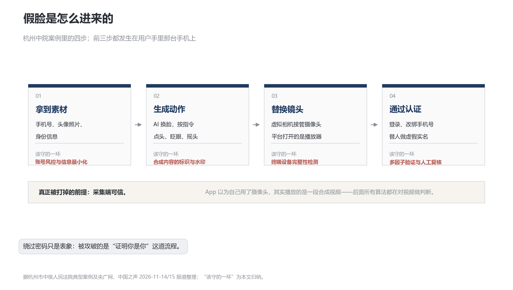
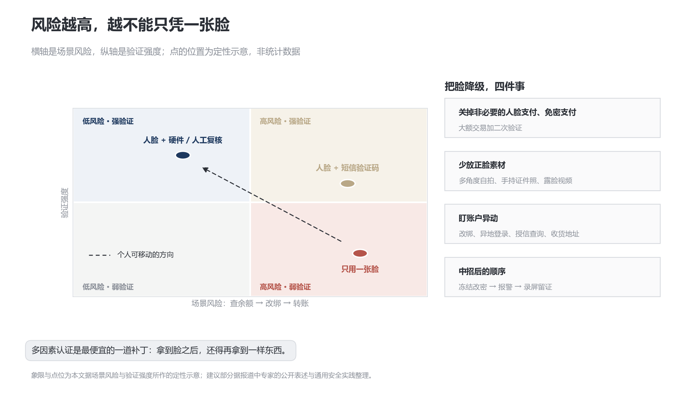

# 会点头的假脸，已经能过你的 App

杭州市中级人民法院近日公布的一起典型案例：张某、王某从境外社交软件拿到他人的手机号、头像照片和身份信息，用"AI 换脸"生成点头、眨眼的动态视频，再在手机里植入"虚拟相机"应用——平台调用摄像头时，屏幕里出现的不是真人，而是这段合成视频。

两人借此登录他人购物平台账号，把收货地址、购物车信息卖给第三方，还收费替人做"虚假实名认证"。

先说结论：**他们绕过的不是你的密码，是一整套"证明你是你"的流程。**

## 一、它骗过的不是脸，是"动作"

刷脸验证的动作库是公开的：点头、眨眼、摇头、张嘴。这套流程验证的其实不是"你是不是你"，而是"镜头前有没有东西在按指令动"。

生成模型现在能按指令产出动作序列，等于把这道题的答案提前写好了。复旦大学青年副研究员张晓寒把伪造拆成两块：先把脸偷出来（面部信息盗取），再让它在镜头前动起来（活体模拟）。

但真正致命的一环不在模型，在**虚拟相机**。App 以为自己打开了摄像头，其实打开的是一个播放器。采集端一旦不可信，后面所有算法都在对一段视频做判断。

## 二、为什么这次不是"又一个漏洞"

杭州市中院知识产权审判庭法官助理叶永青的说法很关键：传统侵权泄露的是信息，这个案子攻破的是**身份验证**这道防线。受害者面对的不再是单条信息泄露，而是账户被接管、财产被转移、身份被冒用。

门槛也变了：过去要专业团队，现在开源工具加一部手机就能做完。

银行不是没有反制。大型银行的远程核验除了看动作，后台还会看成像噪声、光影一致性、纹理、3D 深度。问题是中小 App 没有这套东西——小程序、垂直电商、SaaS 服务商用的往往是最便宜的"动作挑战"。

## 三、防线要往四层补

**采集端**：先证明"这个摄像头是真的"。检测虚拟相机、投屏、模拟器、越狱环境，把设备完整性纳入判定。

**校验端**：别只看动作。近红外与深度、噪声与光流一致性、屏幕摩尔纹，再配合设备指纹、位置、操作节奏。

**流程端**：高风险动作不给人脸单独决策权。改绑手机号、重置密码、提额、转账，必须叠加验证码、原设备确认或人工复核。

**合规端**：人脸识别不得作为唯一验证方式——这句话要落地，替代通道就得真的能用，人工审核和线下核身不能是摆设。

## 四、你现在能做的四件事

一是关掉非必要的人脸支付和免密支付，大额交易加二次验证。二是少放正脸素材，多角度自拍、手持证件照、露脸视频都是训练素材。三是盯异动：改绑手机号、异地登录、突然的授信查询。四是万一中招，顺序是冻结改密、报警、录屏留证。

多因素认证是张晓寒给公众的第一条建议，也是最便宜的一条。

## 五、规则也在动

11 月 14 日，东盟成员国在马尼拉签署《数字经济框架协定》（DEFA）。这是全球首个覆盖整个区域、具法律约束力的数字经济协定，2027 年初生效，优先项目包括数字支付、企业数字身份和电子贸易文件，同时涵盖网络安全、人工智能与跨境数据共享。

跨境身份互认一旦铺开，"谁能证明你是你"就不只是技术问题，而是规则问题。国内这边，民法典、个人信息保护法和新修改的网络安全法都管到了生物识别信息。

## 写在最后

假脸能过认证，不是因为 AI 多聪明，是因为我们把"证明你是你"这件事，外包给了一段两秒钟的视频。

当伪造一张脸的成本低于验证一张脸的成本，防线只能往一个方向移：**不再依赖任何单一的脸。**

---

*事实来源：杭州市中级人民法院公布的典型案例及央广网、中国之声《新闻纵横》2026 年 11 月 14—15 日报道（张某、王某用 AI 换脸制作虚假活体验证视频、通过虚拟相机替换本地相机、登录他人购物平台账号并售卖收货地址与购物车信息、有偿替人虚假实名认证；一审认定侵害众多不特定主体个人信息权益、损害社会公共利益）；杭州市中院知识产权审判庭法官助理叶永青、复旦大学发展研究院青年副研究员张晓寒在报道中的表述；大型银行远程人脸核验的多层反伪造校验（成像噪声、光影一致性、纹理、3D 深度）见同篇报道；人脸识别不得作为唯一验证方式的要求见《个人信息保护法》及人脸识别相关国家标准；东盟《数字经济框架协定》（DEFA）2026 年 11 月 14 日于马尼拉签署、2027 年初生效及优先项目内容，见 CNA、海峡时报、菲律宾通讯社报道。图 3 象限位置为本文据风险与验证强度的定性判断绘制的示意，非统计数据。*
