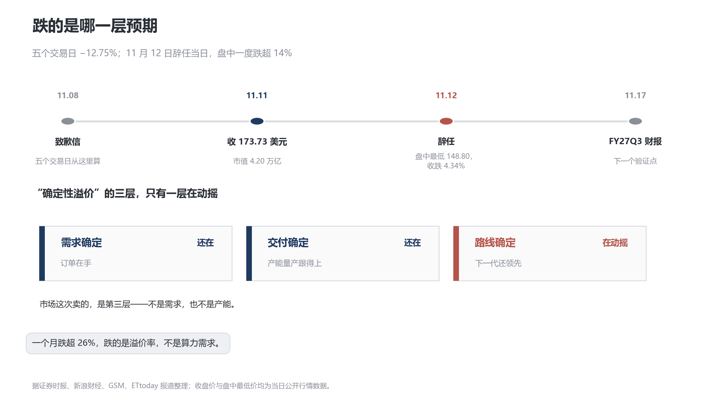
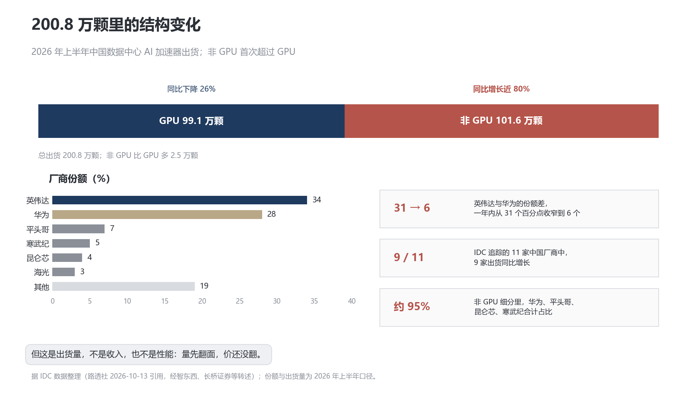
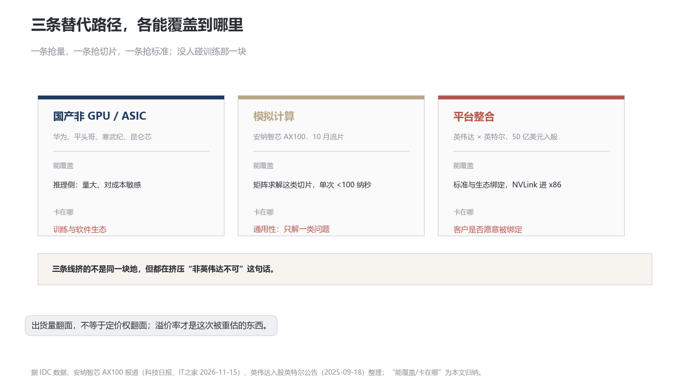

# 非 GPU 首次超过 GPU：英伟达的"确定性溢价"正在被重估

11 月的英伟达有两组数字：一组是股价——自 11 月 8 日致歉信起，五个交易日累计下跌 12.75%；11 月 12 日黄仁勋辞任当天，盘中一度跌超 14%，最低 148.80 美元，创 52 周新低，盘中市值约 3.87 万亿美元，7 月以来首次跌破 4 万亿。

另一组是出货量。IDC 的统计（路透社 10 月 13 日引用）：2026 年上半年，中国数据中心 AI 加速器总出货 200.8 万颗，其中 **GPU 99.1 万颗、同比下降 26%；非 GPU 加速器 101.6 万颗、同比增长近 80%，出货量首次超过 GPU。**

一个跌，一个翻面。它们不是一回事，但指向同一个问题。

## 一、跌掉的不是需求，是"确定性"

多家基金和机构给这次动荡定了性：冲击的不是全球 AI 的长期需求，而是英伟达作为龙头的**确定性溢价**。

这四个字可以拆成三层。第一层，需求确定——订单在手；第二层，交付确定——产能量产跟得上；第三层，路线确定——下一代还是它领先。辞职事件真正动摇的是第三层：需求没变，产能没变，变的是"这家公司一定能赢下一轮"的预期。

所以这更像一次**估值结构上重估**，不像一次需求侧的证伪：过去一个月英伟达股价跌超 26%，而那份要回答"需求还在不在"的财报，11 月 17 日盘后才发。

## 二、中国这边，结构先翻了面

IDC 那份报告的细节比标题更值得看。

英伟达上半年在中国出货 67.8 万颗，同比下降 44%，份额 34%；华为 57.2 万颗，份额 28%——一年前这两家差 31 个百分点，现在只差 6 个百分点。其后是平头哥 7%、寒武纪 5%、昆仑芯 4%、海光 3%；IDC 追踪的 11 家中国芯片厂商里，9 家同比增长。在非 GPU 细分市场，华为、平头哥、昆仑芯、寒武纪四家合计约占 95%。

非 GPU 为什么会翻面？一句话：训练要通用性，GPU 占优；推理要成本与部署效率，ASIC 更划算。当大模型从"训"进入"用"，算力的增量开始长在推理一侧，而推理正是国产专用芯片最容易切进去的地方。

但要看清口径：**这是出货量，不是收入，也不是性能。量先翻面，价还没翻。**

## 三、替代不止一条线

除了国产 ASIC，还有两条平行的线索。

一条是专用化。安纳智芯 11 月 15 日公布 AX100——10 月完成流片，称是世界首颗全集成、一步求解矩阵方程的模拟计算芯片，单次求解时间小于 100 纳秒，单次功耗约 80 毫瓦。参照组是数字方案：解一个 512 阶矩阵方程约需 5 亿次乘加、耗时数十到上百微秒。差距是千倍级，但要注意它替代的是"矩阵求解"这一类活，不是通用训练。

另一条是平台整合。英伟达 2025 年 9 月宣布以 50 亿美元入股英特尔（同年 12 月获 FTC 核准），双方共同开发数据中心与客户端芯片。这条线索说明：龙头自己也在把"卖芯片"往"定标准"上挪。

再往边上一点，是端侧。华为 11 月 15 日披露麒麟 9050 系列新一代巴龙 AI Modem，首发四卡三待、集成境外反诈检测。这跟数据中心不是同一场仗，但都是"少依赖一颗别人的芯片"。

## 四、所以 11 月 17 日那份财报在验什么

英伟达 FY27Q3 财报将于美东 11 月 17 日盘后发布，公司指引 1080 亿至 1092 亿美元，市场预期当季约 1090 亿、四季度指引约 1243 亿；电话会由临时 CEO、CFO 科莱特·克雷斯主持。

这份财报能证明的，是需求与交付——第一层和第二层。它证明不了第三层：交接之后，路线还领不领先。而市场这次卖的，恰恰是第三层。

## 写在最后

出货量翻面，不等于定价权翻面。101.6 万颗里有大量是推理卡，替代的是"够用"的那部分算力；最难替代的训练与生态，还握在原来那几家手里。

真正被重估的是溢价率，不是需求本身。当一个市场里出现了能覆盖推理的替代品、能切片求解的专用芯片、以及开始定标准的龙头，4 万亿美元就要重新回答一个问题：

**它是起点，还是天花板？**

---

*事实来源：IDC 2026 年上半年中国数据中心 AI 加速器出货数据（总出货 200.8 万颗；GPU 99.1 万颗、同比 −26%；非 GPU 101.6 万颗、同比增长近 80%、首次超过 GPU；英伟达 67.8 万颗、同比 −44%、份额 34%；华为 57.2 万颗、份额 28%；平头哥 7%、寒武纪 5%、昆仑芯 4%、海光 3%；11 家中国厂商中 9 家同比增长；非 GPU 细分四家合计约 95%），经路透社 2026-10-13 报道及智东西、长桥证券等转述。英伟达股价与市值：11 月 8 日致歉信起五个交易日累计 −12.75%，11 月 12 日辞任当日盘中一度跌超 14%、最低 148.80 美元、收跌 4.34%、盘中市值约 3.87 万亿美元、7 月以来首次跌破 4 万亿，过去一个月跌超 26%，见证券时报、新浪财经、GSM、ETtoday 报道；“确定性溢价”为多家基金与机构的公开定性，经长桥证券转述。英伟达 FY27Q3 指引 1080–1092 亿美元、市场预期当季约 1090 亿与四季度约 1243 亿、克雷斯主持电话会，见新华财经、TradingKey 2026-11-16 报道。安纳智芯 AX100：10 月完成流片、单次矩阵方程求解小于 100 纳秒、单次功耗约 80 毫瓦、512 阶数字方案约 5 亿次乘加与数十至上百微秒，见科技日报、IT之家 2026-11-15 报道，均为公司口径。英伟达 50 亿美元入股英特尔：2025-09-18 宣布、同年 12 月获 FTC 核准，见英伟达官方博客、财新、每日经济新闻。华为麒麟 9050 系列新一代巴龙 AI Modem（四卡三待、境外反诈检测）见 IT之家 2026-11-15 报道。*
