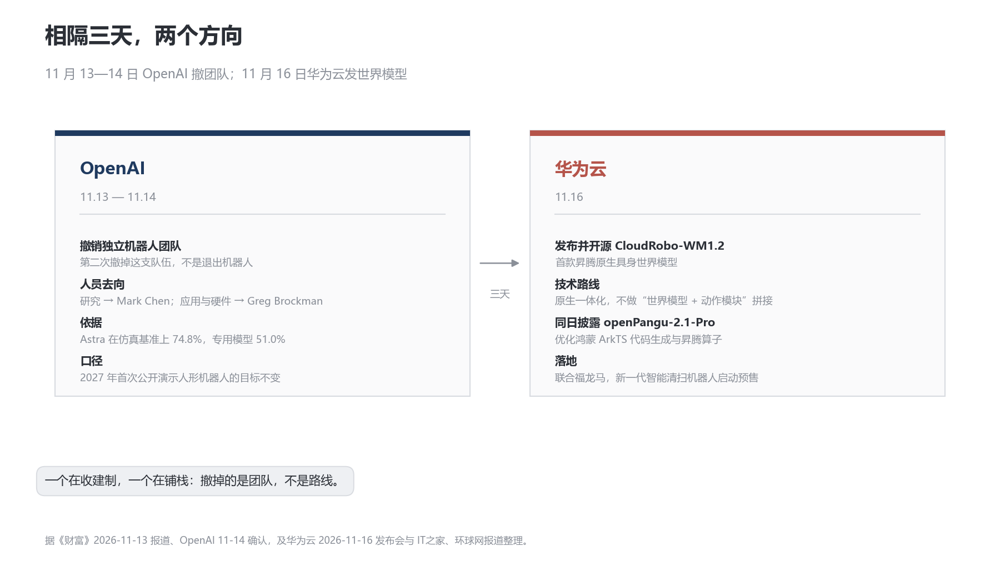
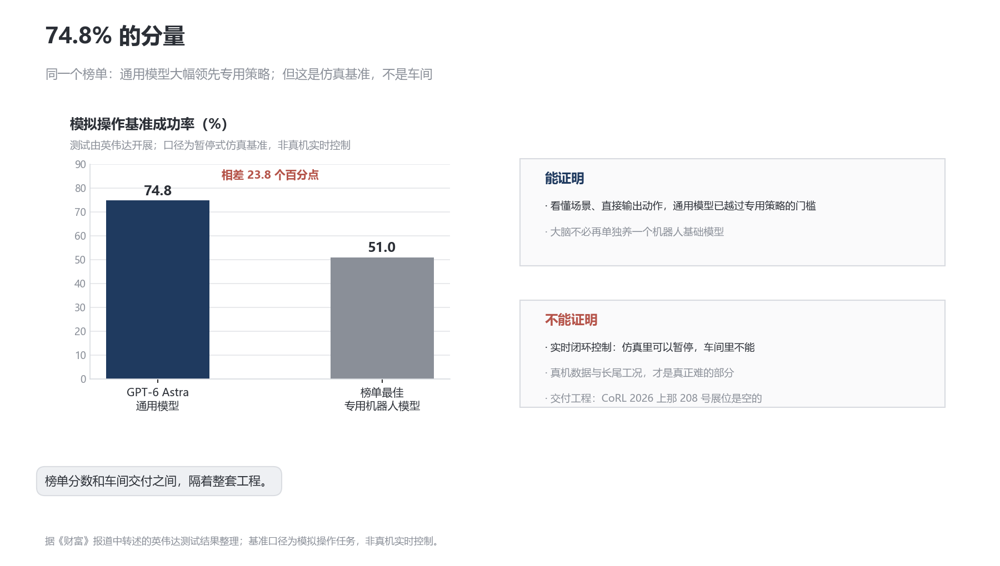
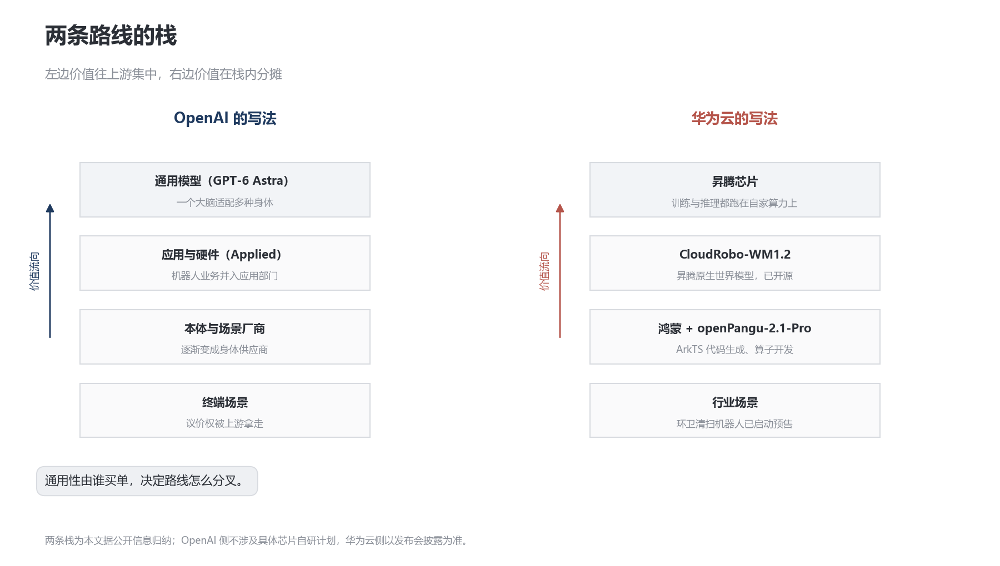

# OpenAI 拆掉机器人团队，华为云把世界模型焊在自家芯片上

11 月 13 日，《财富》报道 OpenAI 已撤销独立建制的机器人团队；14 日公司确认：机器人研究人员并入首席研究官 Mark Chen 领导的核心研究团队，应用机器人与硬件团队划归总裁 Greg Brockman 的 Applied 部门。这是它第二次撤掉这支队伍。

11 月 16 日，华为云发布并开源昇腾原生具身世界模型 CloudRobo-WM1.2，同时披露 openPangu-2.1-Pro 重点优化鸿蒙 ArkTS 代码生成与昇腾算子开发。

相隔三天，两条路线给出了相反的答案：一个在收，一个在铺。

## 一、OpenAI 不是放弃机器人，是把"大脑"收进通用模型

OpenAI 给《财富》的说法是：机器人仍是长期愿景的核心，首次公开演示人形机器人的目标仍定在 2027 年。撤掉的是**建制**，不是业务。

理由是能力：在英伟达开展的一项测试中，由 GPT-6 Astra 驱动的智能体在模拟操作基准上达到 **74.8%** 的成功率，而该榜单上表现最好的专用机器人模型是 51.0%。

这句话的潜台词是：**不需要再养一个专用的机器人基础模型了。**研究并入主研究团队、硬件并入应用部门，本身就是"大脑归通用底座、身体归应用"的组织写法。

## 二、74.8% 能证明什么，不能证明什么

能证明的是"看懂场景、直接输出动作"这件事，通用模型已经越过了专用策略此前守着的门槛。

不能证明的东西也要说清。这是**暂停式仿真基准**，不是实时闭环控制，也不是真机长跑——CoRL 2026 现场那张空着的 208 号展位就是提醒：榜单上的分数和车间里的交付，中间隔着一整套工程。

顺带一提成本。据报道 OpenAI 单季亏损约 109 亿美元。在这个数字面前，"把三条线合成两条线"既是技术判断，也是财务动作。

## 三、华为云走的是另一条：把模型焊在自己的栈上

CloudRobo-WM1.2 的定语很关键：**昇腾原生**、首款、开源。

技术上说，它没有走"世界模型 + 动作模块"的拼接路线，而是走原生一体化，用 PPA 多模态世界表征把感知与动作放在同一套表征里学。这话听起来抽象，落到生意上很具体：训练与推理都跑在昇腾上，整条链路不经过英伟达。

同一天披露的 openPangu-2.1-Pro 更能说明意图——它优化的不是跑分，而是**鸿蒙 ArkTS 代码生成和昇腾算子开发**。这是给开发者铺路：让写应用的人少写样板代码，让调芯片的人少踩算子坑。

落地也给了样本：华为云联合环卫装备龙头福龙马，新一代智能清扫机器人启动预售，并称昇腾云已在国内具身智能算力市场居前。

## 四、两条路线真正的差别：谁付"通用性"的钱

OpenAI 这条线，把通用性做到极致：一个大脑适配多种身体，机器人公司逐渐变成本体与场景的供应商，价值往上游的模型集中。

华为这条线，把通用性摊薄：芯片、模型、操作系统、场景打包，单点能力可以不是最强，但每一环都能自己控制，交付确定性高。

对创业者，这意味着两件事。做**专用机器人基础模型**的窗口正在变窄——通用模型免费把这块做掉了；做**本体、场景、数据**的窗口没有变，反而更值钱，因为那是通用模型暂时还拿不到的东西。

## 写在最后

一个在收建制，一个在铺栈。收的人相信大脑会通用，铺的人相信链路要自主。

两种判断都成立，因为它们赌的不是同一件事：前者赌模型能力继续外溢，后者赌供给安全比能力领先更值钱。

三年后如果机器人真的走进车间，赢家会是"最聪明的那颗大脑"，还是"最不容易断供的那条链"？

---

*事实来源：OpenAI 撤销独立机器人团队及人员去向（研究并入首席研究官 Mark Chen 团队，应用与硬件并入总裁 Greg Brockman 的 Applied 部门；公司称机器人仍是长期愿景核心、2027 年首次公开演示人形机器人的目标不变；此前已撤销过一次独立机器人团队），见《财富》2026-11-13 报道及 11-14 公司确认，经新浪财经、读懂AI时代、the-decoder 等转述；GPT-6 Astra 驱动的智能体在英伟达开展的模拟操作基准测试中成功率 74.8%、该榜单最佳专用机器人模型 51.0%，见同批报道；CoRL 2026 现场 208 号展位空置见相关现场报道。华为云 CloudRobo-WM1.2 于 2026-11-16 发布并开源、定位首款昇腾原生具身世界模型、采用原生一体化路线与 PPA 多模态世界表征、openPangu-2.1-Pro 优化鸿蒙 ArkTS 代码生成与昇腾算子开发、联合福龙马启动新一代智能清扫机器人预售，见华为云发布会、IT之家与环球网报道。“OpenAI 单季亏损约 109 亿美元”来自媒体测算报道，未获公司确认。图 3 的两条栈为本文据公开信息归纳。*
