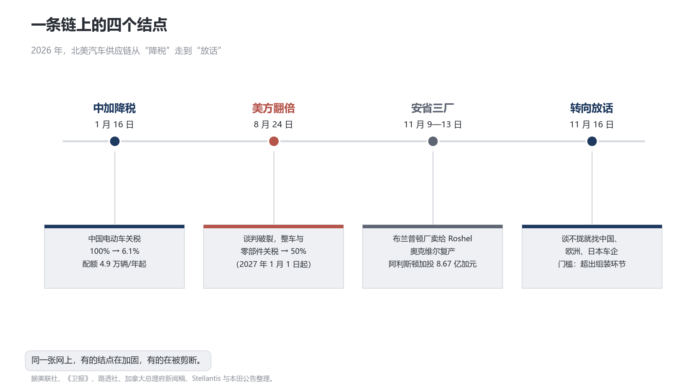
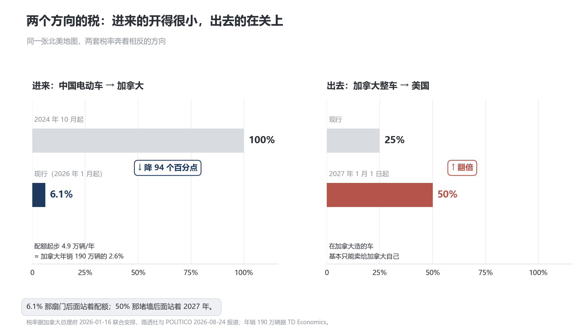
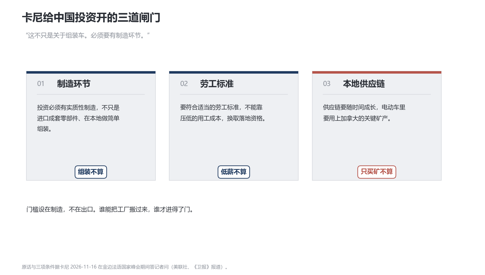

# 加拿大突然放话：可能转向中国车企？北美汽车供应链出现裂缝

11 月 16 日，柬埔寨金边，加拿大总理卡尼在法语国家峰会间隙对记者说：如果与美国的贸易谈判保不住一体化的北美汽车工业，加拿大可以转向中国汽车制造商。

选项他摆全了——欧洲、亚洲，"当然包括中国、日本"。

有人问，中国投资是不是对美谈判的筹码。他否认得很干脆："这不是杠杆。但有行动，就有反应。"

## 一、不满不是今天才有，账是八月记下的

8 月 24 日，美加贸易谈判破裂。特朗普宣布 2027 年 1 月 1 日起，加拿大汽车、卡车、零部件、钢铁的关税提到 50%——此前是 25%——并补了一句"我们不需要加拿大"。

翻倍之后，安省那条跨着底特律河的产线，账就算不过来了。加拿大汽车业 2024 年对 GDP 贡献 168 亿加元，直接雇 12.5 万人。产能九成在安省，它存在的前提就是"一体化"：零部件在边境两侧来回过几道，最后装成一辆车。

最近两周，安省三座厂给出了三种结局。

布兰普顿厂闲置三年，11 月 9 日被 Stellantis 卖给国防承包商 Roshel，原厂 3000 多人。

奥克维尔厂，福特重新开了起来，改产卡车。

阿利斯顿厂，本田 11 月 10 日宣布投 8.67 亿加元，其中 1.66 亿用来重启 2024 年关掉的发动机车间，保住 4000 个岗位，联邦和安省合计出资 4.69 亿。

一座卖掉，两座加钱。这不是崩塌，是同一张网上有的结点在加固、有的在被剪断。卡尼 16 日说的，是剪断的那部分。

## 二、门其实早就开了一条缝

中文舆论容易把这事读成"加拿大要转向了"。时间线更冷一点。

今年 1 月 16 日，卡尼访华，双方达成初步安排：加拿大把中国电动车 100% 的关税降到 6.1%，设关税配额，起步每年 4.9 万辆、逐年提高；中方相应下调油菜籽等农产品关税，三年后复审。

也就是说，中国车企的制度通道 1 月就通了。今天真正新的是后半句。

卡尼给中国投资划了条件：必须远远超出组装环节——要有实质制造，要有劳工标准，要有随时间成长的本地供应链，包括电动车里用上加拿大的关键矿产。原话是："这不只是关于组装车。必须要有制造环节。"

整车出口那扇门 1 月开了；工厂那扇门，今天才刚被指了一下。

## 三、泼冷水：三个数字，浇在三处

**配额太小。** 4.9 万辆对着加拿大一年约 190 万辆的新车市场，是 2.6%。这个量能养活进口商，养不活一座整车厂。

**方向太拧。** 中国车进加拿大交 6.1%，加拿大车进美国从 2027 年起交 50%。在加拿大造的车，基本只能卖给加拿大自己那 190 万辆。在北美建厂、绕开美国关税这条路，恰恰是被堵死的那条。

**人不同意。** 安省是汽车业心脏，省长福特一直反对 1 月那笔交易，说它威胁本地就业。这周联邦和安省刚给本田掏了近 5 亿加元——钱是投给现有车企的，不是留给新来的。

## 四、所以现在是什么

是一次表态，还不是一次落地。

卡尼没给"转向"设期限，美加谈判也没公布时间表。他给的是一个顺序：先谈美国，谈不拢就往欧洲、中国、日本走。而"往哪走"变成"跟谁签"，隔着投资审查、劳工标准、关键矿产几道闸门。

11 月 17 日，他在深圳见习近平，汽车制造是议题之一。这是最快的验证点：会后若只是"讨论继续"，那句话只是谈判桌上的分量；若出现具体投资安排或框架，裂缝才真的开始进风。

跟踪三个节点：深圳会面有没有落到具体接触；2027 年 1 月 1 日那 50% 是否真生效；美加谈判有没有重新排期。

卡尼说加拿大有"世界上最好的汽车工人"，希望他们在一体化北美市场充分就业，"但受美国贸易举措影响，这个市场的一体化程度降低了"。这段话里，没有一句是冲着中国说的。

他要的是工厂，不是伙伴。谁能给工厂，谁就是选项。

---

*事实来源：卡尼 2026 年 11 月 16 日在柬埔寨金边法语国家峰会期间的表态、"这不是杠杆，但有行动，就有反应"、中国投资须超出组装环节并满足劳工标准与本地供应链（含在电动车中使用加拿大关键矿产）等条件，据美联社、路透社、《卫报》、新加坡《海峡时报》、加拿大《环球邮报》报道，经京报网、环球网转述；11 月 17 日深圳会晤习近平、汽车制造为议题之一，据《海峡时报》《联合早报》。2026 年 8 月 24 日美加谈判破裂后，特朗普宣布 2027 年 1 月 1 日起对加拿大汽车、卡车、零部件与钢铁征收 50% 关税（此前 25%），据路透社、POLITICO、德国之声、France 24、半岛电视台。2026 年 1 月 16 日《中加经贸问题初步联合安排》：加拿大将中国电动车 100% 关税降至 6.1%、设起步 4.9 万辆/年的关税配额并逐年提高、三年后复审，中方下调油菜籽等农产品关税，据加拿大总理府新闻稿、加拿大全球事务部背景文件、路透社、CBC、《纽约时报》。安省三厂：Stellantis 于 11 月 9 日将闲置的布兰普顿厂售予国防承包商 Roshel（原雇 3000 余人），据《环球邮报》与 Stellantis 公告，联邦与安省 11 月 13 日仍在提供支持方案（CBC）；福特奥克维尔厂复产改产卡车（《环球邮报》）；本田 11 月 10 日宣布 8.67 亿加元投资、含 1.66 亿重启 2024 年关闭的发动机车间、维持 4000 个岗位，联邦出资 3.13 亿、安省 1.56 亿（本田公告、加拿大政府新闻稿）。行业规模：2024 年对 GDP 贡献 168 亿加元、直接就业逾 12.5 万人（加拿大创新科学与经济发展部）；2026 年加拿大新车销量预计 190 万辆、同比降 4.3%（TD Economics）。安省省长福特反对 1 月对华安排，据加媒报道。*
