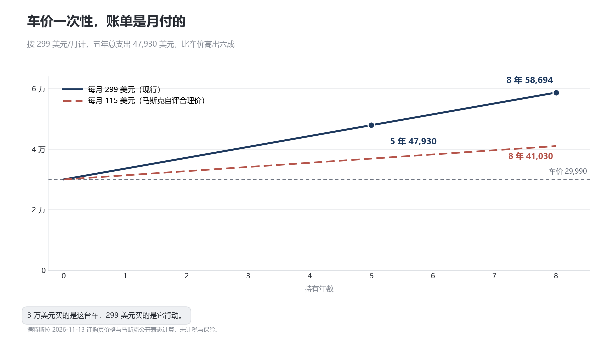
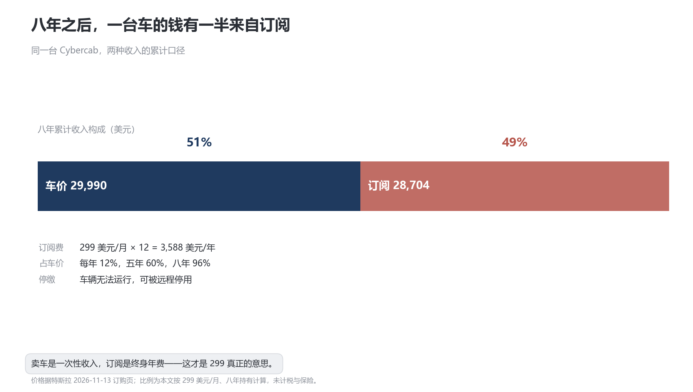
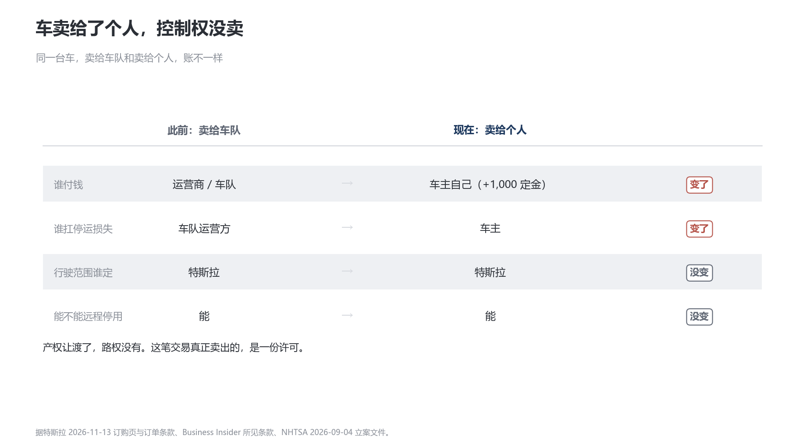

# 29990 美元买车，每月再交 299 美元：特斯拉把 Robotaxi 卖给个人了

11 月 13 日晚，特斯拉 @robotaxi 账号发帖：部分受邀客户可以个人用途订购 Cybercab。页面上的数字很干净——车价 29,990 美元未税，定金 1,000 美元、不可退，每月 299 美元的"自动驾驶订阅"，首月含在车价里。交付预计 12 月，首批在得州奥斯汀，每位受邀客户限购一台。

真正要读的不是 29,990，是 299。

## 一、3 万美元是入场券，不是总价

299 乘 12 是 3,588 美元，一年订阅费等于车价的 12%。五年 17,940 美元，加车价一共 47,930 美元，比车价高出六成。八年 28,704 美元，几乎等于再买一台。

这跟普通车上的智驾选装不是一回事。FSD 不开，车照样能开；Cybercab 不订阅，它就是一块两吨重的金属——车上没有方向盘，也没有油门和刹车踏板。按 Business Insider 看到的条款，订阅失效后特斯拉可以远程让车无法使用。

所以这笔月费买的不是功能，是"车能自己动"这件事本身。

定价自己也在试水。马斯克在帖子下面说 299"偏高"，合理价位应该跟现有车型的智驾订阅加联网服务相当，每月 115 美元上下。一个自己都说高的价格先挂出来卖，这不是定价，是探底。

## 二、这件事为什么要单独立一条线

过去十年，高阶智驾的收入都挂在"选装"上：一次买断，或者月付 FSD，规模受制于愿意选的人有多少。

Cybercab 把它改成了前置条件——不订阅，车不能运行。每卖出一台车，就锁住一条按月计费的现金流，可调价、可停用、可远程执行。

对特斯拉，这是用硬件让利换订阅回收：车价贴着 3 万美元卖，钱从后面收。

对供应链，这是把成本从选配挪到标配。没有方向盘和踏板的车，必须全套线控转向与制动、双冗余、每台预置算力，不能像后装套件那样省掉。这些是卖一台收一台的钱，而且和订阅模式绑在一起。

## 三、三道限制，先把话说清楚

地理围栏。车只能在已经开通 Robotaxi 的城市里跑。首批交付在奥斯汀，范围限于得州少数几座城市。

监管。9 月 3 日特斯拉在奥斯汀投入约 1000 台 Cybercab 运营，第二天 NHTSA 就立案，查的是它有没有绕开"无方向盘车辆需申请豁免"的程序。

产权与控制权分离。车是你买的，能去哪、能不能动，由特斯拉决定。这不是买车，是买一张许可，附带一台车。

再加每人限购一台。这个动作的性质很清楚——不是走量，是试点。

## 四、验证点只有一个

不是交付量，是转化率：受邀的人里，有多少真掏了那 1,000 美元不可退的定金。

这个数字特斯拉不会公布。能看的替代指标有三个：12 月的实际交付台数；299 会不会降到马斯克自己说的 115；以及最关键的续订率——三个月后若大量车主退订，"硬件+订阅"就不是商业模式，只是一次定价实验。

跑通的真正意义不在特斯拉。它证明的是高阶智驾能脱离整车毛利单独收费，并且有人愿意为"车能自己动"按月付钱。这条路径一旦成立，做线控底盘和车规算力的公司都会多一个客户。

跑不通，29,990 就只是一次限量营销，顺便测了一下市场对自动驾驶的真实支付意愿。

两种结果都有价值。区别是：前者要转化率，后者只要话题度。

---

*事实来源：特斯拉 @robotaxi 账号 2026 年 11 月 13 日晚发布个人用途订购邀请，订单页显示车价 29,990 美元（未税）、1,000 美元不可退定金、每月 299 美元 Autonomy Subscription（含首月）、预计 2026 年 12 月在得州奥斯汀交付、每位受邀客户限购一台，据路透社、TechCrunch、The Verge、Business Insider、IT之家、界面新闻、21 世纪经济报道；车辆取消方向盘、油门与刹车踏板、后视镜，不订阅则无法运行，远程停用条款据 Business Insider 所见订单条款；马斯克称 299 美元偏高、合理价位应与现有车型智驾订阅加联网服务相当（约每月 115 美元），据 21 世纪经济报道、界面新闻；首批交付范围限于得州少数城市、运营范围与已开通 Robotaxi 区域一致，据界面新闻、IT之家、Not a Tesla App；特斯拉 9 月 3 日在奥斯汀投入运营、NHTSA 于 9 月 4 日就约 1000 台 Cybercab 的自我认证合规性立案（调查编号 AQ26002），据路透社、美联社、ABC News。订阅费累计与占比为本文据公开价格计算。*
