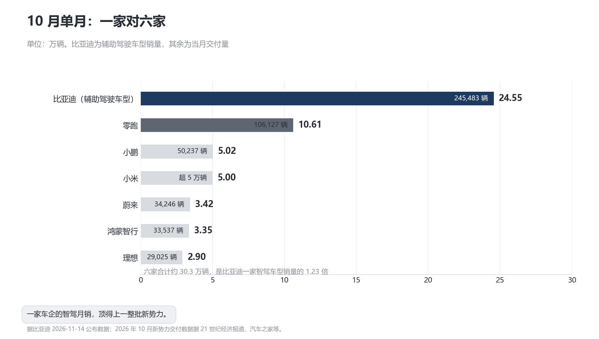
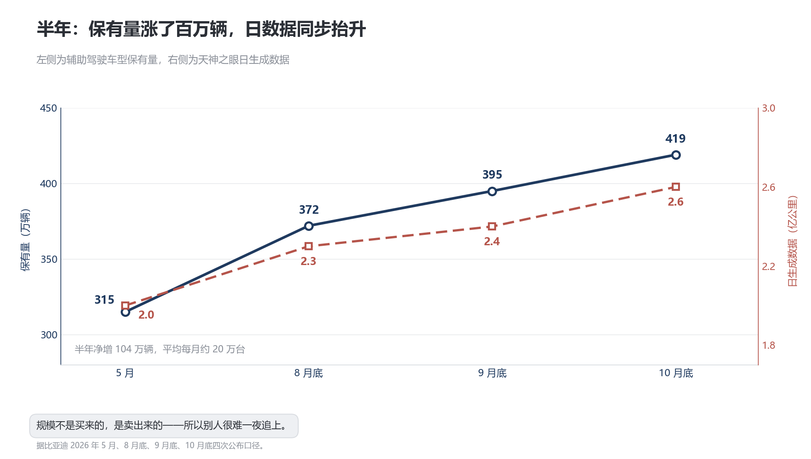
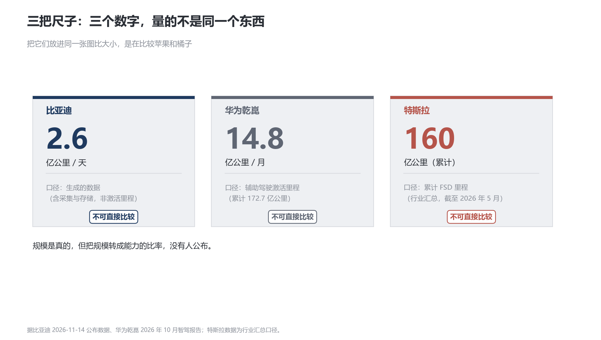

# 419 万辆、每天 2.6 亿公里：比亚迪把智驾拖进数据规模战

11 月 14 日，比亚迪公布了一组数：截至 10 月 31 日，辅助驾驶车型保有量超过 419 万辆；10 月单月这类车型卖了 24.55 万辆；天神之眼辅助驾驶每天生成的数据超过 2.6 亿公里。

三个数字指向同一件事——智驾的竞争单位，正在从"有没有这个功能"变成"有多少台车在替你跑路"。

## 一、先把口径掰开

419 万辆是**累计销量**口径，不是每天有 419 万辆车在路上开。而且这个范围包含搭载华为乾崑智驾的车型，2.6 亿公里只对应天神之眼。

2.6 亿公里是什么概念？按赤道四万公里算，一天绕地球约 6500 圈。

增长曲线更能说明问题：5 月 315 万辆、日数据 2 亿公里；8 月底 372 万辆、2.3 亿公里；9 月底 395 万辆、2.4 亿公里；10 月底 419 万辆、2.6 亿公里。不到半年净增逾百万辆，平均每月新增约 20 万台带辅助驾驶的车。

## 二、规模为什么变成了壁垒

端到端模型的训练素材是真实行驶样本，而样本的价值极不均匀：并线、跟车这类常规场景到处都是，异形障碍物、无标线乡村路、暴雨积水这类长尾场景才是难点。长尾场景的采集量，基本与总里程成正比。

规模差一个数量级，含义很直接：同一个罕见场景，一家见了十次，另一家见了一千次。前者要靠工程师补规则，后者可以让模型自己收敛。

比亚迪海洋网总经理张卓的说法是：数百万辆车的数据积累，是天神之眼 B 在 2026 年体验提升的直接原因，系统开始通过海量真实数据学习复杂博弈，而不是依赖工程师逐条手写规则。

这就是为什么保有量本身能成为独立壁垒——它不是营销数字，它决定迭代速度和标注成本。

## 三、对比：确实不在一个数量级

10 月单月，零跑 10.6 万辆、小鹏 5.0 万辆、小米超 5 万辆、蔚来 3.4 万辆、鸿蒙智行 3.4 万辆、理想 2.9 万辆。六家合计约 30.3 万辆。

比亚迪单是辅助驾驶车型就有 24.55 万辆，接近这六家合计的八成。

唯一同一量级的对手是华为：搭载量 9 月破 200 万辆，乾崑智驾累计辅助驾驶里程 10 月底达 172.7 亿公里，10 月单月 14.8 亿公里，月活用户占比 95.2%。注意，它是供应商模式——车不是它的，数据是它的。

## 四、冷水：三把尺子，量的不是同一个东西

比亚迪的 2.6 亿公里是"生成的数据"，华为的 14.8 亿公里是"辅助驾驶激活里程"，特斯拉的 160 亿公里是累计 FSD 里程。三个数字放在一张图里很好看，但它们不同源、不同口径，直接比大小是错的。

更关键的是转化率没人公布：每天 2.6 亿公里里，有多少被真正用于训练？多少进了闭环？多少只是存着？规模是必要条件，不是充分条件。

还有一条容易被忽略：保有量不等于同时在跑。长尾覆盖率取决于激活率和使用率，而这恰恰是各家最少公开的指标——华为的 95.2% 月活是为数不多的样本。

## 五、门槛换了

过去三年，智驾的发布会讲的是"我们有无图 NOA""我们有多少个城市"。现在这套话术正在失效，因为城市数可以一夜之间开放，车队规模不行。

新的门槛由三个数组成：在路上的车有多少、其中多少人真的在用、用出来的里程能不能变成模型更新。第一个数比亚迪最大，第二个数华为公开得最完整，第三个数没有人公布。

接下来看三件事：天神之眼会不会开始公开激活里程和月活；419 万辆到 500 万辆要用几个月；以及新势力是不是把宣传口径从"接管次数"换成"累计里程"——换口径这个动作本身，就是承认门槛变了。

数据规模不是护城河的全部，但它把讲故事的成本抬高了。以后再说"我们的算法更强"，得先回答一个问题：你见过多少次。

---

*事实来源：比亚迪汽车 2026 年 11 月 14 日公布数据（截至 2026 年 10 月 31 日辅助驾驶车型保有量超 419 万辆、10 月销售 245,483 辆、天神之眼每天生成数据超 2.6 亿公里），及 5 月 315 万辆/2 亿公里、8 月底 372 万辆/2.3 亿公里、9 月底 395 万辆/2.4 亿公里等历史口径，据 IT之家、第一财经、界面新闻、第一电动网、凤凰网；"保有量含搭载华为乾崑智驾车型、2.6 亿公里仅对应天神之眼、419 万辆为累计销量口径"见第一电动网对官方海报脚注的说明；"2.6 亿公里约为绕地球 6500 圈"为第一电动网按赤道周长换算；张卓关于数据积累与天神之眼 B 体验提升的表述见凤凰网、IT之家转述。华为乾崑智驾截至 2026 年 10 月 31 日累计辅助驾驶里程 172.7 亿公里、10 月单月 14.8 亿公里、月活占比 95.2%，搭载量 9 月突破 200 万辆，据华为智能汽车解决方案官方报告及新浪、ATC 转述。2026 年 10 月新势力交付：零跑 106,127 辆、小鹏 50,237 辆、小米超 5 万辆、蔚来 34,246 辆、鸿蒙智行 33,537 辆、理想 29,025 辆，据 21 世纪经济报道、汽车之家、BitAuto 汇总；六家合计约 30.3 万辆与"接近八成"为本文计算。特斯拉 FSD 累计里程 160 亿公里（100 亿英里）为行业汇总口径，非本文一手核实。本文数据口径差异的提示据第一电动网与华为官方说明整理。*
