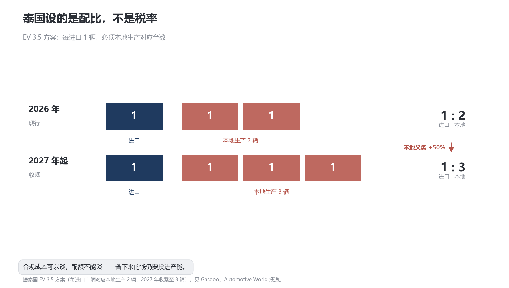
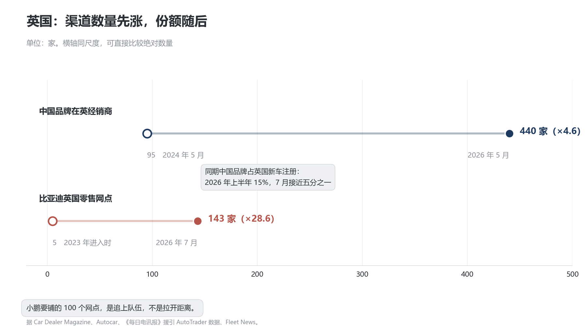
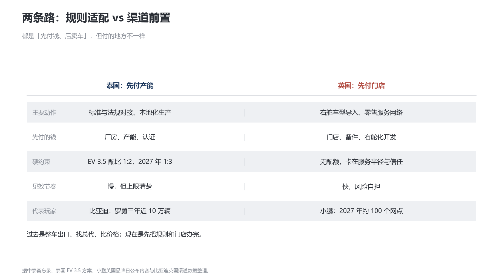

# 中国车企出海变打法：一边降泰国合规成本，一边在英国先铺 100 个网点

11 月 13 日，两件事隔着一个时区同时发生。曼谷，李强与泰国总理阿努廷会谈当天，泰国工业部与中国工信部签署汽车产业合作谅解备忘录。伦敦，小鹏办首届英国品牌日，宣布未来一年导入 5 款右舵车、2027 年在英国铺到约 100 个零售及服务网点。

一份是规则文件，一份是门店清单。两件都不像"卖车"，但都是卖车之前必须先付的钱。

## 一、泰国：省下的不是关税，是审批和试错

备忘录覆盖五个领域：投资、贸易、标准与法规、产业管理、政策措施，有效期五年。

关键是第三项。中国车企在泰国做本地化，最贵的往往不是厂房，是"这套东西按谁的规矩做"——同一块电池包，两套标准、两次认证、两轮整改，周期按月算。中泰把标准与法规放进同一个框架，等于把重复测试和来回确认的成本压下来。

泰国的分量也够：东南亚最大汽车生产基地，中国品牌已拿下当地约三成市场份额，纯电市场的占比约九成。

## 二、但泰国真正的门槛不在合规成本

泰国给电动车设的是配比，不是税率。按 EV 3.5 方案，每进口 1 辆，本地要造 2 辆；2027 年这个比例收紧到 1 比 3。

比亚迪是现成的样本：罗勇工厂 2024 年 9 月投产，三年下来产量逼近 10 万辆，正在从"供应泰国"转向"从泰国出口"。

所以备忘录降低的是做对文件的成本，配额决定的是你有没有资格卖。前者是效率问题，后者是准入问题。合规成本省下来的钱，最后仍要投进产能。

## 三、英国：先铺网点，是因为右舵市场没有捷径

小鹏公布的清单很具体：MONA L03 起售 32,990 英镑、G9L 64,990 英镑起（顶配 78,990 英镑），2027 年 1 月、2 月先后交付；未来 12 个月 5 款右舵车，搭载下一代 NGP（VLA 2.0）；6 个月内在伦敦、曼彻斯特开 3 家旗舰店；2027 年约 100 个零售及服务网点，签 20 家经销商与租赁合作；英国子公司已成立，改为直营。

右舵车的固定成本是硬的：右舵化开发、认证、备件体系，一款车一套钱。但真正卡住中国品牌的是服务半径——英国用户买车看的是"最近的店多远"，小鹏给的目标是 30 分钟车程。

## 四、这不是新打法，是补课

把 100 个网点当新闻，会高估它。比亚迪 2023 年进英国时只有 5 家零售点，到 2026 年 7 月已有 143 家，同期累计销量破 10 万辆。中国品牌在英国的经销商总量，从 2024 年 5 月的 95 家涨到 2026 年 5 月的 440 家。

份额也在动：2026 年上半年中国品牌占英国新车注册 15%，7 月接近五分之一。

也就是说，小鹏的 100 个网点是追上队伍，不是拉开距离。

## 五、两条路，同一件事

泰国是规则适配：把合规成本压下去，但配额决定天花板，见效慢、上限清楚。

英国是渠道前置：没有配额墙，但要先付门店、备件、认证的钱，见效快、风险自担。

两者都是"先付钱、后卖车"，都跟十年前那套"整车出口、找总代、比价格"不是一回事。

## 六、这一轮的竞争线

出海竞争正在从产品价格战，转到规则适配和本地渠道资产。这两个东西都不出现在配置表上，也都不便宜。

接下来看三个数：泰国 2027 年 1 比 3 的配比执行得多严；小鹏英国 100 个网点兑现了几成；以及比亚迪、奇瑞、零跑谁先在右舵市场把网点铺过 200 家。

前两个能查，第三个要等。但方向已经很清楚——能不能卖，越来越不取决于车好不好，取决于你在当地把规则和门店这两件事办到了哪一步。

---

*事实来源：中泰汽车产业合作谅解备忘录于 2026 年 11 月 13 日在曼谷签署（此前 11 月 10 日泰国内阁批准草案），签署方为泰国工业部与中国工业和信息化部，覆盖投资、贸易、标准与法规、产业管理、政策措施五大领域，有效期 5 年，涉及整车与零部件、电动车、电池生产与回收；同日李强在曼谷与泰国总理阿努廷会谈。据中国政府网、泰国总理府新闻稿、MGR Online、泰国头条新闻、中财网及中泰证券、国泰海通研报。泰国 EV 3.5 方案要求每进口 1 辆对应本地生产 2 辆、2027 年收紧至 1 比 3，据 Gasgoo、Automotive World；中国品牌在泰市场份额约三成、占纯电销量约九成，据 Rhodium Group 中国跨境观察；比亚迪罗勇工厂 2024 年 9 月投产、三年产量逼近 10 万辆，据泰国《每日新闻》。小鹏 2026 年 11 月 12—13 日伦敦首届英国品牌日（The Next Chapter）：MONA L03 起售 32,990 英镑、G9L 起售 64,990 英镑（顶配 78,990 英镑），L03 于 2027 年 1 月、G9L 于 2 月交付；未来 12 个月 5 款右舵车型并引入搭载 VLA 2.0 的下一代 NGP；6 个月内在伦敦与曼彻斯特开设 3 家旗舰店；2027 年在英建成约 100 个零售及服务网点、达成 20 项经销商与租赁合作；英国子公司成立并转为直营；目标 2028 年成为英国领先高端电动车品牌、服务半径约 30 分钟车程，据小鹏集团官网、界面新闻、老虎证券、AASTOCKS。比亚迪 2023 年进入英国、零售点由 5 家增至 2026 年 7 月的 143 家、英国累计销量突破 10 万辆，据 Car Dealer Magazine、Autocar；中国品牌在英经销商由 2024 年 5 月 95 家增至 2026 年 5 月 440 家，据《每日电讯报》援引 AutoTrader 数据；2026 年上半年中国品牌占英国新车注册 15%（约 17.5 万辆/113 万辆），据 Fleet News；7 月接近五分之一，据 Autocar。本文对"追上队伍而非拉开距离"的判断为作者分析。*