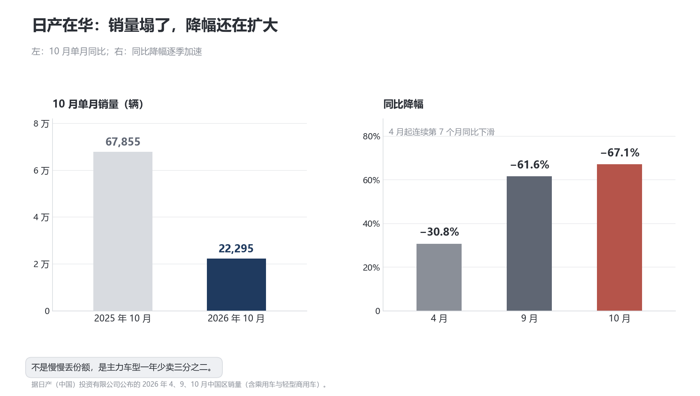
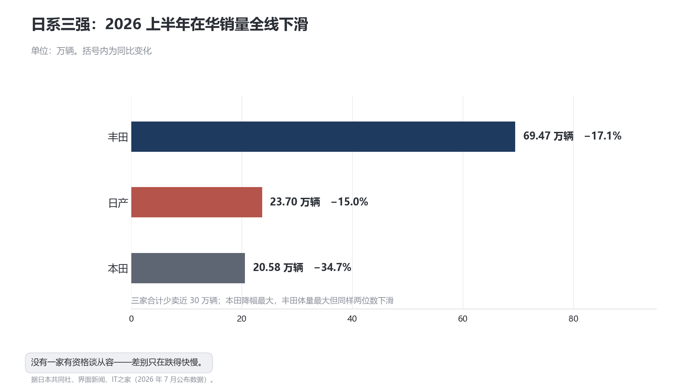
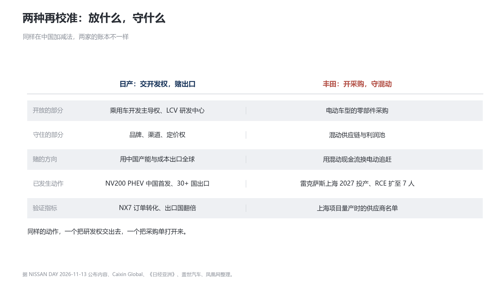

# 日产突然改口：中国不只是市场，还是创新中心和全球出口基地

11 月 13 日，珠海。日产（中国）、东风日产、郑州日产一起办了场 NISSAN DAY。

台面上的东西不少：品牌宣言从"尽兴由 NI"换成"人车生活 因你而变"；NX7 开启预售，12.99 万到 14.99 万元；NV200 PHEV 全球首秀；NISMO 正式进入中国。

但真正值钱的是一句定位。CEO 伊凡·埃斯皮诺萨在视频致辞里说，日产与合资伙伴在中国持续投入，目标"不止是在本土市场的成功"；中国在日产全球版图中正扮演愈发重要的角色。

过去三十年，合资车企的剧本是外资给技术、中方给市场。这句话把剧本反过来念了一遍。

## 一、反转不是口号，是三条权限在挪

看外资车企是不是真把中国当创新中心，只需看它交出了什么。

日产交了三样。一，推动总部把**乘用车产品开发的主导权**交给中国团队。二，把日产**全球唯一的轻型商用车研发中心**落在郑州，和总部一起面向全球开发皮卡。三，NV200 PHEV 的**全球首秀放在中国**——首发地变了，意味着产品定义的人变了。

第三点最硬。一款车在哪里全球首发，等于承认这个市场的需求定义值得让全世界照着做。

## 二、但先别急着感动：这是被销量逼出来的

日产 2026 年 10 月在华销量 22,295 辆，同比降 67.1%，去年同期 67,855 辆。这是自 4 月以来连续第 7 个月同比下滑：4 月 32,051 辆、降 30.8%，9 月 23,658 辆、降 61.6%。

产能摆在那儿，销量塌了。"把中国变成出口基地"因此不是远见，是唯一能同时解决产能和成本的解法。

马智欣给了时间表：2026 年底前把合资公司产的车卖到 30 多个国家，2027 年翻倍。

## 三、丰田走的是另一条：换供应商，不换品牌

同期，丰田的路子完全不同。

据《日经亚洲》报道，丰田走双轨：电动车跳出长期依赖的日系关联供应商，转向中国本地采购，为的是追上本土厂商的开发速度和成本；混动继续依托原有体系，稳住现金流。

丰田执行副总裁宫崎洋一把话说明白了：按竞争力采购，"不论国籍或集团归属"。

代价已经出现。雷克萨斯上海金山项目竞标，几个核心环节中国本土供应商拿走较多订单，丰田体系内的日本零部件企业多项落败。那款纯电 SUV 计划 2027 年投产、在中国全球首发。

研发这侧，丰田 2026 年推行 RCE（中国首席工程师）制度，团队从 4 人扩到 7 人，把中国市场产品的研发决策权交给本土。

## 四、两家的差别在"放什么、守什么"

日产放的是开发权，赌的是出口：用中国的成本和速度，造车卖给全球。它守的是品牌和渠道——车还是日产的车，认证、渠道、定价权都在总部手里。

丰田放的是采购权，守的是混动利润池。它在中国混动市场占六成以上，这块年销 50 到 60 万辆，是它敢在电动上慢慢追的本钱。

一个是把工厂变成出口基地，一个是把供应链换成中国籍，目的都是用中国的效率补别处的亏。

## 五、需要泼的一盆水

出口这条路没那么顺。中国产的电动车卖到欧洲要过关税，卖到美国基本关着门，能上量的多半是中东、拉美、东南亚——单价低、渠道散，靠走量不靠品牌溢价。

还有一层：开发权、采购权、定价权是三件事。若零部件仍从原体系买、价格仍由总部定，"创新中心"就只是个研发外包部门。

## 六、看什么

这一轮日系在华再校准，不是"看好中国"的表态，是"离不开中国的成本和速度"的现实。三家上半年在华销量全线下滑，没有一家有资格谈从容。

验证日产，看三个数：NX7 的订单能转化多少；30 多个国家到 2027 年翻倍兑现了几成；郑州 LCV 中心的全球首款车由谁定义。

验证丰田，看一个名单：雷克萨斯上海项目量产时的供应商构成。

口号可以先喊，名单不会撒谎。

---

*事实来源：NISSAN DAY 于 2026 年 11 月 13 日在珠海国际会展中心举行，由日产（中国）、东风日产、郑州日产共同举办；品牌宣言由"尽兴由 NI"升级为"人车生活 因你而变"，代言人陈伟霆；NX7 开启预售，320 Pro 12.99 万元、320 Max 13.99 万元、320 Ultra 激光雷达版 14.99 万元；NV200 PHEV 全球首秀；2027 款锋坦 Frontier Pro PHEV 亮相；NISMO 品牌宣布进入中国市场。CEO 伊凡·埃斯皮诺萨视频致辞"目标不止是在本土市场的成功"及中国在全球版图中角色愈发重要，据日产中国官网新闻稿、界面新闻、BitAuto、网易、新浪财经。乘用车产品开发主导权移交中国团队、全球唯一轻型商用车研发中心落户郑州，据网易、BitAuto 报道；2024 年启动新能源转型以来已在华推出 Z9、N7、锋坦 Frontier Pro、N6、NX8 五款新能源车，据 BitAuto。出口时间表（2026 年底前销往 30 多个国家、2027 年翻倍）由日产中国管理委员会主席马智欣（Stephen Ma）在活动现场披露，据 Caixin Global。在华销量：2026 年 10 月 22,295 辆、同比降 67.1%（去年同期 67,855 辆），4 月 32,051 辆、降 30.8%，9 月 23,658 辆、降 61.6%，自 4 月起连续第 7 个月同比下滑，据日产（中国）投资有限公司公布数据及盖世汽车；2026 年上半年 23.70 万辆、降 15.0%，丰田 69.47 万辆、降 17.1%，本田 20.58 万辆、降 34.7%，据日本共同社、界面新闻、IT之家。丰田在华供应链重构（电动转向中国本地采购、混动依托原有体系）、执行副总裁宫崎洋一"不论国籍或集团归属"表态、雷克萨斯上海金山项目 2027 年投产并在中国全球首发、中国供应商在车身与电池相关件及控制线束竞标中获较多订单，据《日经亚洲》报道及盖世汽车、凤凰网、新华财经转述。丰田在中国混动市场占比六成以上、年销 50–60 万辆约当在华总销量三分之一，为瑞穗银行高级首席研究员 Jin Tang 估计，经凤凰网转述。RCE（中国首席工程师）制度 2026 年推行、团队由 4 人扩至 7 人，据腾讯新闻、观察者网。本文对"开发权与采购权、定价权分离"的判断及出口市场结构分析为作者观点。*