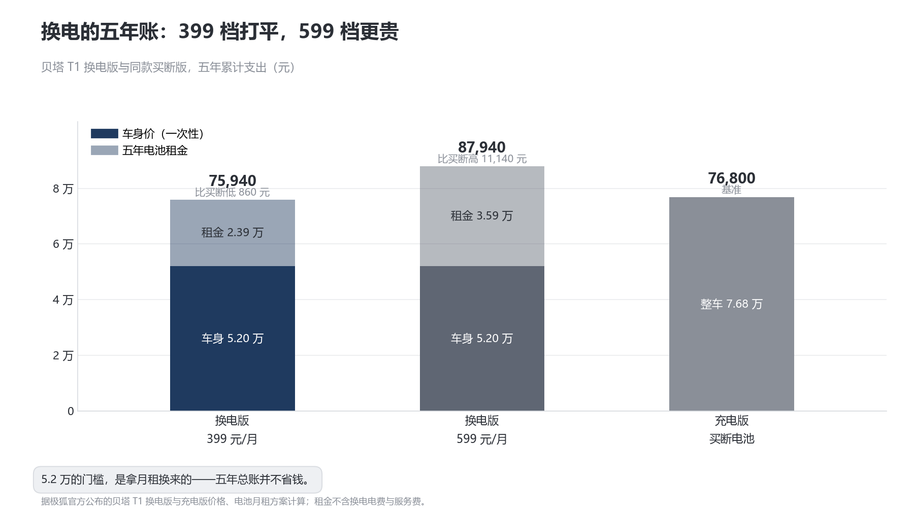
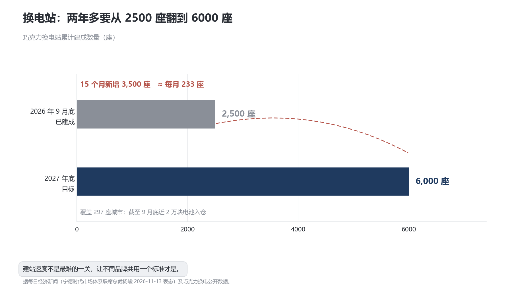
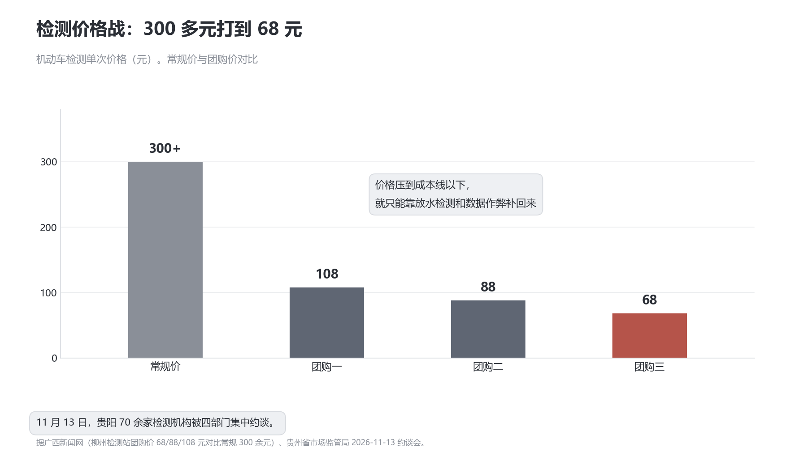

# 新车不好卖，车圈开始经营 3.7 亿辆存量车：换电 6000 座与检测约谈同时来了

11 月 13 日，两件事同一天。

北京，极狐发布"极+时代"全民换电生态，贝塔 T1 换电版上市，电池租用后车身价 5.20 万元和 6.00 万元。

贵阳，贵州省市场监管局联合省发改委、省公安厅、省生态环境厅，约谈 70 余家机动车检测机构和行业协会。

一场在卖车，一场在管年检。看着不相干，说的是同一句话：新车不好卖之后，车圈开始经营存量车——截至 10 月底，全国汽车保有量 3.7 亿辆。

## 一、5.2 万卖的不是车，是"电池归谁"

先把账算清楚。

5.20 万元是车身价，电池按月租：399 元一档（月里程 5,000 公里）、599 元一档（不限里程）。同款车充电版（电池买断）售价 6.88 万和 7.68 万元。

五年总账：5.20 万 + 399×60 = 7.59 万元；599 档 8.79 万元；充电版 550 PRO 是 7.68 万元。

也就是说，399 档五年下来和买断电池几乎打平，只差 860 元；599 档则明显更贵——而这还没算每次换电的电费和服务费。

所以换电版不负责让人省钱。它做的是把一次性支出拆成首付加月费，顺便把电池衰减、暗伤、残值三件麻烦事从车主账上挪走。极狐与宁德时代的分工也印证这点：极狐管整车和换电结构，宁德时代管电池安全和健康监测。

真正的生意在电池那头：巧克力换电在运行时实时监测 53 项指标，每次进站再加 13 项深度体检，共 66 项。一块电池从出厂到退役，每次进站都留一条记录——这才叫经营资产。

## 二、6000 座是个什么量级

截至 9 月底，巧克力换电站累计建成超 2,500 座，近 2 万块电池入仓。宁德时代市场体系联席总裁杨峻给的目标是：2027 年建成 6,000 座，覆盖 297 座城市。

从 2,500 到 6,000，是 15 个月再建 3,500 座，约合每月 233 座。这个速度不低，但难的不是建站，是把不同品牌的车塞进同一套标准。10 月 22 日北汽与宁德时代签的协议，核心就是让北汽旗下多品牌车型接入巧克力生态，冲刺百万辆换电车型。

首款合作车型贝塔 S3，上市以来 70% 的用户选了换电版——低价车身确实能把人拉进来。

## 三、检测约谈：给存量车拉一条底线

贵阳那场会整治四件事：低价恶性竞争、价格串通、垄断、篡改检测数据。

低价到什么程度？柳州此前出现 68 元、88 元、108 元的团购价，而常规检测价是 300 多元；有的地方优惠价不足百元。

价格打到成本线以下，就只能靠"放水检测"和数据作弊补回来——这正是四部门把价格监管、道路安全、检测合规、环保、反垄断摆在一张桌子上的原因。

行业本身也在收缩：全国机动车检测机构约 1 万余家，同比下降 7%，进入"减量提质"。需求端却是刚性的——3.7 亿辆车，每辆每年都要过这一关。

## 四、两件事的同一个底层

增量还在，只是不好赚了。上半年新注册汽车 1,051 万辆，仍在高位，可价格战把新车利润压得很薄。

钱于是往存量走：补能、检测、电池、保险、维修。政策也在这一侧密集落子——10 月生态环境部与市场监管总局推进排放检验机构监管改革，目标是 2027 年底基本建成全国统一的检验检测智慧监管平台。

换电是在存量上做加法：把电池变成可运营、可监测、可梯次利用的资产。检测约谈是在存量上做减法：把靠低价和数据造假活着的供给清出去。

一加一减，方向一致——从"卖更多车"，转向"经营每一辆车的一生"。

## 五、看什么

三个数：6,000 座能不能在 2027 年兑现；百万辆换电车型目标对比眼下的实际量级；检测价格能不能回到成本线以上。

还有一个更硬的问题：换电的收入结构。车卖得便宜，钱得从月租、电费、服务费里收。一年 4,788 元，这门生意的现金流好不好，要看车主愿意留多久。

车卖一次，服务收十年。这才是存量市场的算法。

---

*事实来源：极狐于 2026 年 11 月 13 日晚在北京举办全民换电生态暨贝塔系列新品发布会，发布与宁德时代共建的"极+时代"全民换电生态；贝塔 S3 535 ULTRA+ 激光换电版租电价格 7.88 万元，贝塔 T1 换电版 530 PRO、530 MAX 电池租用后车身价分别为 5.20 万元、6.00 万元；电池月租两档为 399 元/5000 公里、599 元/不限里程；充电版 450 PRO 售价 6.88 万元、550 PRO 售价 7.68 万元，据极狐官方、每日经济新闻、汽车之家、BitAuto、界面新闻。截至 2026 年 9 月底巧克力换电站累计建成超 2,500 座、近 2 万块电池入仓，宁德时代市场体系联席总裁杨峻称计划 2027 年建成 6,000 座换电站、覆盖 297 座城市，据每日经济新闻；北汽集团与宁德时代于 2026 年 10 月 22 日签署全面深化换电业务合作协议，北汽将推动旗下多品牌车型接入巧克力换电生态、冲刺百万辆换电车型目标，据界面新闻、BitAuto；贝塔 S3 上市以来 70% 用户选择换电版，据每日经济新闻；换电检测为运行中实时监测 53 项指标加每次进站 13 项深度体检，据界面新闻。2026 年 11 月 13 日贵州省市场监管局联合省发展改革委、省公安厅、省生态环境厅召开贵阳市机动车检测行业集中约谈会，70 余家检测机构及行业协会负责人参会，整治低价恶性竞争、价格串通、垄断、篡改检测数据，据贵州省市场监管局、中新网贵州、经济观察网、澎湃新闻。截至 2026 年 4 月 30 日全国机动车检测机构 1 万余家、同比下降 7%，据全国组织机构统一社会信用代码数据服务中心数据（《经济日报》报道）；柳州检测站 68、88、108 元团购价对比常规 300 余元，据广西新闻网；生态环境部与市场监管总局 2026 年 10 月推进机动车排放检验机构监管改革、目标 2027 年底基本建成全国统一检验检测智慧监管平台，据澎湃新闻及市场监管总局方案。截至 2026 年 10 月底全国汽车保有量 3.7 亿辆；2026 年上半年新注册登记汽车 1,051 万辆，据公安部交通管理局。文中五年总支出、打平差额 860 元与"每月 233 座"均为本文据公开价格与时间计算。*

*注：文中"3.7 亿辆"为汽车保有量口径（非机动车 4.76 亿辆）。*