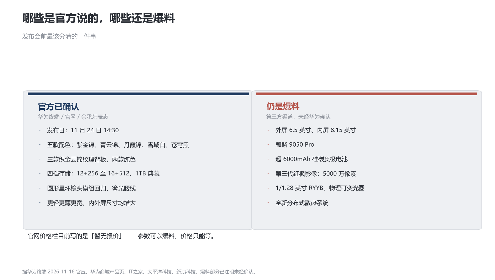
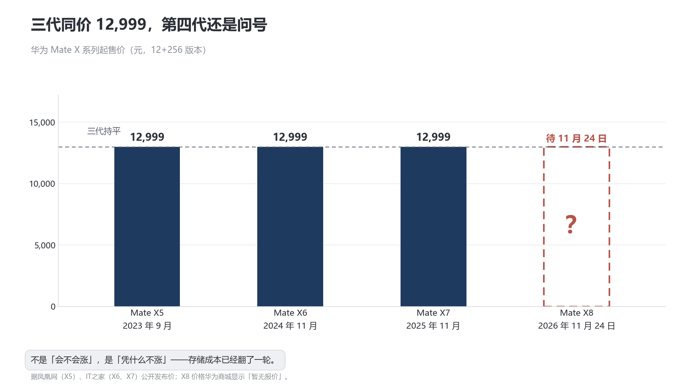
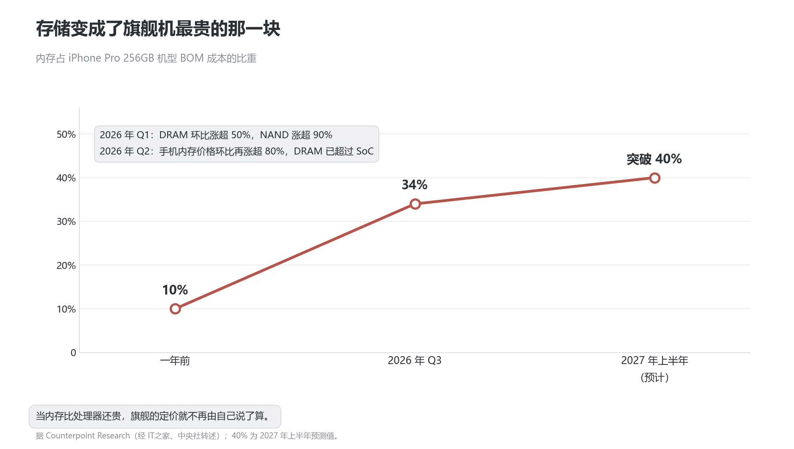

# 华为 Mate X8 定档 11 月 24 日：三代同价 12999，这次可能要破了

11 月 16 日，华为终端官宣：Mate X8 及全场景新品发布会定档 11 月 24 日 14:30。

官网当天就挂出了产品页并开启预约，五款配色全部公开：紫金锦、青云锦、丹霞锦、雪域白、苍穹黑。存储分四档——标准版 12+256、12+512，典藏版 16+512、16+1TB。余承东和何刚的微博小尾巴都已显示"Mate X8 典藏版"，等于提前确认这个版本还在。

唯独价格栏写着"暂无报价"。

## 一、官方说了什么，什么还只是爆料

这类发布前的稿子最容易出错的地方，是把爆料写成参数。先分层。

**官方已确认**：发布日；五款配色，其中"锦"字三款用织金云锦纹理背板，雪域白与苍穹黑是纯色方案；圆形"星环"镜头模组回归；轴盖新增鎏光腰线；机身相比前代更轻、更薄、更宽，内外屏尺寸都有增加。余承东的原话是"更大、更薄、更强"。

**仍是爆料**：外屏 6.5 英寸、内屏 8.15 英寸；麒麟 9050 Pro；超 6000mAh 硅碳负极电池；第三代红枫影像，主摄 5000 万像素 1/1.28 英寸 RYYB、支持物理可变光圈；全新分布式散热。

一张官网的海报能确认形状和颜色，确认不了芯片和电池。这一段要等到 24 日。

## 二、这代真正的动作是"变大同时变薄"

上一代 Mate X7 的数字是：235 克，展开 4.5mm、折叠 9.5mm、外屏 6.49 英寸、内屏 8.0 英寸、5600mAh。

折叠屏的物理常识是：屏幕变大，重量跟着涨。如果爆料的外屏 6.5 英寸、内屏 8.15 英寸成立，X8 就是在两块屏都变大的前提下继续减重——这比单纯堆参数难得多，靠的是铰链、中框、电池三处的材料与堆叠，不是一颗芯片能解决的。

外观上还有一条线索：X7 用的就是非遗云锦工艺背板，X8 换成织金云锦。同一路线往下做，加了纹理和光泽。配色则明显往外走——紫、绿两色跳出了大折叠一贯的深色商务调。

## 三、变量在价格，不在参数

这是本文最想说的部分。

Mate X5（2023 年 9 月）、Mate X6（2024 年 11 月）、Mate X7（2025 年 11 月），连续三代起售价都是 **12,999 元**（12+256 版本）。

三代同价，在手机行业里是件不容易的事。但 2026 年的成本环境变了。

Counterpoint 的数据：2026 年第一季度移动 DRAM 价格环比涨超 50%，NAND 环比涨超 90%；第二季度手机内存价格环比再涨超 80%，DRAM 已经超过 SoC，成为旗舰机最贵的单一部件。TrendForce 预计第四季度手机存储合约价还要环比涨 10% 到 20%。

后果已经写在终端价上：iPhone 18 Pro 系列国行起售价上调超千元，逼近 1.5 万元的折叠新品也出现了；国产阵营里 vivo、OPPO、荣耀的多款大存储旗舰和折叠屏，调价幅度普遍跨过千元。

所以问题不是"X8 会不会涨价"，而是"它凭什么不涨"。如果 24 日它仍报 12,999，说明华为在别处让了利、或者用自研器件换了空间；如果涨了，那也是全行业动作，不是它一家的事。

## 四、24 日只看三个数

一是起售价，二是整机重量，三是内屏尺寸。前两个决定它值不值，第三个决定爆料准不准。

还有一个容易被忽略的观察点：典藏版 16+1TB 的定价。存储越贵，大容量版本的溢价就越显眼——它会变成这代产品的价格锚，也会告诉你厂商想从哪一档赚利润。

最后提醒一句：折叠屏仍然是小众生意。2026 年第二季度全球智能手机出货同比下滑 11%，是 2013 年以来同期最低，但行业营收反而同比增长 7%，靠的就是涨价。在这个背景下，"高端折叠"这四个字既是产品定位，也是成本转嫁最顺手的出口。

---

*事实来源：华为终端 2026 年 11 月 16 日官宣 HUAWEI Mate X8 及全场景新品发布会定档 11 月 24 日 14:30；官网同日上架并开启预约，公开紫金锦、青云锦、丹霞锦、雪域白、苍穹黑五款配色，其中前三款为织金云锦纹理背板，存储为 12+256、12+512、16+512、16+1TB 四档，价格显示"暂无报价"；余承东称"更大、更薄、更强"，余承东与何刚微博设备标识为 Mate X8 典藏版，据 IT之家、华为官网、新浪科技、太平洋科技、什么值得买。屏幕尺寸 6.5/8.15 英寸、麒麟 9050 Pro、超 6000mAh 硅碳负极电池、第三代红枫影像（5000 万像素 1/1.28 英寸 RYYB、物理可变光圈）、分布式散热等均为第三方爆料，未经华为确认。历代价格：Mate X5 2023 年 9 月 14 日开售 12,999 元起（凤凰网、每日经济新闻）；Mate X6 2024 年 11 月 26 日发布 12,999 元起（IT之家）；Mate X7 2025 年 11 月 25 日发布 12,999 元起（IT之家）。Mate X7 参数：235 克、展开 4.5mm、折叠 9.5mm、外屏 6.49 英寸、内屏 8.0 英寸、5600mAh、第二代红枫影像、麒麟 9030 Pro、非遗云锦工艺背板，据 IT之家、icspec、搜狐科技。存储价格：Counterpoint Research 数据显示 2026 年第一季度移动 DRAM 环比涨超 50%、NAND 涨超 90%，第二季度手机内存价格环比涨超 80% 且 DRAM 超过 SoC 成为旗舰机最贵部件（IT之家转述）；TrendForce 预计 2026 年第四季度手机存储合约价环比涨 10%—20%；iPhone 18 Pro 系列国行起售价上调超千元（投资界、21 世纪经济报道、界面新闻）；vivo、OPPO、荣耀多款大存储旗舰与折叠屏调价跨过千元（界面新闻、央视财经转述）；2026 年第二季度全球智能手机出货同比下滑 11%、行业营收同比增长 7% 至 1090 亿美元（Counterpoint，21 世纪经济报道转述）。*