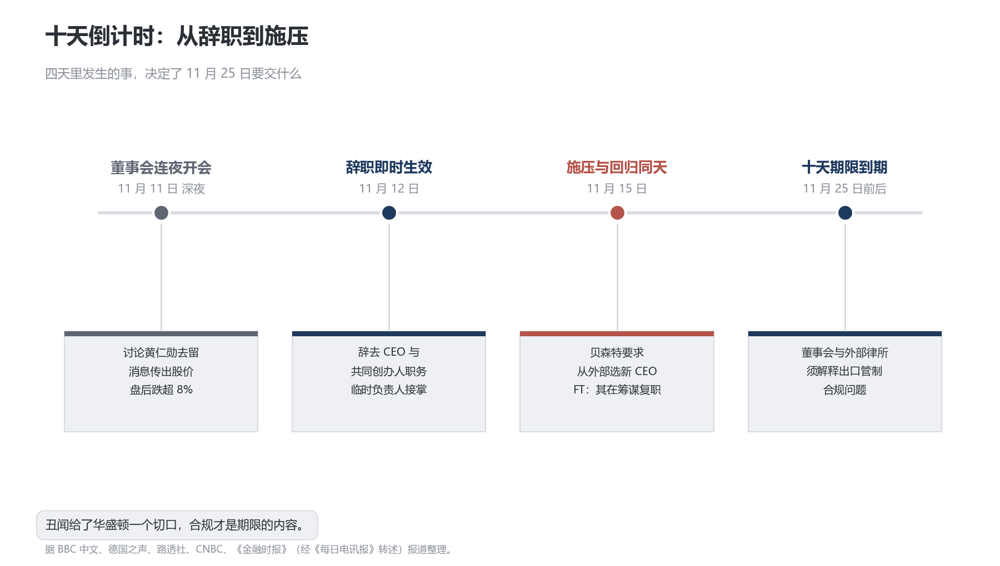
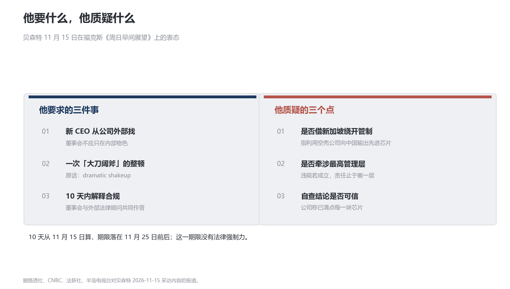
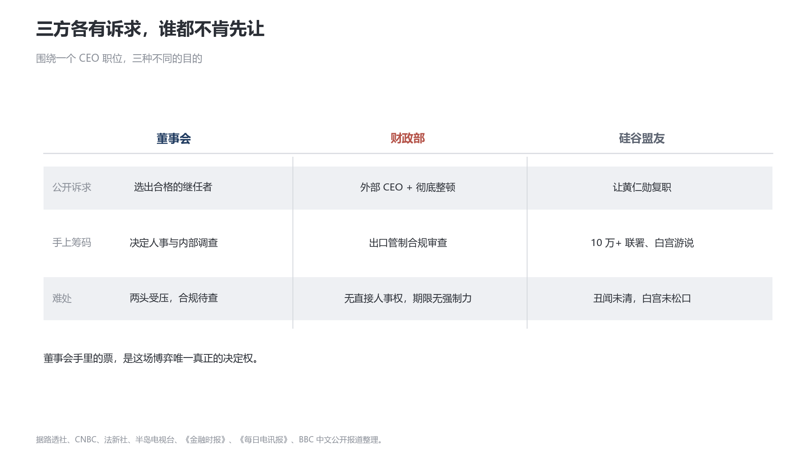

# 美财长要英伟达去外面找 CEO，还给了 10 天：这不是人事问题

11 月 15 日，周日，福克斯新闻《周日早间展望》。美国财政部长斯科特·贝森特说了三句话，把英伟达推到了一个新位置。

第一句：英伟达找新 CEO 要"从公司外部"找。第二句：公司需要一次"大刀阔斧的整顿"。第三句：董事会和外部法律顾问要在未来 10 天内，就出口管制合规问题给出解释。

10 天，按 11 月 15 日算，期限落在 11 月 25 日前后。

## 一、先看清时间线，素材里漏了最关键的一段

11 月 11 日深夜，英伟达董事会开会讨论黄仁勋的去留，消息传出后股价盘后跌超 8%。

11 月 12 日（周四），董事会宣布黄仁勋辞去 CEO 及共同创办人职务，即时生效。起因是婚外情曝光，其中一段的对象被指疑似为中国从事间谍活动。董事会已安排临时负责人接掌。

11 月 15 日，两件事同一天。贝森特上电视施压；《金融时报》则报道，黄仁勋已与亲信讨论重返 CEO 的可能，盟友在硅谷组建"战情室"，游说董事会并争取白宫支持，马斯克等人联署的公开信签名超过 10 万。

所以这不是"换不换 CEO"的问题，是一场还没结束的争夺战。贝森特的表态，是在这个当口插进去的。

## 二、他真正问的不是人事，是合规

贝森特的质疑很具体：英伟达是否长期利用新加坡的空壳公司，绕过美国对华先进芯片的出口限制；如果确有违规，是否牵涉最高管理层。

背景是 Megaspeed。这家新加坡公司周四宣布已聘请一家美国律师事务所，对其持有的 GPU 进行全面普查，并独立核实出口管制措施。

这里有个细节值得停一下。10 月 29 日，黄仁勋曾对彭博社说，英伟达已经研究了 Megaspeed 的全部部署情况，清点了每一块芯片。

如果每块芯片都被清点过，那律所还要清点什么？这个问题现在没人回答，而它恰好落在 10 天期限里。

## 三、"外部 CEO"这个要求，越过了常规管线

美国出口管制的行政主管机关是商务部工业与安全局（BIS），财政部通常经由制裁和投资审查介入。一位财政部长在电视上直接指定一家私营公司 CEO 的选人范围，并且给出一个没有法律强制力的期限，这是政治压力，不是监管程序。

这也是为什么它比丑闻本身更值得看：它把"一家公司的治理结构"变成了政策工具。董事会的选择只剩两种——接受外部人选，等于承认内部合规文化有问题；坚持内部提拔，等于跟华盛顿顶牛。

## 四、对英伟达的实际影响

短期是战略停摆。继任未定、合规待查，任何长周期决策都会往后推——包括此前被反复讨论的对外投资与担保安排。

市场这一侧，中国 AI 企业正在抢租海外数据中心的英伟达算力，说明需求没消失，只是路径在绕。另有一条线：美国民主党参议员已要求政府保留英伟达对华芯片出口的相关文件。

中方也表了态。中国外交部指美方编造"间谍叙事"。

## 五、10 天里看四件事

一是 11 月 25 日前后，董事会与外部律所是否交出书面说明——给不出，压力会升级。

二是董事会接不接"外部人选"这个条件。接了，黄仁勋回归的门就关了一半。

三是回归能不能成。这需要董事会和白宫同时点头，目前看两边都没松口。

四是 Megaspeed 的普查结果。这是唯一能验证"每块芯片是否被清点"的第三方证据。

丑闻会过去，合规不会。这家公司真正的风险，从来不是 CEO 是谁，而是它的芯片最终去了哪里、账能不能对上。

---

*事实来源：美国财政部长斯科特·贝森特 2026 年 11 月 15 日接受福克斯新闻《周日早间展望》（主持人拉里·库德洛）采访时称英伟达需"从公司外部"寻找新任 CEO、需要"大刀阔斧的整顿"，并质疑英伟达是否利用新加坡空壳公司绕过对华先进芯片出口限制、违规是否涉及最高管理层，要求董事会与外部法律顾问在 10 天内就出口管制合规作出解释，据路透社、CNBC、法新社、半岛电视台、Quartz 报道。英伟达董事会于 2026 年 11 月 12 日（周四）宣布黄仁勋辞去 CEO 及共同创办人职务、即时生效，起因涉及婚外情曝光，其中一段对象被指疑似为中国从事间谍活动；11 月 11 日深夜董事会开会讨论其去留、消息传出后股价盘后跌超 8%；董事会已安排临时负责人，据 BBC 中文、德国之声、路透社。黄仁勋与亲信讨论重返 CEO、盟友组建"战情室"并争取白宫支持、马斯克等人联署公开信签名逾 10 万，据英国《金融时报》报道（经《每日电讯报》、Odaily 转述）。Megaspeed 已聘请美国律师事务所对其 GPU 进行全面普查并独立核实出口管制措施；黄仁勋 10 月 29 日对彭博社称英伟达已清点每一块芯片，据《商业时报》（新加坡）。美国民主党参议员要求政府保留英伟达对华芯片出口相关文件、中国 AI 企业抢租海外英伟达算力、中国外交部指美方编造"间谍叙事"，据德国之声引路透社。出口管制由商务部工业与安全局（BIS）主管、财政部经由制裁与投资审查介入，为公开制度背景。文中"10 天期限落在 11 月 25 日前后"及对治理含义的分析为作者据公开信息推算与判断。*