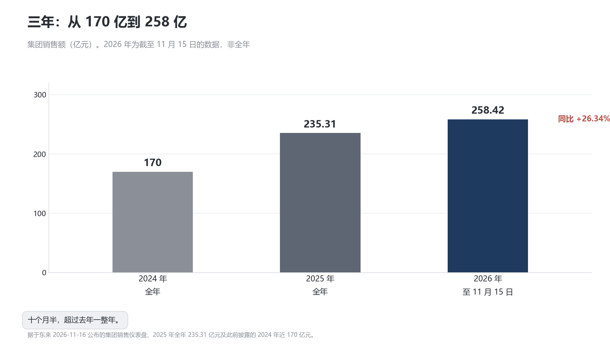
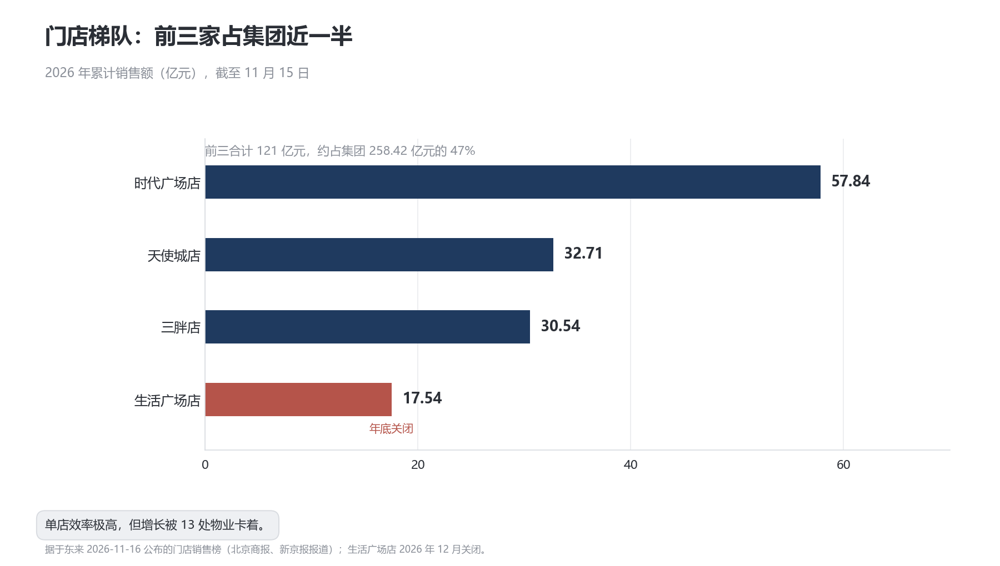
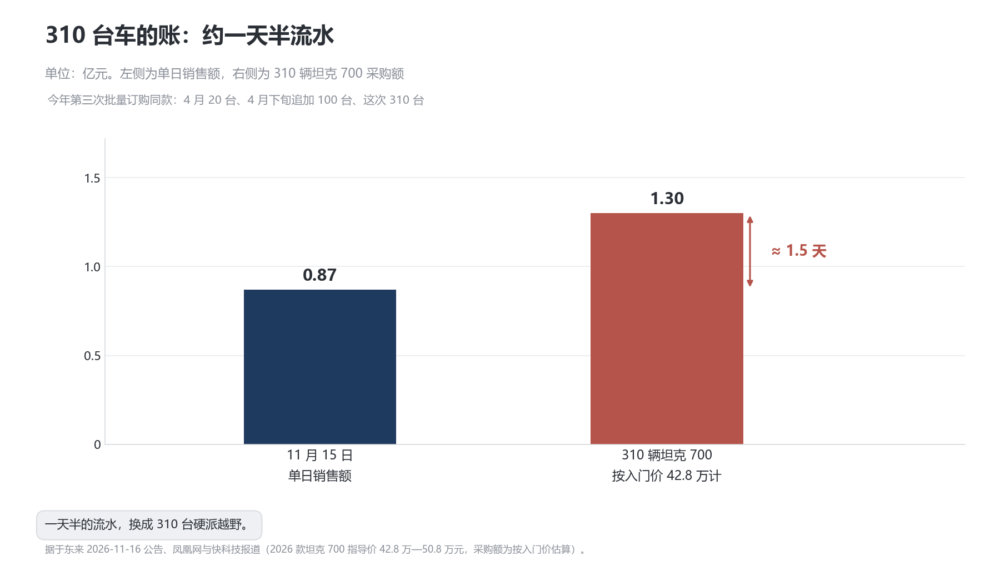

# 胖东来今年 258 亿：一天卖 8709 万，310 台越野车只值一天半

11 月 16 日，于东来在社交平台晒出"集团销售仪表盘"三张截图。

截至 11 月 15 日，胖东来集团 2026 年累计销售 258.42 亿元，同比增长 26.34%；11 月单月（截至 15 日）11.23 亿元，同比增长 25.56%；11 月 15 日单日合计 8709 万元，同比增长 18.95%。

同一天，他宣布再采购 310 辆坦克 700，配发给管理队伍。

业绩和车，放在一条动态里发，是有讲究的。

## 一、10 个半月，超过去年一整年

2025 年全年，胖东来集团销售额 235.31 亿元。今年只用了十个半月，就到 258.42 亿元。

把三年连起来看：2024 年近 170 亿元，2025 年 235.31 亿元，2026 年至 11 月 15 日 258.42 亿元。两年涨了五成以上，而全部盘子只有许昌、新乡两地共 13 家店。

单日 8709 万元，大约相当于一家中型商超一整年的销售额。

按月均约 24.6 亿元粗算，全年有机会摸到 290 亿元附近——推算，非公司口径。

## 二、一家店顶半边天，也顶着一半风险

门店梯队很清楚：时代广场店 57.84 亿元，断层第一，单店就占集团 22%；天使城店 32.71 亿元第二；三胖店 30.54 亿元第三。前三家合计超过 121 亿元，占集团近一半。

第四名有点扎眼：生活广场店 17.54 亿元——这家店年底就要关。

它开了 24 年，是胖东来第一家大型综合门店，年销售 20 亿元、年利润超 1 亿元，是标准的现金牛。关店原因不是不赚钱：2015 年前后，经办人员没按公司规定统一签订租约，导致个别租户租金涨到"远远脱离公平"的地步，公司退也退不成、干也干不下去。

为了不再被租金拿捏，胖东来在自持物业上加码，投约 65 亿元建总建筑面积超 57 万平方米的"梦之城"。

这就是这家公司的结构性矛盾：单店效率高到罕见，但增长被物业卡住。258 亿里有多少是能力，有多少是那 13 处好位置，账面看不出来。

## 三、310 台车，等于一天半的流水

2026 款坦克 700 官方指导价 42.8 万至 50.8 万元。按入门价粗算，310 辆超过 1.3 亿元。

折算一下：1.3 亿 ÷ 8709 万元/天 ≈ 1.5 天。胖东来一天半的销售额，够给管理队伍配 310 台硬派越野。

这笔钱不是今年头一回花。今年 4 月，于东来去长城汽车见魏建军，当场敲定 29 台长城车型订单，其中 20 台坦克 700 给高管；4 月下旬他在直播里打电话追加 100 台；到这次 310 台，已经是今年第三次批量订购同款。过去几年累计采购的长城系车型超过 300 台。

值得一提的是这是定向支出：发给管理层，不是全员普发。对 1.9 万人的企业，310 台覆盖的比例很小，但信号很明确。

## 四、需要说清的一件事：时点

11 月 7 日，网络出现质疑胖东来在售的卡蓓诺（CABELO）洗发水"假洋牌"、产地造假的视频。11 月 8 日胖东来发布说明，称今年 1 月已赴广州的贸易商与日本总部实地溯源；11 月 13 日于东来表示已成立专项团队调查，会拿出详细报告；11 月 14 日他接受采访时说，"大家对胖东来的期待太高，同样的事情放在别的商家身上关注度很低，放在胖东来就会被放大"。

11 月 16 日，就是晒业绩和买车这天。

我不打算把两件事硬连成因果。但有一点是事实：胖东来的溢价来自"信任"，而信任这种资产的特点是——建立要二十年，折损只要一条视频。258 亿证明的是过去，那份调研报告决定的是往后。

## 五、接下来看四件事

一是洗发水的调研报告。这是于东来公开承诺的，出不来或出得含糊，都会二次折损。

二是生活广场店 12 月闭店后的客流去向——是分流到时代广场，还是流失到别家。

三是"梦之城"的进度。重资产一旦压上，胖东来就从"高坪效的零售商"变成了"有物业负担的开发商"，两种生意的风险结构完全不同。

四是年底那组数字。258.42 亿元到 12 月 31 日会落在哪，决定它是"稳稳增长"还是"增速放缓"。

一家把 24 年老店关掉、又花 1.3 亿给管理层买车的公司，账不能只看销售额。

---

*事实来源：2026 年 11 月 16 日于东来在个人社交平台发布"集团销售仪表盘"数据：截至 11 月 15 日集团累计销售 258.42 亿元、同比增长 26.34%；11 月单月累计 11.23 亿元、同比增长 25.56%；11 月 15 日单日合计 8709 万元、同比增长 18.95%；当日门店前三为时代广场 1954.09 万元、天使城 1174.68 万元、小胖店 1045.45 万元；本年累计前三为时代广场 57.84 亿元、天使城 32.71 亿元、三胖店 30.54 亿元（前三合计超 121 亿元），生活广场店约 17.54 亿元，据新京报、北京商报、凤凰网、新浪财经。2025 年全年集团销售额 235.31 亿元、2024 年近 170 亿元，据凤凰网及于东来此前披露。同日宣布再采购 310 辆坦克 700 配发管理队伍，2026 款坦克 700 官方指导价 42.8 万—50.8 万元，按入门价估算采购总额超 1.3 亿元；今年 4 月 2 日于东来赴长城汽车与董事长魏建军会面、敲定 29 台长城车型订单（含 20 台坦克 700 奖励高管），4 月下旬直播中追加 100 台，过去几年累计采购长城系车型超 300 台，据凤凰网、快科技、极目新闻、大象新闻。生活广场店为胖东来首家大型综合门店、经营 24 年、年销售 20 亿元、年利润超 1 亿元，因 2015 年前后租约未统一签订导致个别租户租金大幅上涨，宣布 2026 年 12 月关闭；胖东来投约 65 亿元建设总建筑面积超 57 万平方米的"梦之城"；许昌 11 家店（大型综合商场 3 家、社区超市 7 家、服饰门店 1 家）、新乡 2 家，吸纳就业 1.9 万人，据京报网、澎湃新闻、联合早报、腾讯新闻。卡蓓诺（CABELO）洗发水"假洋牌"争议时间线：11 月 7 日出现质疑视频，11 月 8 日胖东来发布说明（称今年 1 月已赴广州贸易商与日本总部实地溯源），11 月 9 日品牌方声明称在日本生产、报关单证齐全并将追究不实信息传播者责任（未解释"1992 年创立于日本"的说法），11 月 13 日于东来表示成立专项团队调查并将拿出详细调研报告，11 月 14 日于东来接受采访称外界对胖东来期待太高，据京报网、澎湃新闻、腾讯新闻、河南商报、21 世纪经济报道。文中"全年或接近 290 亿元"、"1.5 天流水"及对物业依赖与信任资产的分析为本文据公开数据推算与判断。*