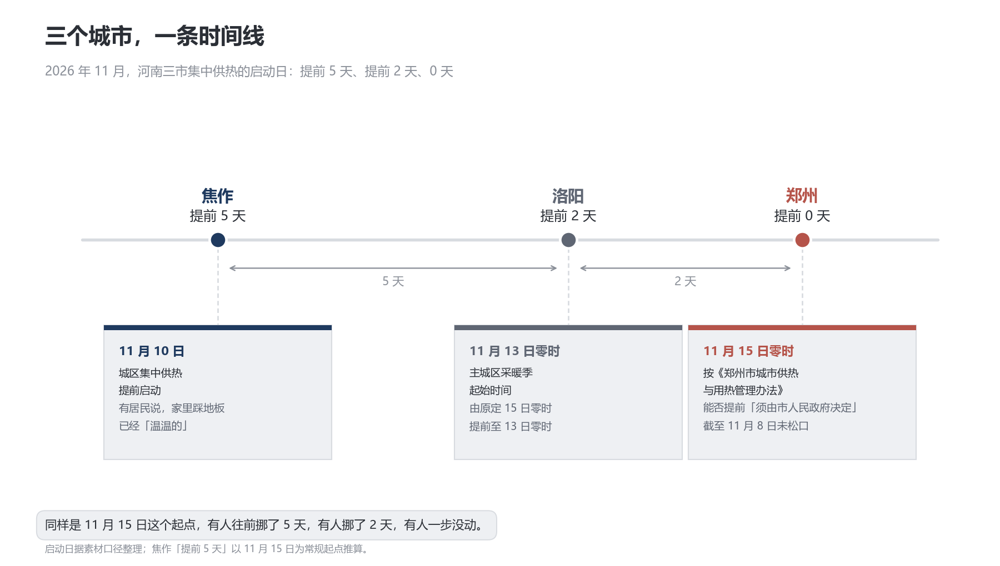
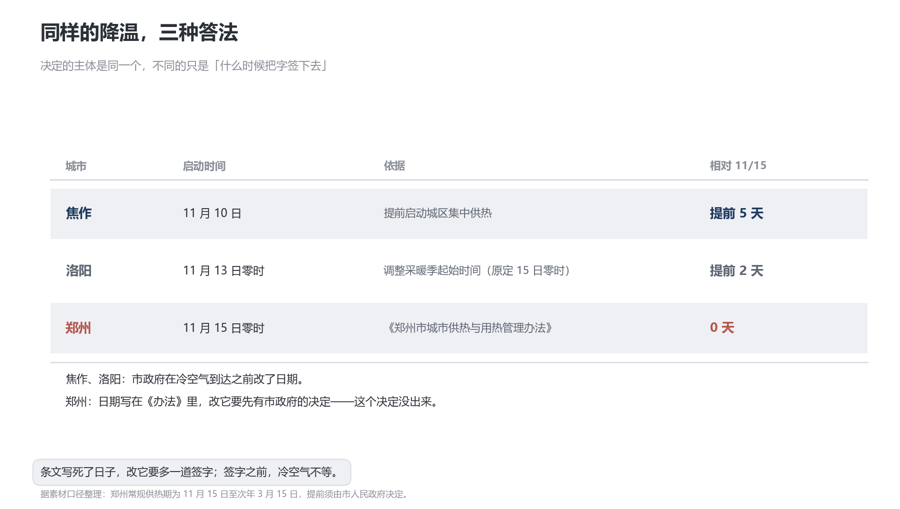
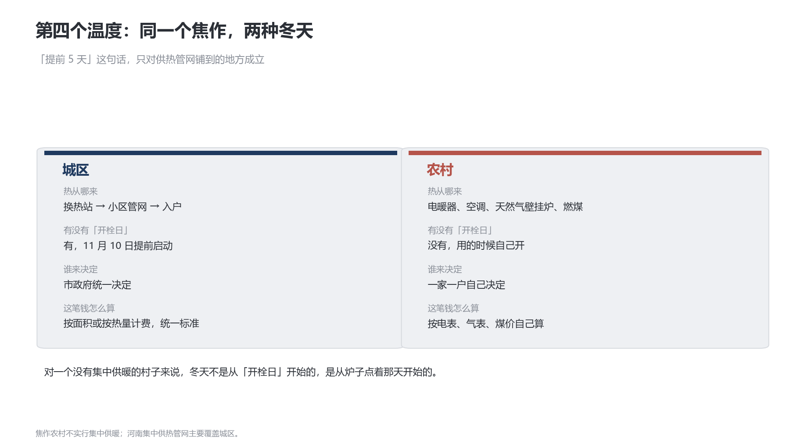

# 同一个河南，三个温度：焦作提前 5 天，洛阳提前 2 天，郑州一天没早

11 月 17 日，郑州进入供热期的第三天。

往前数一周：11 月 10 日，焦作城区集中供热提前启动，有居民说家里踩地板已经"温温的"；11 月 13 日零时，洛阳把主城区采暖季的起始时间从原定的 15 日零时往前挪了两天。而郑州，按《郑州市城市供热与用热管理办法》，供热期是 11 月 15 日至次年 3 月 15 日，一天没早。

同一个省，同一股冷空气，三个城市交出三份不同的答案。

## 一、先把时间线摆出来

**焦作：11 月 10 日。** 城区集中供热提前启动。若以 11 月 15 日这个北方通行的起点作参照，相当于提前了 5 天。

**洛阳：11 月 13 日零时。** 市政府把主城区采暖季起始时间从原定 11 月 15 日零时提前到 13 日零时，提前 2 天。这是白纸黑字改了日期的。

**郑州：11 月 15 日零时。** 按《办法》，常规供热期从这天开始。能不能提前，条文写的是"须由市人民政府决定"。截至 11 月 8 日，官方没有松口。于是 15 日到了，郑州按条文上的日子进入供热期，提前 0 天。

提前 5 天、提前 2 天、0 天。三个数字摆在一起，比任何形容词都清楚。

## 二、差的不是天气，是谁在什么时候签字

决定提前还是不提前，这个权限都在市一级。洛阳是市政府直接把起始时间改了；郑州的条文也写明，提前"须由市人民政府决定"。区别只在时间点。

洛阳和焦作是在冷空气到之前就把日期改了；郑州的日期写在《办法》里，改动要先有市政府的决定，而这轮冷空气来的时候，这个决定没出来。

提前供暖从来不是技术难题。管网就在地下，锅炉就在厂里，多烧一天，多一天的燃气费和热费——这笔账得有人认。谁签字，谁担账；不签字，就按条文上的日子过。

所以这件事真正的分水岭不是"冷不冷"，是"什么时候决定认这笔账"。

## 三、这一轮，整个中东部都在冷

需要说清楚的是，这不是郑州一个城市的问题。

中央气象台预计，11 月 15 日至 18 日，两股冷空气接连影响我国，中东部出现大范围雨雪天气，局地降温 12℃ 以上。

冷得广，意味着各地在同一张考卷上答题。同样一场降温，焦作抢答，洛阳跟上，郑州按标准答案交卷。差距一望即知——这也是这条新闻真正的传播点：读者不是在看供暖，是在看自己的城市排在哪一档。

## 四、还有第四个温度：焦作的农村

"焦作提前供暖"这句话，有个默认前提——城区。

焦作的农村没有集中供暖。河南的集中供热管网主要铺在城区，农村自建房大多不在覆盖范围内，那边的冬天靠电暖器、空调、天然气壁挂炉，或者烧煤，各想办法。

所以对住在焦作农村的人来说，"提前 5 天"这句话是不成立的：他们没有"开栓日"这个日子，只有自己什么时候舍得把电暖器打开、把炉子生起来。

供暖的落差，不只在城市之间，也在同一座城市内部。

## 五、你家暖气热了吗：三步，比在评论区喊管用

第一步，摸两根管。进水管烫手、回水管温热，是正常；两根都凉，问题多半在楼外——换热站或者主管网。

第二步，问一句邻居。整栋楼都凉，直接找热力公司；只有你家凉，先看入户阀门开没开、滤网堵没堵、有没有欠费、管道要不要排气。

第三步，打电话。热力公司的客服电话在小区公告栏、缴费单、公众号上都有，也可以直接打 12345。报小区名、楼栋、门牌，记下工单号。

交费是你的义务，按约定供热是对方的义务，这两件事不冲突。

五天、两天、零天。对一座城市，这是三个数字；对一间屋子，这是五个晚上、两个晚上、零个晚上。

暖气热不热，是技术问题，打个电话能问；早不早，是取舍问题，只能等下一年。

---

*事实来源：2026 年 11 月 14 日前后河南气温骤降；焦作于 11 月 10 日提前启动城区集中供热，居民反映家中地板已"温温的"，焦作农村不实行集中供暖；洛阳将主城区采暖季起始时间由原定 11 月 15 日零时提前至 11 月 13 日零时；郑州常规供热期按《郑州市城市供热与用热管理办法》执行，为 11 月 15 日至次年 3 月 15 日，能否提前"须由市人民政府决定"，截至 11 月 8 日官方尚未松口；中央气象台预计 11 月 15 日至 18 日两股冷空气接连影响中东部，出现大范围雨雪天气，局地降温 12℃ 以上——以上据素材方提供的事实口径整理，本次检索未找到可交叉核对的公开报道。文中"焦作提前 5 天"系以 11 月 15 日为常规起点推算，素材未给出焦作原定启动日；郑州是否于 11 月 15 日实际开栓亦未见公开确认，本文按《办法》规定的常规供热期表述；"郑州进入供热期第三天"按 11 月 15 日起算。河南农村取暖方式（电暖器、空调、天然气壁挂炉、燃煤）为一般情况描述。文中关于"决定权与成本承担"的分析为作者判断。*
