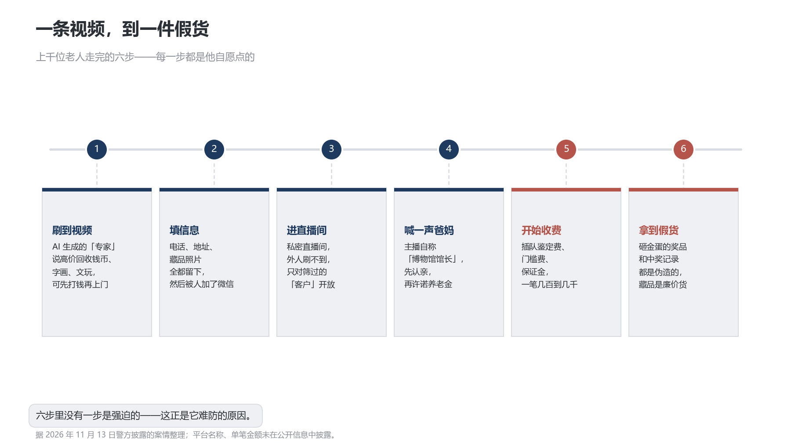
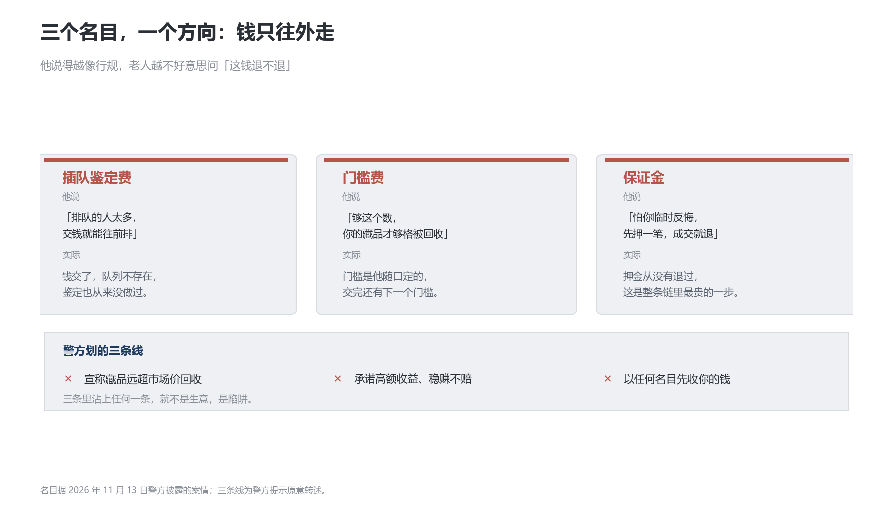
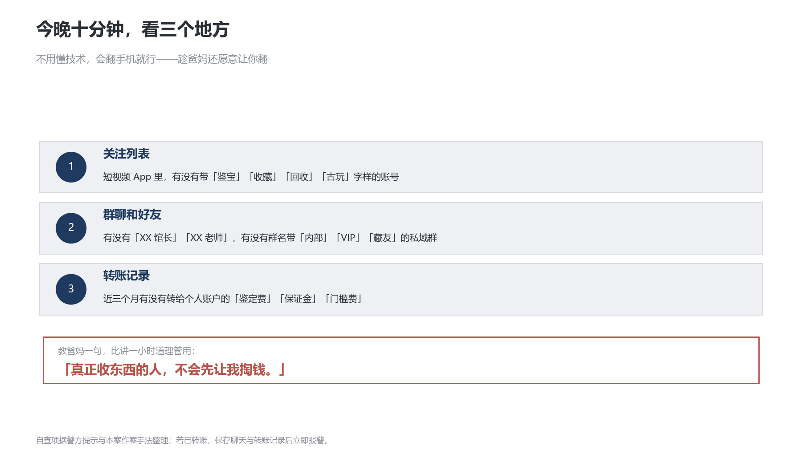

# AI「馆长」喊了声爸妈：上千位老人，为一句天价估价掏了上千万

11 月 13 日，警方披露打掉一个以"免费鉴宝、高价回收藏品"引流的大型诈骗团伙：涉案金额超过一千万元，受害者上千人，多数是老年人。

这条链子不长，但每一环都踩在老人熟悉的东西上——短视频、直播间、一声"爸妈"。

## 一、第一环：算法推过来的一条"鉴宝"视频

骗子在短视频平台发布鉴宝视频，画面里的"专家"是 AI 生成的，说的话很诱人：高价回收古钱币、字画、文玩，可以先打钱、再上门。

对刷到这条视频的老人来说，这不像广告，更像"我家里那枚铜钱，终于有人要了"。

视频下面留着入口：填个信息，把电话、地址、藏品照片留下。留完，人就进了下一环。

## 二、第二环：一个外面看不见的直播间

填过信息的老人，被拉进私密直播间。

"私密"是关键词。这种直播间不在公开的推荐流里，外人刷不到，平台的内容审核也很难事先看见——它只对已经被筛过一遍的"客户"开放。

直播间里的主播，身份是"博物馆馆长"。他先不谈钱，先谈感情：一口一个"爸妈"，许诺以后给老人发养老金。

感情铺垫完，才到正题——估价。"馆长"看一眼照片，说这枚钱币值几十万，那幅字值上百万。

一个过了一辈子紧日子的老人，没见过几十万现金，但他在手机屏幕上看见了。

## 三、第三环：从"插队费"开始的收费清单

天价估完，就该收钱了。名目换着来：

"插队鉴定费"——人多，交钱能排前面；
"门槛费"——够这个数，才有资格被回收；
"保证金"——怕你反悔，先押一笔。

每一笔都不大，几百到几千，老人掏得起，也不觉得是骗——毕竟是为了那几十万。

钱交完，还有一道"砸金蛋抽奖"。奖品是真的吗？不是。中奖的转账记录，也是伪造的。

最后老人收到的东西：一件廉价假藏品。而那件"值几十万"的真东西，从头到尾没有被真正鉴定过。

## 四、这套为什么比电话诈骗难防

电话诈骗有个天然的破绽：陌生号码。老人接起来，心里会先紧一下。

这套没有这个破绽。视频是算法推给他的，直播间是他自己点进去的，主播喊他爸妈，群里的"藏友"在恭喜他——所有环节都在他熟悉的那块屏幕里完成。

而且它很有耐心。不催老人一次掏大钱，而是几百、几千地收，收上几个月。等家里人发现，账已经很长了。

## 五、今晚花十分钟，看三个地方

警方的提示很直接：凡是宣称藏品远超市场价回收的、承诺高额收益的、先交各类费用的，都是陷阱。

落到具体动作上，是三个地方：

第一，打开爸妈手机的短视频 App，看关注列表。有没有带"鉴宝""收藏""回收""古玩"字样的账号。

第二，看微信和群聊。有没有叫"XX 馆长""XX 老师"的人，有没有群名带"内部""VIP""藏友"的私域群。

第三，看转账记录。近三个月有没有转给个人账户的"鉴定费""保证金""门槛费"。

再教爸妈一句话，比讲道理管用：真正收东西的人，不会先让我掏钱。

骗子最狠的地方，不是他编了一个天价，是他让老人觉得，那个天价只差几千块就能兑现。

---

*事实来源：2026 年 11 月 13 日警方披露打掉一个以"免费鉴宝、高价回收藏品"引流的大型诈骗团伙，涉案金额超千万元、受害者上千人、多为老年人；作案链条为在短视频平台发布 AI 生成的鉴宝视频，宣称高价回收古钱币、字画、文玩并可先打钱再上门，引导受害人填写信息、拉入私密直播间，主播伪装成"博物馆馆长"对藏品虚估天价，再以"插队鉴定费""门槛费""保证金"等名目收费，过程中通过认"爸妈"、许诺发放养老金打感情牌，后续"砸金蛋抽奖"的奖品与中奖转账记录均为伪造，受害人最终只拿到廉价假藏品；警方提示：凡宣称藏品远超市场价回收、承诺高额收益、先交各类费用的均为陷阱——以上据素材方提供的事实口径整理，本次未找到可交叉核对的公开报道，案件发生地、涉案平台名称及具体金额构成均未在素材中给出，本文未作补充。文中对"私密直播间的审核难点""为何比电话诈骗难防"的分析为作者判断，非警方表述。*

