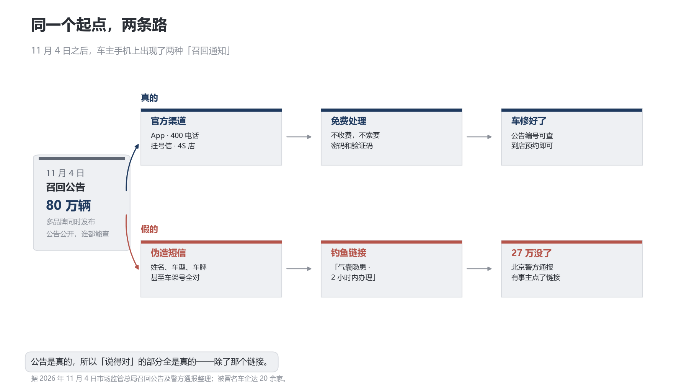
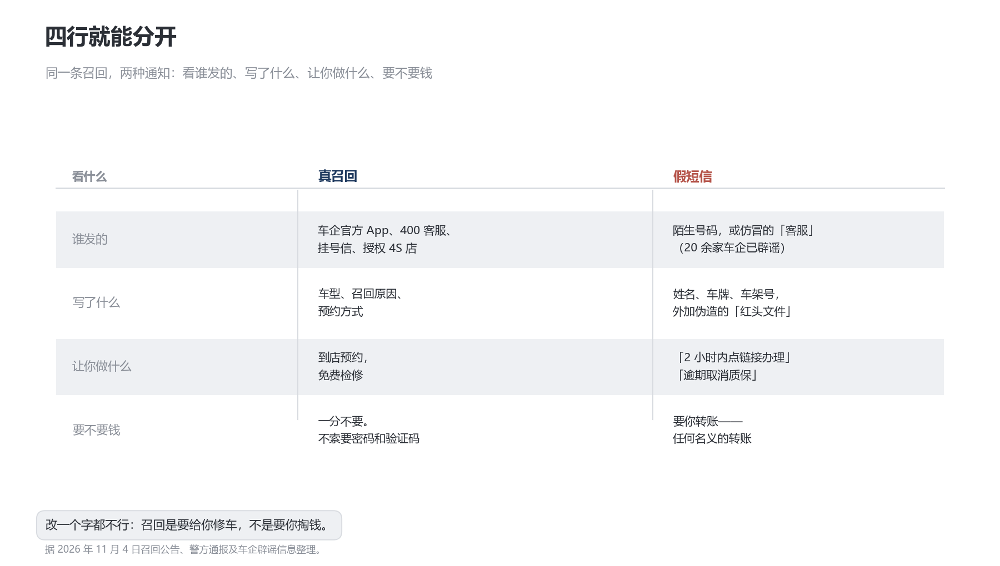
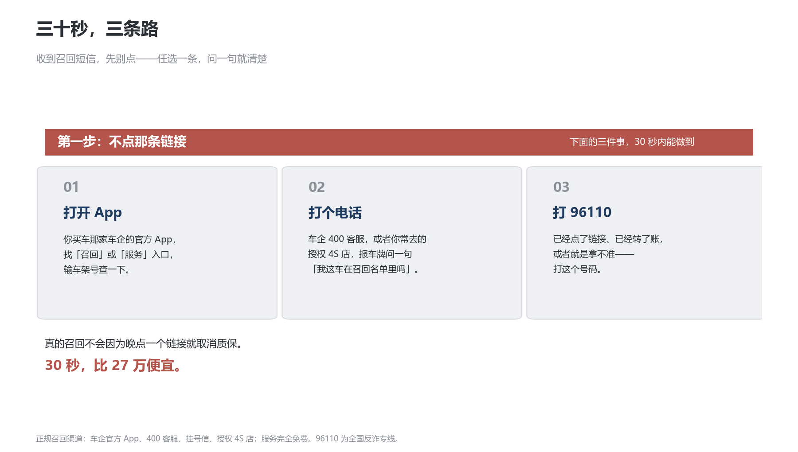

# 召回是真的，短信是假的：80 万辆车的公告发出后，有人点了链接，27 万没了

11 月 4 日，市场监管总局一次发布多起车辆召回公告，涉及大众、丰田、路特斯、Jeep 等品牌，合计超过 80 万辆。

公告发出后不久，召回短信就到了车主手机上。姓名对、车型对、车牌号对，有的连车架号都对。

短信是假的。

北京警方的通报里，有事主点了那条链接，27 万元没了。被冒名的车企已经有 20 多家——大众、理想、宝马、丰田、比亚迪、长城、蔚来等相继辟谣。

## 一、真的那部分：一天，80 万辆

先说真的。

11 月 4 日是集中发布日，多起召回公告同时挂出，涉及多个品牌，合计超过 80 万辆。这类公告是公开的，编号、车型、生产区间、缺陷描述、处理方式都写得清楚，谁都能查。

对车主来说，这本来是件好事：你的车可能被免费修好。

但它同时也是一个窗口。公告公开，意味着几十万车主这几天正在等一条"我的车被召回了"的通知——而骗子也知道这一点。

## 二、假的那部分：它为什么看起来是真的

伪造的召回通知，能报出姓名、车型、车牌号，有的还有车架号。这些信息不在公开公告里，只能来自别处。

有的还附了"红头文件"和公章截图。红头是仿的，公章是截的。

话术就三句，一句比一句急：

"气囊隐患"——安全问题，不敢拖；
"2 小时内办理"——制造时限；
"逾期取消质保"——用损失吓人。

三句压完，再给你一个链接。

## 三、分界线其实很清楚

正规召回只有四种到达方式：车企官方 App、400 客服电话、挂号信、授权 4S 店。

四种里最容易被忽略的是挂号信。很多人收到一封印刷品，随手往桌上一放，其实那就是真的召回通知——它慢，但它不会问你要钱。

规矩是三条，一条都不能破：

服务完全免费；不索要银行卡密码，不索要短信验证码；不要求转账——任何名义的转账都不行。

这三条记住了，判断就不难：召回是车企花钱给你修车，不是让你花钱证明自己的车该被修。

## 四、为什么老司机也会点

因为这条短信其实只有一处破绽——那个链接。

而人不会先去验证链接。人会先看"说的是不是我"：姓名对、车型对、车牌对、时间也对，真召回确实正在发生。所有能验证的部分都是真的，只有要去点的那一下是假的。

这不是防骗意识不够，是信息不对称被用得极彻底：骗子知道你的车，也知道你这几天在等什么。

## 五、30 秒，比 27 万便宜

收到召回短信，先别点。做一件事就够：

打开你买车的那个 App，看有没有召回通知；或者打 4S 店、车企 400 电话，报车牌问一句。

30 秒。拿不准就打 96110。

如果链接已经点了，别先自责，先做三件事：把手机银行的密码和支付密码改掉；翻一遍最近安装的应用，把不认识的卸掉；给银行客服打个电话，问这半小时有没有异常交易。时间越短，能拦下来的越多。

真的召回，不会因为你晚点了一个链接就取消质保。假的召回，等的就是你那一下。

---

*事实来源：2026 年 11 月 4 日国家市场监督管理总局一次发布多起车辆召回公告，涉及大众、丰田、路特斯、Jeep 等品牌，合计超 80 万辆；公告发布后不久出现伪造的"召回通知"短信，可报出车主姓名、车型、车牌号乃至车架号，部分附伪造"红头文件"与公章截图，话术为"气囊隐患""2 小时内办理""逾期取消质保"，诱导点击钓鱼链接；北京警方通报有事主被骗 27 万元；被冒充的车企品牌已达 20 余家，大众、理想、宝马、丰田、比亚迪、长城、蔚来等相继辟谣；正规召回通过车企官方 App、400 客服、挂号信或授权 4S 店发出，服务完全免费，不会索要银行卡密码或验证码，不会要求转账——以上据素材方提供的事实口径整理，本次未找到可交叉核对的公开报道；具体被骗事主的所在地、涉案钓鱼域名及各品牌召回数量拆分均未在素材中给出，本文未作补充。文中关于"信息不对称""窗口期"的分析为作者判断。报警与咨询电话 96110 为公开的全国反诈专线。*

