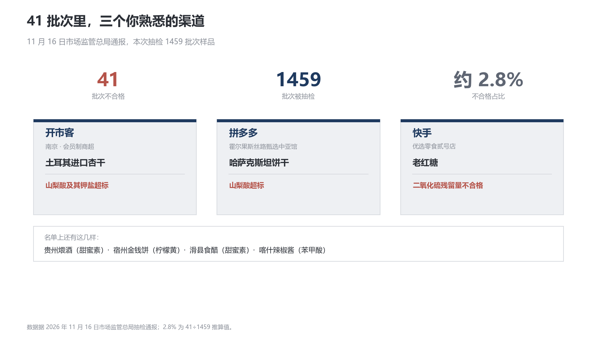
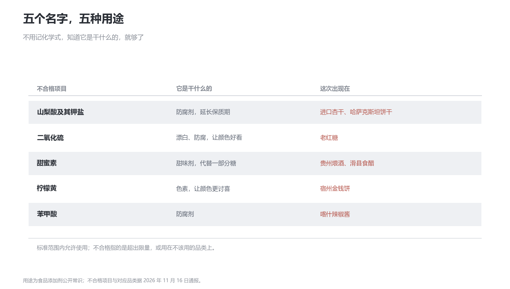
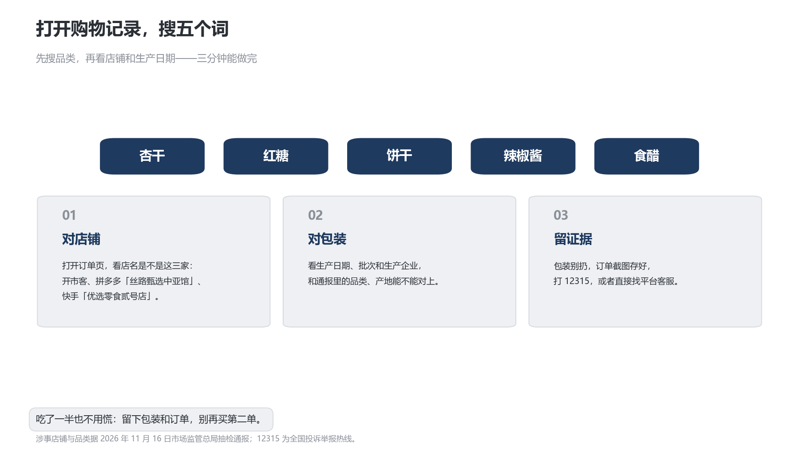

# 41 批次不合格：开市客的杏干、拼多多的饼干、快手的老红糖

11 月 16 日，市场监管总局通报 41 批次食品抽检不合格。这次一共抽了 1459 批次样品。

名单不长，但每一条都很具体：开市客（南京）销售的土耳其进口杏干，山梨酸及其钾盐超标；拼多多"霍尔果斯丝路甄选中亚馆"销售的哈萨克斯坦饼干，山梨酸超标；快手"优选零食贰号店"销售的老红糖，二氧化硫残留量不合格。

还有贵州煨酒（甜蜜素）、宿州金钱饼（柠檬黄）、滑县食醋（甜蜜素）、喀什辣椒酱（苯甲酸）。

不是"某类食品有问题"，是有名字、有店铺、有产地的具体东西。

## 一、按渠道看：三个平台，三种买法

开市客（南京），土耳其进口杏干，山梨酸及其钾盐超标。

拼多多"霍尔果斯丝路甄选中亚馆"，哈萨克斯坦饼干，山梨酸超标。

快手"优选零食贰号店"，老红糖，二氧化硫残留量不合格。

三个渠道，其实是三种买法：一个是会员制商超，一个是跨境店铺，一个是短视频小店的直播间。它们的共同卖点是"进口""原产地""看着靠谱"——也正好是这三种心态最容易松劲的地方。

## 二、按问题看：五个名字，五种用途

不用记化学式，只要知道它们是干什么的。

山梨酸及其钾盐，防腐剂，用来延长保质期；

二氧化硫，漂白和防腐，让颜色好看、放得久；

甜蜜素，甜味剂，代替一部分糖；

柠檬黄，色素，让颜色更讨喜；

苯甲酸，防腐剂。

这些添加剂在标准范围内是允许使用的。不合格的意思是：超出了限量，或者用在了不该用的品类上。

## 三、为什么总是这几样东西

看名单上的品类：杏干、红糖、饼干、辣椒酱、食醋、煨酒、糕点。

共同点很清楚——它们都怕两件事：颜色变丑，放不久。

果干要金黄透亮，红糖要红得正，辣椒酱要红得艳，饼要黄得讨喜。而这些东西又都是囤着吃的，保质期越长越好卖。

所以添加剂一旦超标，多半超在这两个方向上：让它更好看，让它放更久。

## 四、名单是抽检结果，不是判决书

要说清一件事：这份名单对应的是具体批次、具体生产日期，不是"这些品牌全线有问题"。

但对买东西的人来说，这个区别意义不大——没人记得住批号。所以真正有用的动作只有一个：对照你自己买过的东西。

顺带说一句，名单里这三条有两条是进口：土耳其的杏干、哈萨克斯坦的饼干。跨境买的东西你看不到货架，只能看店铺和页面上的产地——判断的余地本来就比逛超市小。

## 五、现在能做的一件事

打开你常用的购物 App，搜五个词：杏干、红糖、饼干、辣椒酱、食醋。

然后看三样：店铺名、生产企业、生产日期。

如果对上了，先别急着扔。把包装和订单截图留下来，打 12315，或者找平台客服。

对不上也不用翻篇：同品牌换个批次不一定有问题，但你买的只要是通报里那几个品类，多看这一眼不亏。

吃了一半的也不用慌。留证据、别再买，比发一条朋友圈管用。

---

*事实来源：2026 年 11 月 16 日国家市场监督管理总局通报 41 批次食品抽检不合格，共抽检 1459 批次样品；名单包括开市客（南京）销售的土耳其进口杏干（山梨酸及其钾盐超标）、拼多多"霍尔果斯丝路甄选中亚馆"销售的哈萨克斯坦饼干（山梨酸超标）、快手"优选零食贰号店"销售的老红糖（二氧化硫残留量不合格），以及贵州煨酒（甜蜜素）、宿州金钱饼（柠檬黄）、滑县食醋（甜蜜素）、喀什辣椒酱（苯甲酸）等——以上据素材方提供的事实口径整理，本次未找到可交叉核对的公开报道；各不合格项目的具体检出值与限量值、涉事批次的生产日期与规格、41 批次中其余批次的品类，素材均未给出，本文未作补充。五类添加剂的标准用途（防腐、漂白、甜味、着色）为公开的食品添加剂常识。素材切入角度中提及的"淘宝俄货饼干"未出现在其事实源名单内，本文未写入。文中关于"为什么总是这几类"的分析为作者判断。*

