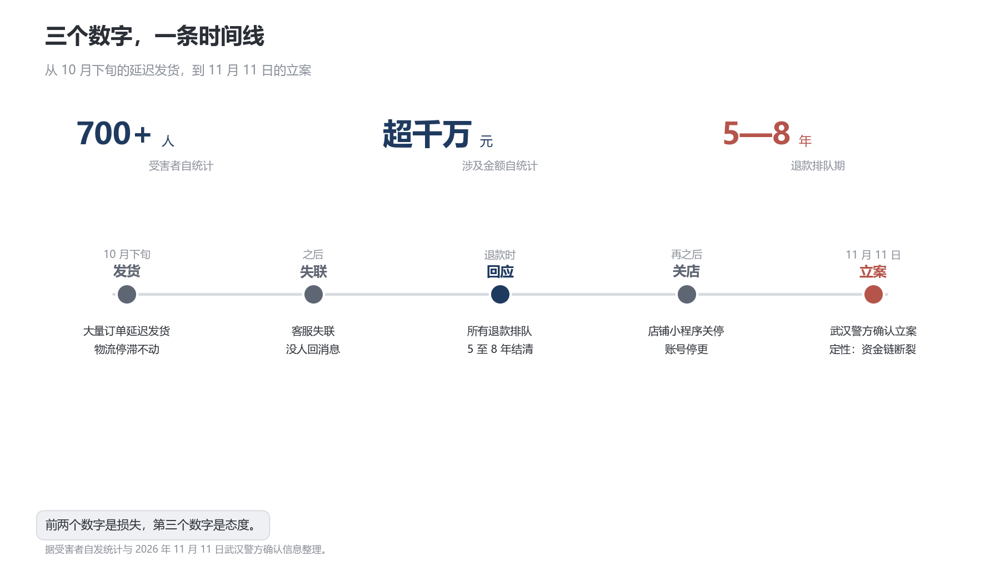
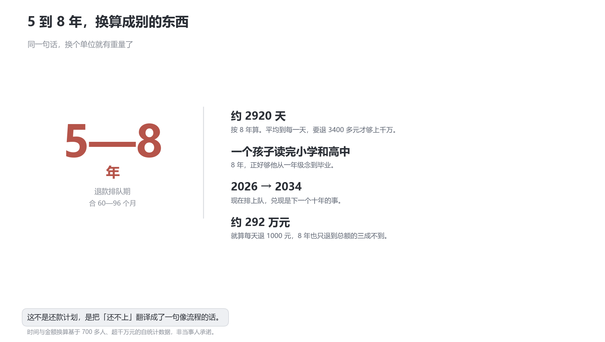
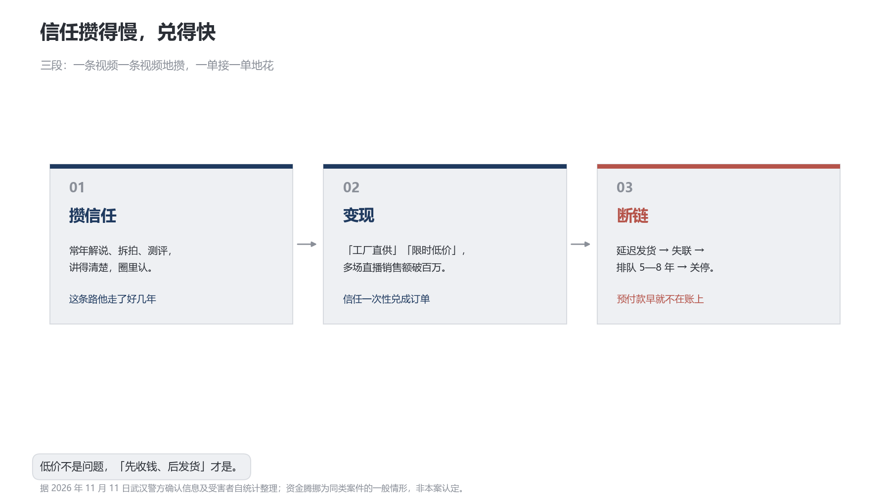

# 退款排队 5 到 8 年：700 多人、上千万，和一句没人信得过的承诺

一个羽毛球主播，700 多个买家，上千万的货。退款怎么退？他的回应是：排队，5 到 8 年。

11 月 11 日，武汉警方确认已立案，移交经侦大队，定性为经营不善、资金链断裂无法履约。

## 一、先把三个数字摆在一起

700 多人，是受害者自己统计的人数。

上千万，是他们自己统计的金额。

5 到 8 年，是主播给出的退款周期。

三个数字里，第三个最不像人话。前两个是损失，第三个是态度。

## 二、5 到 8 年是什么概念

按 8 年算，是 96 个月，约 2920 天。

8 年，够一个孩子从小学一年级读到高中毕业。

从现在算，兑现的年份是 2034。

再算一笔：就算每天退 1000 元，8 年退下来是 292 万元——不到"上千万"的三成。

换句话说，这个"排队"根本不是一个还款计划。它只是把"我还不上"翻译成了一句听起来像流程的话。

## 三、他并不是一上来就想骗

龙宝是头部羽毛球主播。"头部"这两个字是攒出来的：常年做解说、拆拍、测评，讲得清楚，圈里认。

先有专业，才有"工厂直供""限时低价"这几个字的分量。同样一句低价，一个陌生账号喊，没人信；一个你听了两年的人喊，你会想"他渠道硬"。

信任不是天上掉的，是一条视频一条视频、一单接一单攒起来的。它攒得很慢，但可以一次性兑出去。

## 四、低价是怎么把人留下的

"工厂直供"这四个字，是这套生意的核心。它同时解释了两件事：为什么便宜，为什么你敢买。

便宜是真的。多场直播销售额破百万，也是真的。

但直播间的钱是先收的，货是后发的。收得快、发得慢，中间那段时间里，钱是可以被挪走的——补前一批的窟窿、压下一批的货、投下一场直播的流量。

这条链只要有一环慢下来，后面全是窟窿。

## 五、"排队"是一个选择，不是一个结果

订单延迟、物流停滞、客服失联，然后是小程序关停、账号停更。

这套动作的顺序值得看一眼：先失联，再给一个长到荒谬的期限，最后连店都没了。

如果真想还，正常的做法是给方案：分期、折扣、抵押、负责人出面。给"5 到 8 年"这种期限，等于在说：我不打算还，但我暂时不想承认。

按警方的定性，这是经营不善、资金链断裂无法履约，不是一开始就设好的局。但这不改变结果：钱是真没了，损失是真落在 700 多个人身上。

## 六、如果你是那 700 人之一

先留证：订单截图、支付记录、聊天记录，尤其是"排队 5 到 8 年"那条回应。

再去报案：武汉警方已立案，可到经侦大队补充材料；同时向平台投诉、向 12315 反映。

别做两件事：别信"私下退款、加微信先交手续费"，也别跟着所谓"维权代理"走——二次收割往往就发生在这一步。

---

信任这东西，攒的时候是一条视频一条视频，花的时候是一单接一单。

你在直播间买过的最"信任"的一单，后来怎么样了？

---

*事实来源：头部羽毛球主播"龙宝羽毛球"以"工厂直供""限时低价"在直播间销售球拍、羽毛球等装备，多场直播销售额破百万元；自上月下旬起大量订单延迟发货、物流停滞、客服失联；消费者申请退款后，其回应为所有退款需排队 5 至 8 年结清，随后店铺小程序关停、账号停更；据受害者自发统计，涉及 700 多人、总金额超千万元；2026 年 11 月 11 日武汉警方确认已立案、移交经侦大队，定性为经营不善、资金链断裂无法履约——以上据素材方提供的事实口径整理，本次未找到可交叉核对的公开报道；具体涉案金额构成、涉及商品品类占比、退款方案细节均未在素材中给出，本文未作补充。文中"2920 天""每天退 1000 元 8 年约 292 万元""兑现年份 2034"等为据公开数字所做的换算，非当事人承诺；"先收钱后发货的资金腾挪""维权代理二次收割"为作者根据同类案件的一般情况所做的判断与提醒。*

