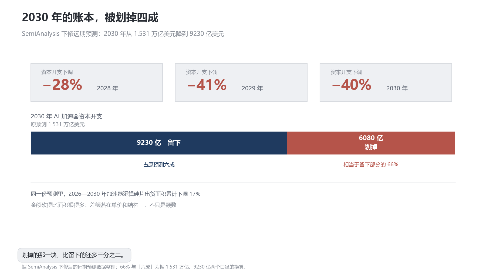
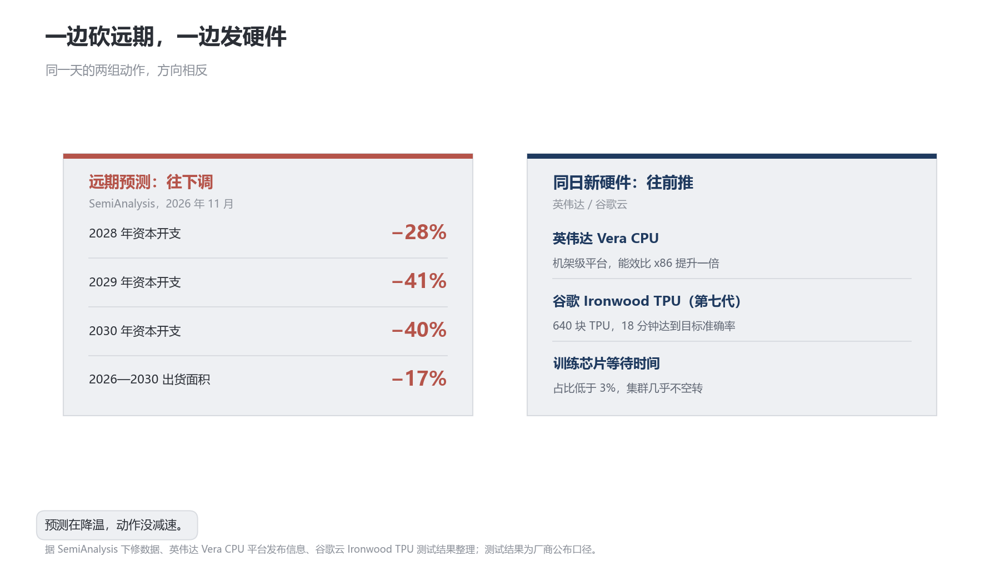
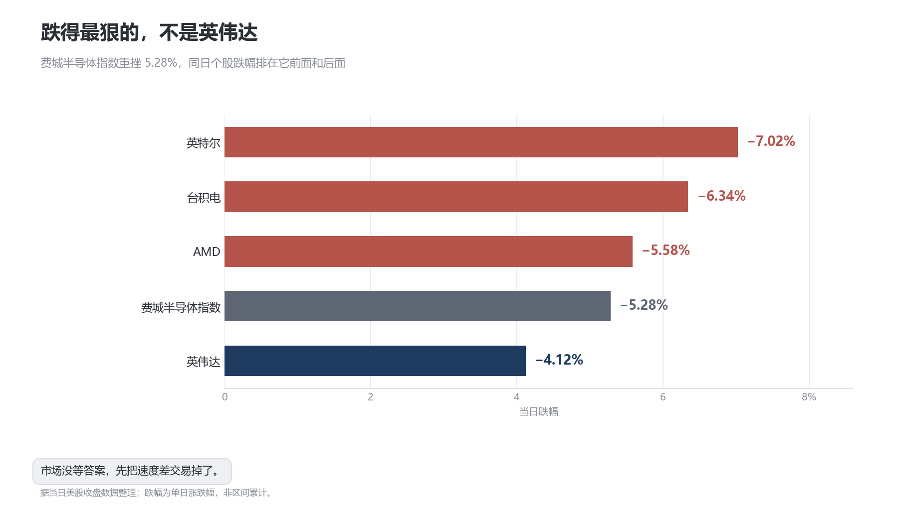

# AI 算力叙事分裂：2028 年资本开支预测砍 28%，英伟达谷歌却同日发新硬件

11 月 17 日，两组动作同时发生。

SemiAnalysis 大幅下修远期 AI 算力预测：2028 年全球 AI 加速器资本开支下调 28%，2029 年 41%，2030 年 40%；2030 年的数字从 1.531 万亿美元降到 9230 亿，少了 6080 亿；2026 至 2030 年，加速器逻辑硅片出货面积累计下调 17%。

同一天，英伟达推出 Vera CPU 机架级平台，称能效比 x86 提升一倍；谷歌云公布第七代 Ironwood TPU 测试结果：640 块 TPU 在 18 分钟内达到目标准确率，训练时芯片等待时间占比低于 3%。

一边砍预测，一边发硬件。芯片股先给前者定了价。

## 一、划掉的比留下的还多

28%、41%、40%——拐点不在第一年，在第二年。

2030 年从 1.531 万亿到 9230 亿。9230 亿正好是原来的六成，降幅四成，与口径对得上。被划掉的 6080 亿，相当于留下部分的 66%——划掉的比留下的还多三分之二。

面积不一样：五年累计只下调 17%，远小于金额降幅。钱少了一大截，面积没少那么多，差额只能落在两处——单价下来了，或结构变了。

## 二、硬件该发还在发

英伟达的关键词是“能效比翻倍”。Vera 是机架级平台，对标 x86。同一句话，对卖芯片的是卖点，对买芯片的是省钱。

谷歌云给的是另一组数：640 块 Ironwood，18 分钟达标，训练时芯片等待时间占比低于 3%。这个指标很少被单独讲，因为它量的不是芯片多快，而是集群有没有在空转。3%，几乎不空转。

两个发布的方向一致：单位算力更便宜，集群更少空转。

## 三、市场先给速度差定价

费城半导体指数重挫 5.28%。个股：英特尔跌 7.02%，台积电跌 6.34%，AMD 跌 5.58%，英伟达跌 4.12%。

同一天里，硬件是利好，预测是利空；指数只走了一个方向。

跌得最狠的不是英伟达。

市场没等答案，先把速度差交易掉了：远期账本在缩，近期动作在加速，中间的缝由股价填。

## 四、砍预测和发硬件，可能是一件事

容易被忽略的一层：单位算力真便宜了，买到同样多的智能，本来就需要更少的资本开支。

还要分清：被下调的是 2028 年之后的远期预测，不是当期订单。远期可以重估，当期订单只能交付。

所以这次下修，未必在说“需求要凉”，也可能在说“同样的钱能买更多算力”。两句话标题上长得一样，生意上是相反的。

但不能说满。硬件发布证明得了能力在往前，证明不了买的人会变多。两家同日发新东西，本身也是竞争在加剧——能效翻倍这种话，只有一家的时候是不用说的。

## 写在最后

远期在降温，短期没减速。市场没法同时定价，所以先跌为敬。

答案不在模型里，在下一轮财报的资本开支指引里：下调，砍的是需求；持平或上调，砍的只是价格。

同一份数据，两种读法——你押哪一个？

---

*事实来源：SemiAnalysis 下修远期 AI 算力预测（2028、2029、2030 年资本开支分别下调 28%、41%、40%；2030 年由 1.531 万亿美元降至 9230 亿、减少 6080 亿；2026—2030 年加速器逻辑硅片出货面积累计下调 17%）；同日英伟达发布 Vera CPU 机架级平台、称能效比 x86 提升一倍，谷歌云公布第七代 Ironwood TPU 测试结果（640 块、18 分钟达标、等待时间占比低于 3%）；美股费城半导体指数重挫 5.28%，英伟达 −4.12%、英特尔 −7.02%、台积电 −6.34%、AMD −5.58%。以上据素材方提供口径整理，未检索到可交叉核对的公开报道；“六成”“66%”为据 1.531 万亿与 9230 亿的换算，“单价与结构差异”“算力变便宜会压低资本开支”为作者推断。*
