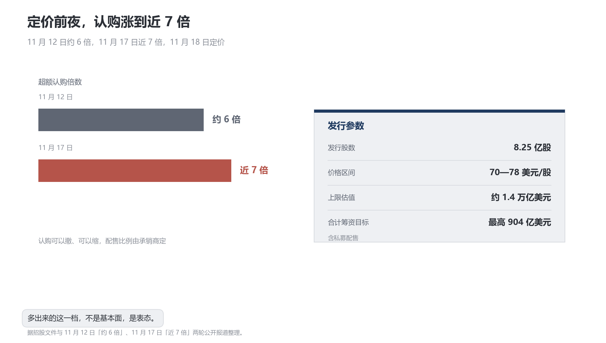
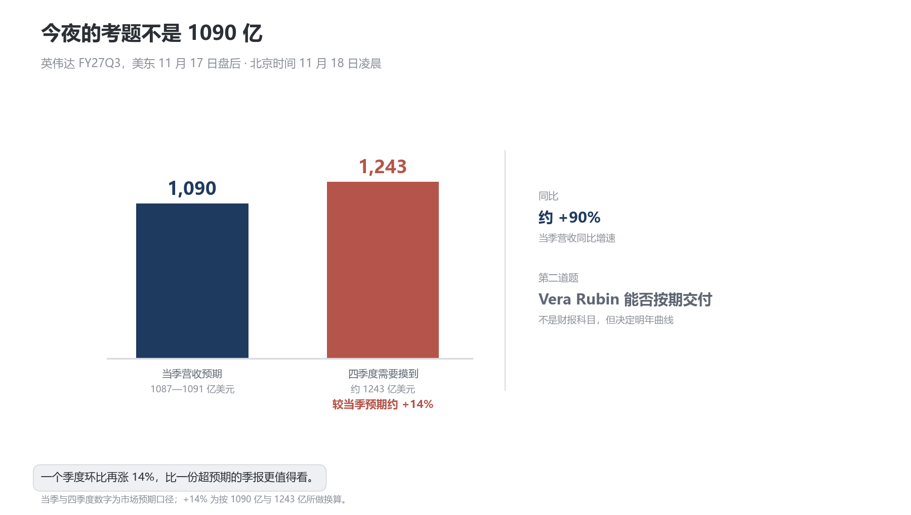
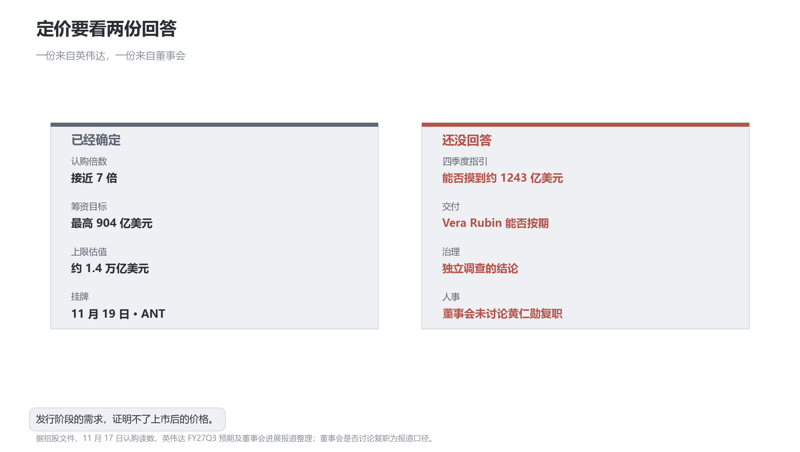

# 认购近 7 倍、估值 1.4 万亿美元：Anthropic 上市前夜，英伟达财报来了

11 月 17 日，两件事挤在同一天。白天是 Anthropic 定价前的最后一次读数，夜里是英伟达的财报。

认购订单已经接近拟发行股份的 7 倍，高于 11 月 12 日的约 6 倍。拟发行 8.25 亿股，每股 70 至 78 美元，按上限算估值约 1.4 万亿美元；叠加私募配售，整体筹资目标最高 904 亿美元。11 月 18 日定价，11 月 19 日以“ANT”登陆纳斯达克。

美东 11 月 17 日盘后、北京时间 11 月 18 日凌晨，英伟达发布 FY27Q3 财报——这是黄仁勋离任后的第一份。市场预期营收 1087 亿至 1091 亿美元，同比增长约 90%。

两件事只隔一夜。前一件要钱，后一件要证据。

## 一、7 倍是定价前的最后一次表态

从 6 倍到近 7 倍，中间没有新产品、没有新客户，也没有新的财务数据。变的是日期：离定价越近，下单越像举手。

这个数字要按它本来的口径读。认购可以撤、可以缩，配售比例由承销商定。7 倍说明想买的人多，不说明最后成交多少。热度也可以被安排：路演排期、定价窗口、基石配售，都会把订单往截止日那道线上推。定价日就在 11 月 18 日，也就是说，这 7 倍里有一部分是赶在截止前递进来的。

## 二、今夜的考题不是 1090 亿

市场预期当季营收 1087 亿至 1091 亿，同比增长约 90%。这个数字大概率不会出意外——公司自己的指引是 1080 亿至 1092 亿，已经在附近。所以这份财报的看点，从一开始就不在当季。

真正被盯的是四季度指引：能不能摸到约 1243 亿美元。按当季 1090 亿算，这意味着一个季度要再涨约 14%。

第二个考题是 Vera Rubin 平台能不能按期交付。它不是财报科目，但决定了明年那条曲线画得出来还是画不出来。

一个季度环比再涨 14% 的指引，比一份超预期的季报更值得看。

## 三、董事会那条暗线

这份财报还有一层特殊：它是黄仁勋离任后的第一份，也是第一次没有创始人在场的回答。

董事会并没有讨论让他重返 CEO 岗位，重点是推进独立调查。这句话的分量在于，它把治理从背景音提到了台前——市场原本只需要判断需求和交付，现在还要判断这中间的空位由谁填、填多久。

所以今晚要回答的是三个问题：需求还在不在、四季度指引够不够、这层不确定性有没有被处理。前两个有数字，第三个没有。

## 写在最后

发行阶段的需求很强，强到接近 7 倍。但上市后的价格不归承销商定，归市场定，而市场只认两份回答：一份来自英伟达的指引，一份来自董事会的调查结论。

11 月 18 日凌晨，第一份揭晓。第二份，没有时间表。

**7 倍是别人的热情，1.4 万亿是自己的价格。**

---

*事实来源：Anthropic IPO 认购订单接近拟发行股份的 7 倍、高于 11 月 12 日约 6 倍，拟发行 8.25 亿股、每股 70—78 美元、按上限估值约 1.4 万亿美元、叠加私募配售整体筹资目标最高 904 亿美元、11 月 18 日定价、11 月 19 日以 “ANT” 登陆纳斯达克，据招股文件与 11 月 12 日、11 月 17 日两轮公开发行报道整理。英伟达 FY27Q3 财报于美东 11 月 17 日盘后（北京时间 11 月 18 日凌晨）发布，为黄仁勋离任后首份；市场预期营收 1087—1091 亿美元、同比增长约 90%，公司指引 1080—1092 亿美元；四季度市场预期约 1243 亿美元；Vera Rubin 平台交付进度与“董事会未讨论让黄仁勋重返 CEO、重点是推进独立调查”见相关报道。以上据素材方提供口径整理，本次未检索到可交叉核对的公开报道。“环比再涨约 14%”为按 1090 亿与 1243 亿所做换算；“下单越像举手”“治理从背景音提到台前”“前两个有数字、第三个没有”为作者判断，非当事方表述。*
