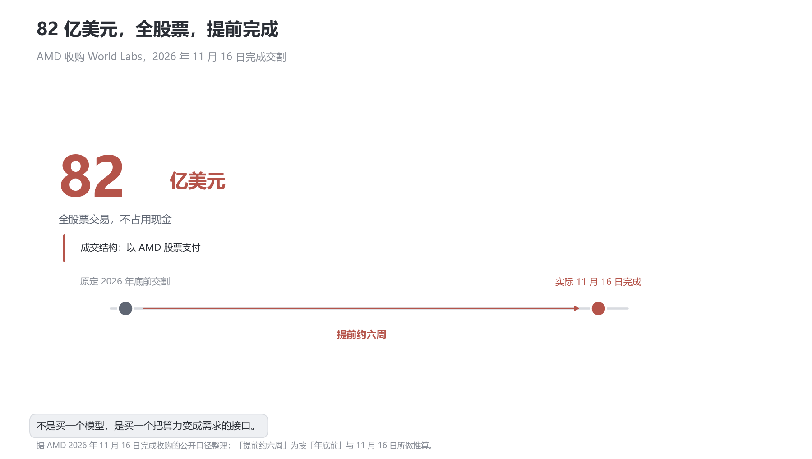
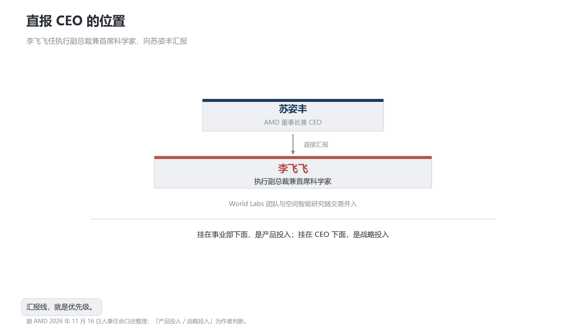
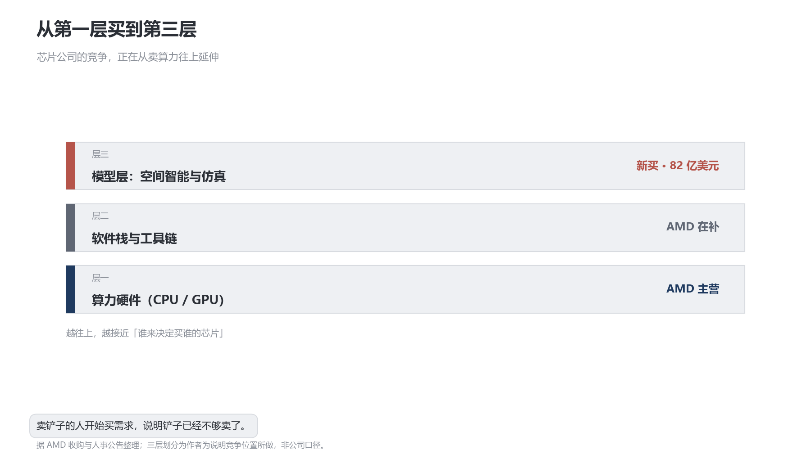

# 82 亿美元，李飞飞入职 AMD：芯片巨头不只卖算力，开始买“空间智能”

11 月 16 日，AMD 完成了一笔交易：以约 82 亿美元全股票收购空间智能公司 World Labs。原定 2026 年底前交割，实际提前了一个多月。

同一天公布的还有人事：World Labs 创始人李飞飞出任 AMD 执行副总裁兼首席科学家，直接向苏姿丰汇报。

两件事放在一起看，才是这笔交易的全貌。买一家公司，顺手把创始人放到 CEO 旁边——这不是常规的人才收购。

## 一、82 亿美元，买的是什么

World Labs 做的不是通用大模型。它做的是创建和模拟可交互的 3D 环境，以及机器人学习与仿真。

这两件事听起来偏，其实很实：机器人要在虚拟环境里反复试错，才能把动作学对，而每一次试错烧的都是算力。

这条路线李飞飞讲了很多年：让机器理解三维世界怎么运转，而不只是认出图片里有什么。

所以 AMD 买的不是“一个模型”，是一个把算力变成需求的接口。

## 二、全股票，说明了两件事

第一件，不花现金。82 亿美元用股票付，账面现金留着——对一家正在扩产的芯片公司，这比什么都实在。

第二件，把卖方绑在股价上。World Labs 的股东拿到的是 AMD 股票，未来能拿多少，取决于 AMD 涨不涨。这比付现金更能留住人。

代价当然也有：股票支付意味着稀释，而且只有 AMD 估值被认可的时候才划算。

## 三、汇报线，就是优先级

李飞飞的位置值得单独看一眼：执行副总裁兼首席科学家，直接向苏姿丰汇报。

大公司里，一条汇报线能说明很多。挂在事业部下面，是产品投入；挂在 CEO 下面，是战略投入。AMD 选了后者。

这条线还有一层隐含意思：World Labs 没有被并进某条 GPU 业务线，而是留在“研究”的位置上。

## 四、从卖芯片到买需求

芯片公司的竞争，原本发生在三个地方：制程、算力、价格。现在多了一层——谁的芯片，能被模型和工具链默认选中。

这一层不靠流片赢，靠生态。英伟达走过的路就是样本：先用仿真和开发者工具把人圈进工作流，再让芯片变成默认选项。

AMD 缺的正是这一段。而它买下的 World Labs，恰好是这一段里最难自建的部分：空间智能要的是长期的基础研究积累，不是一年能堆出来的。

## 写在最后

82 亿美元买一家还没大规模商业化的公司，账面上不好看。但这笔钱买的不是今年的收入，是下一轮的入场券。

反过来说，这笔交易也承认了一件事：光有算力不够。

问题是：模型层的能力，能不能真的变成芯片的订单？

**卖铲子的人开始买需求，说明铲子已经不够卖了。**

---

*事实来源：AMD 于 2026 年 11 月 16 日正式完成对 World Labs 的收购，交易约 82 亿美元、以全股票方式支付，原定 2026 年底前交割、实际提前完成；World Labs 专注创建和模拟交互式 3D 环境的 AI 模型，以及机器人学习与仿真技术；创始人李飞飞即日起出任 AMD 执行副总裁兼首席科学家，直接向苏姿丰汇报——以上据素材方提供的事实口径整理，本次未检索到可交叉核对的公开报道。“提前约六周”为按“年底前”与 11 月 16 日所做推算；全股票对现金与稀释的影响、汇报线与投入级别的对应、“英伟达用仿真与开发者工具把开发者圈进工作流”的路径、三层能力划分，均为作者为说明逻辑所做的判断与背景陈述，非当事方表述。*
