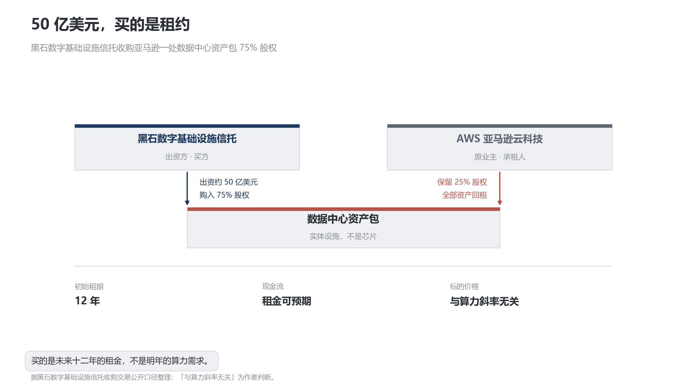
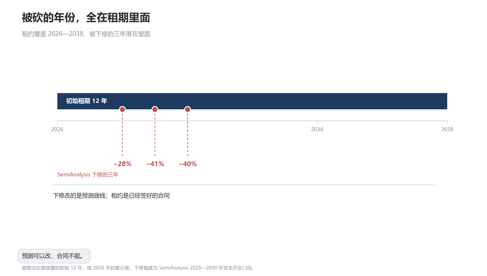
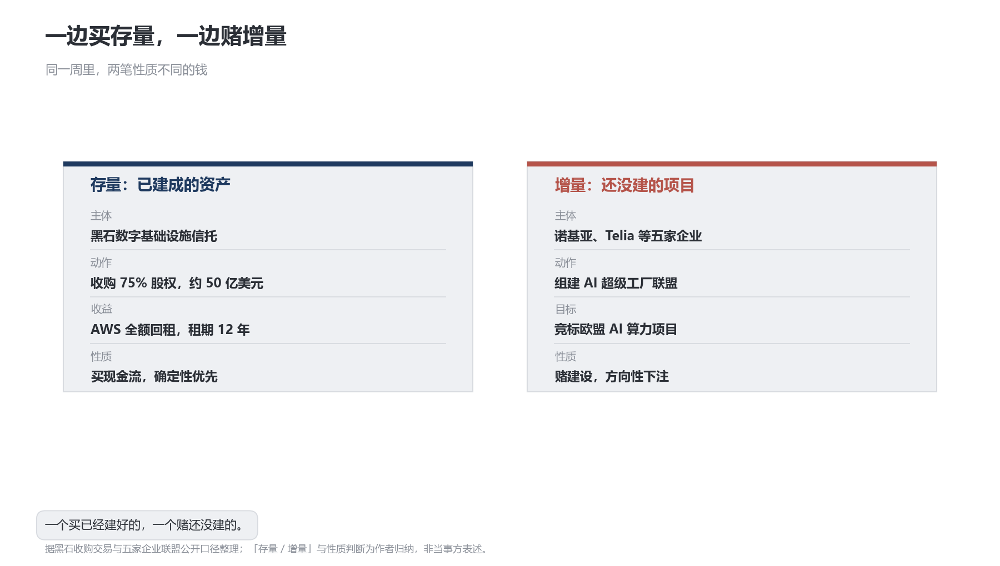

# 远期算力被砍，黑石却花 50 亿美元买数据中心：谁在逆势下注 AI 基建？

同一周里，两个方向的动作撞在了一起。

一边是机构在下修：SemiAnalysis 大幅下调远期 AI 算力预测，2028 年资本开支砍 28%，2029 年砍 41%，2030 年砍 40%。

另一边是钱在进场：黑石数字基础设施信托以约 50 亿美元，收购亚马逊一处数据中心资产包 75% 股权。AWS 保留剩下的 25%，并把全部资产回租，初始租期 12 年。

同一批资产，一边说远期不行，一边被人高价买走。这不矛盾，因为它们算的不是同一笔账。

## 一、这笔交易的真实结构

先把结构拆开：黑石出钱，拿到 75% 的股权；AWS 卖掉大部分所有权，但继续用这些机房，付租金。

也就是说，AWS 把一笔重资产从资产负债表上挪了出去，换回 50 亿美元现金，代价是未来 12 年要付租金。

黑石拿到的，是这 12 年租金构成的现金流。

这里有个关键区别：买的是机房，不是芯片。芯片三年就换代，机房能用二三十年。所以这笔钱投向的是“承载算力的物理空间”，不是“算力本身”。

## 二、为什么预测被砍，这笔钱还敢进

答案藏在一个日期里。

那 12 年租期，覆盖的是 2026 到 2038 年。而 SemiAnalysis 下修最狠的三年——2028、2029、2030——全都落在这段租期里面。

这不是巧合，是这类交易的设计前提：租约签在预测之前，且比预测的期限更长。

所以对黑石来说，那三年的需求到底是涨还是跌，短期内不影响它收到的租金。合同写的是固定租期和约定租金，不是“按算力需求浮动”。

对 AWS 来说则相反：它放弃了资产升值的可能，换来的是不用把 50 亿美元压在砖头里。

## 三、这和“算力叙事降温”不冲突

要分清两件事：预测的是一年一年往上加的增量，卖掉的是已经建成的存量。

下修预测，改的是“未来还要再建多少”；这笔交易，处理的是“已经建好的怎么变现”。

一个在说斜率，一个在说水平。斜率变缓，不代表水平要降。

这也是为什么这类交易在远期预期转冷的时候反而更活跃：预期越不确定，持有方越想把重资产换成现金，而愿意接盘的人，要的恰好是“不确定性之外的确定部分”——一份长约。

## 四、另一个方向：联盟去竞标

同一周还有一条线：诺基亚、Telia 等五家企业组建 AI 超级工厂联盟，拟竞标欧盟 AI 算力项目。

这和黑石那笔是两种钱。黑石买的是已经建成、已经有租约的资产，确定性优先；联盟赌的是还没建的项目，方向性下注。

一个在收割存量，一个在争夺增量。两边同时发生，说明市场对“AI 基建还要不要继续建”没有统一答案——但对“已经建成的值不值钱”，分歧小得多。

## 写在最后

值得注意的是交易对手。卖方是 AWS，全球最大的云厂商之一。它选择卖出并回租，而不是继续持有，这个动作本身就有信息量：连最有钱的买家，也开始在意资产的轻重。

所以“逆势下注”这个说法要改一改。黑石买的不是对 AI 的信仰，是十二年的租金；AWS 卖的不是对 AI 的怀疑，是资产结构。

真正的分歧不在“AI 行不行”，而在“这笔钱该以什么形式待着”。

**远期可以改，合同不能改——这就是有人还敢买的理由。**

---

*事实来源：SemiAnalysis 大幅下修远期 AI 算力预测（2028、2029、2030 年资本开支分别下调 28%、41%、40%）；黑石数字基础设施信托以约 50 亿美元收购亚马逊一处数据中心资产包 75% 股权，AWS 将全部资产回租、初始租期 12 年；诺基亚、Telia 等五家企业组建 AI 超级工厂联盟，拟竞标欧盟 AI 算力项目。以上据素材方提供的事实口径整理，本次未检索到可交叉核对的公开报道。“租期覆盖 2026—2038”“下修的三年落在租期内”为按初始租期 12 年自 2026 年起算的示意，实际起租日与租金条款未在素材中披露；“买的是水平不是斜率”“卖方动作本身有信息量”“收割存量／争夺增量”等为作者判断，非当事方表述。*