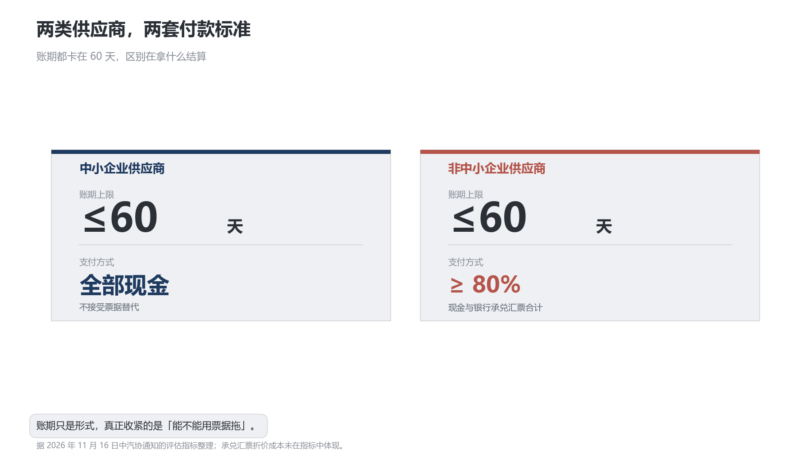
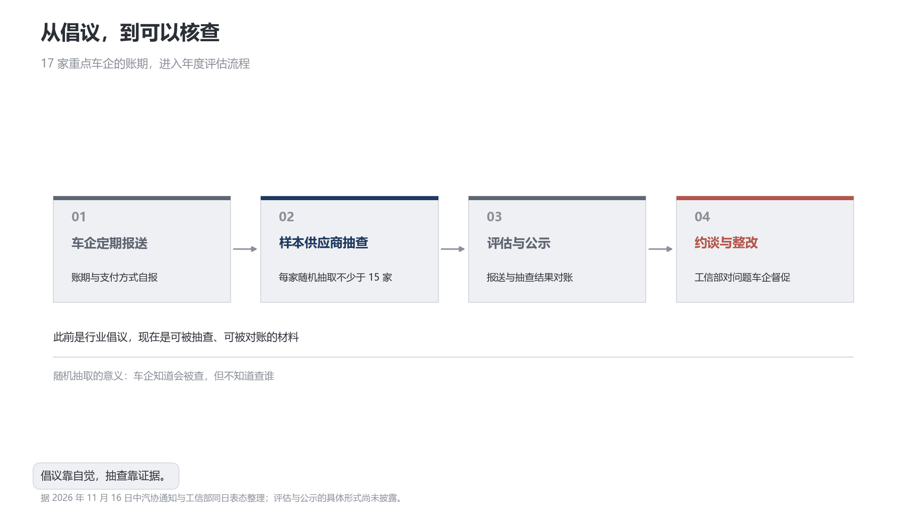
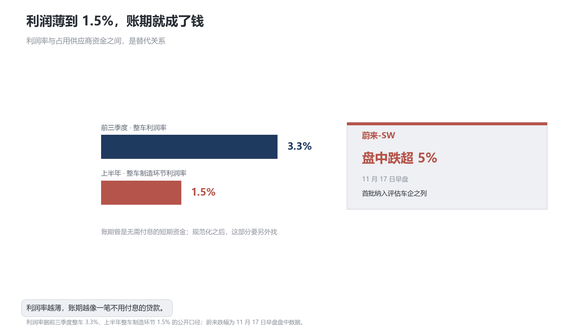

# 17 家车企被抽查账期：60 天现金支付，蔚来盘中跌超 5%

11 月 17 日早盘，蔚来-SW 盘中跌超 5%。前一天，中汽协刚发了一份通知。

通知的内容不复杂：对 17 家重点车企的供应商账款支付，启动年度调研评估。蔚来在首批纳入评估的车企之列。

一边是一份行业文件，一边是股价先跌。市场已经读懂了它意味着什么。

## 一、账期这事，从“倡议”变成了“可核查”

过去几年，车企账期一直是行业里的软约束。60 天付款喊过很多轮，但喊归喊——拖到 90 天、120 天，供应商也只能等。

这次的不同在于核查方式：车企定期报送，加上样本供应商抽查，每家随机抽取不少于 15 家。

报送是自报，抽查是核实。两者一对账，自报的数字就藏不住了。

随机抽取还有一层意思：车企知道会被查，但不知道查谁。这比“全面检查”更有效——全面检查可以提前准备，随机抽查不能。

## 二、硬指标其实是两套

看细则，标准是按供应商规模分开的。

中小企业供应商：账期不超过 60 天，而且必须全部现金支付，不接受票据替代。

非中小企业供应商：账期同样符合 60 天要求，但现金和银行承兑汇票合计不低于 80%。

差别在“票据”两个字上。银行承兑汇票不是现金，到期才能兑，急用钱得去贴现，贴现要付利息。对中小企业来说，收一张 6 个月的承兑，等于又让了半年。

所以这条规则真正收紧的，不是天数，是“能不能用票据拖”。

## 三、为什么车企会在意这 60 天

因为账期是钱。

整车行业的利润率很薄：前三季度整车利润率 3.3%，上半年整车制造环节只有 1.5%。

在这种利润率下，占用供应商资金等于一笔无息贷款。货进来了，钱 90 天后才付，中间这 30 到 60 天，资金是免费用的。

规模越大，这笔“免费资金”越大。所以账期不是财务细节，是现金流工具。

现在这个工具被规范了：60 天、现金支付。原来靠拖账期腾出来的那部分资金，得另外找。

## 四、谁的感受最强

规则对所有人都一样，但影响不一样。

现金流本来就紧、又处在扩张期的车企，受影响最大——它们最依赖这部分无息占款。蔚来的盘中跌幅，某种程度上就是市场在给这件事定价。

反过来，现金充裕、账期本来就规范的车企，几乎没有感觉，甚至还有相对优势。

再往下一层，是供应商。60 天现金支付对中小供应商是实打实的改善：回款快了，不用贴息贴现，资金周转能松一口气。

## 写在最后

这次的动作不是一次运动式检查，是把账期纳入了年度评估的常规流程：报送、抽查、评估、约谈。

流程一旦固定，账期就从“谈判筹码”变成了“合规指标”。车企再想用账期调节现金流，成本会高很多。

短期看，这会挤掉一部分车企的现金流缓冲；长期看，供应链上的钱会流得更快一些。

**账期从谈判桌挪到了报表上，这才是股价先跌的原因。**

---

*事实来源：2026 年 11 月 16 日中汽协发布通知，对 17 家重点车企供应商账款支付启动年度调研评估，采取“车企定期报送 + 样本供应商抽查”，每家随机抽取样本供应商不少于 15 家；硬指标为中小企业账期不超过 60 天、全部采用现金支付，非中小企业账期符合 60 天要求、现金和银行承兑汇票支付比例不低于 80%；工信部同日明确，对应付账款规模大、故意拉长账期、供应商投诉集中的车企，将联合约谈、督促整改。市场端蔚来-SW 11 月 17 日早盘盘中跌超 5%，蔚来在首批纳入评估车企之列。背景数据为前三季度整车利润率 3.3%、上半年整车制造环节利润率 1.5%。以上据素材方提供的事实口径整理，本次未检索到可交叉核对的公开报道。“账期等于无息贷款”“对现金流紧张车企影响最大”“供应商回款改善”等为作者据财务常识所作的推断，非当事方表述；文中未给出 17 家车企名单与各家账期现状，评估结果与整改名单亦未披露。*