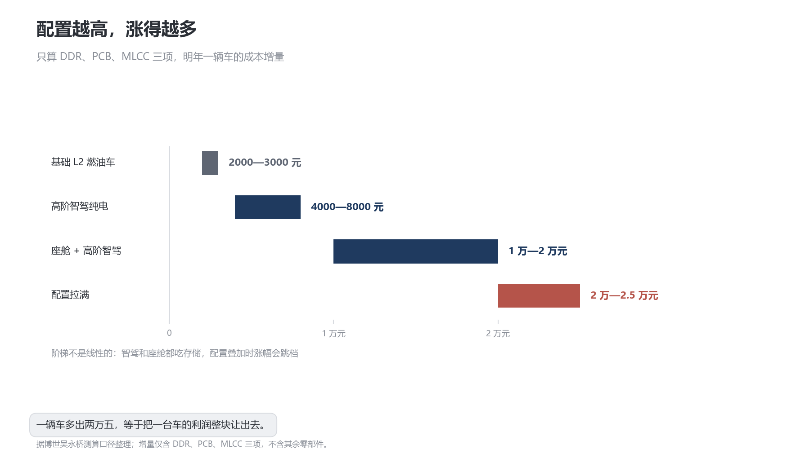
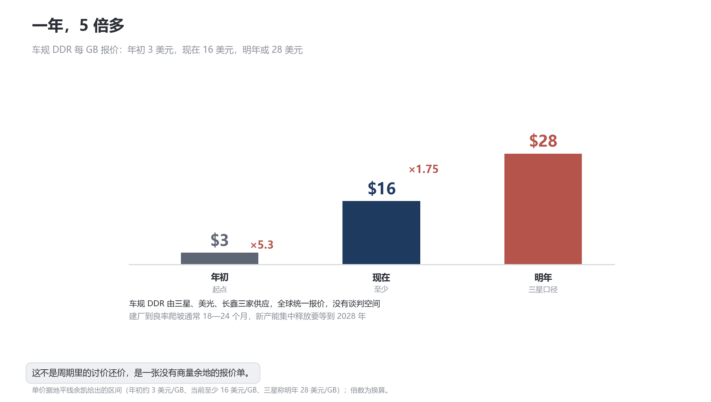
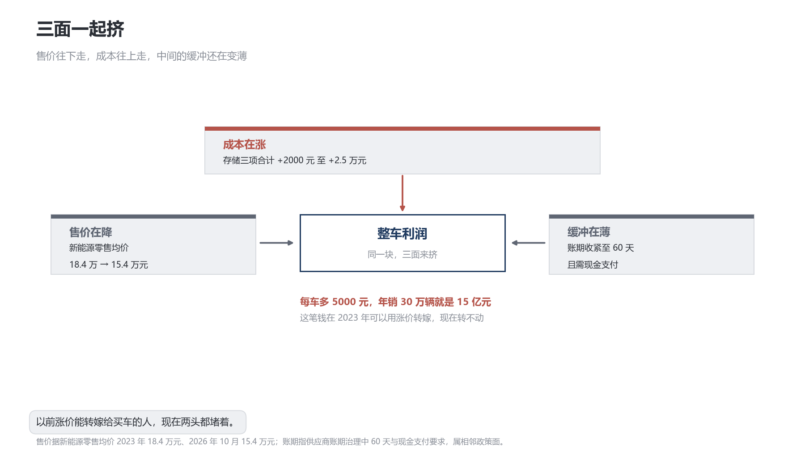

# DDR 从 3 美元涨到 16 美元：一辆车成本多出 2.5 万，存储涨价为何“没得谈”？

博世智能驾控中国区总裁吴永桥给了一组测算。只算 DDR、PCB、MLCC 三项，明年一辆车要多花多少：

只配基础 L2、没有 8155 芯片的燃油车，多 2000 到 3000 元；
配高阶智驾的纯电车，多 4000 到 8000 元；
座舱配高通 8397 加高阶智驾，多 1 万到 2 万元；
智驾和座舱配置拉满，多 2 万到 2.5 万元。

一辆十几万的车，成本凭空多出两万五。这不是某个零件的问题，是一整层结构在往上顶。

## 一、涨得不是线性的

看那四档，涨幅不是等距的。

基础燃油车多两三千，到高阶智驾纯电就跳到四千到八千，配置拉满直接两万五。

原因不难理解：智驾和座舱都吃存储。传感器数据要缓存，模型要驻留内存，座舱的屏和语音要实时响应——每加一层智能，就要多一层 DRAM。

所以存储涨价不是均匀地压在每辆车上，它专挑配置高的车下手。而配置高的车，恰恰是新能源车企用来赚毛利的那部分。

## 二、这次和锂、铝、铜不一样

过去几年车企习惯了原材料涨价：锂涨过，铝涨过，铜涨过。那些都有办法——换供应商、改配方、等周期回落。

存储不一样，差在三点。

第一，供给太集中。车规 DDR 基本是三星、美光、长鑫三家供应，报价全球统一。吴永桥的说法很直接：没有任何人能谈判。

第二，车企没有产能优先权。存储厂的产能先给手机、给服务器，汽车的量在上面排不上号。缺货的时候，不是加钱就能拿到，是排不上。

第三，短期扩产抹不平。建存储晶圆厂，从投入到良率爬坡通常要 18 到 24 个月。中信证券的判断是，供不应求至少持续到 2027 年，实质性缓解要等 2028 年新产能集中释放。

三个条件叠起来，“谈判”这件事本身就不成立。

## 三、价格到底涨成什么样

地平线余凯给了一个参照：年初每 GB 约 3 美元，现在至少 16 美元，三星说明年要涨到 28 美元。

一年，5 倍多。如果明年真到 28 美元，那是年初的 9 倍多。

这个涨幅放在任何制造业里都是异常的。而它落在了单车成本上。

## 四、三面一起挤

真正难受的地方在于，这三件事同时发生。

下游，售价在降。新能源零售均价从 2023 年的 18.4 万元降到 2026 年 10 月的 15.4 万元。价格战还没停。

上游，成本刚性上升。存储的价格不由车企定，也不由车企的采购量决定。

中间，缓冲在变薄。过去车企能靠拖供应商账期腾出一段无息资金，现在这部分正在被收紧——60 天、现金支付。

算一笔：每辆车多 5000 元，年销 30 万辆，就是 15 亿元。这不是小数，是很多车企一年的利润量级。

三年前，这笔钱可以靠涨价转嫁给买车的人。现在转不动了。

## 写在最后

存储涨价这件事，短期看不到解法。

扩产要 18 到 24 个月，新产能要等到 2028 年。这中间的两三年，车企只能自己消化——要么砍配置，要么压毛利，要么把成本往供应链上游再传一层。

值得注意的是，这不是需求旺盛带来的涨价，而是产能被别处占走的结果。车企在这条链上，既不是最大的买家，也不是优先的买家。

最贵的那部分，往往不是芯片本身，是“你必须买、且只能按对方的价格买”这件事。

**涨价不可怕，没有谈判资格才可怕。**

---

*事实来源：博世智能驾控中国区总裁吴永桥测算，仅计 DDR、PCB、MLCC 三项涨价，明年基础 L2 燃油车（无 8155）成本增 2000—3000 元、高阶智驾纯电增 4000—8000 元、座舱高通 8397 加高阶智驾增 1 万—2 万元、配置拉满增 2 万—2.5 万元；车规 DDR 由三星、美光、长鑫三家供应、报价全球统一、“没有任何人能谈判”；地平线余凯给出年初约 3 美元/GB、现在至少 16 美元/GB、三星称明年 28 美元/GB；中信证券判断供不应求至少持续到 2027 年、实质性缓解要等 2028 年新产能集中释放，建存储晶圆厂从投入到良率爬坡通常 18—24 个月；新能源零售均价 2023 年 18.4 万元、2026 年 10 月 15.4 万元。以上据素材方提供的事实口径整理，本次未检索到可交叉核对的公开报道。“5 倍多”“9 倍多”为按 3、16、28 美元所做换算；“每车 5000 元 × 30 万辆 = 15 亿元”为素材给出的示例算法，非特定企业数据；“三面挤压”“存储专挑高配车下手”为作者据数据所作的归纳与判断，非当事方表述。账期一项指供应商账期治理中的 60 天与现金支付要求，属相邻政策面，与存储涨价并非同一链条。*