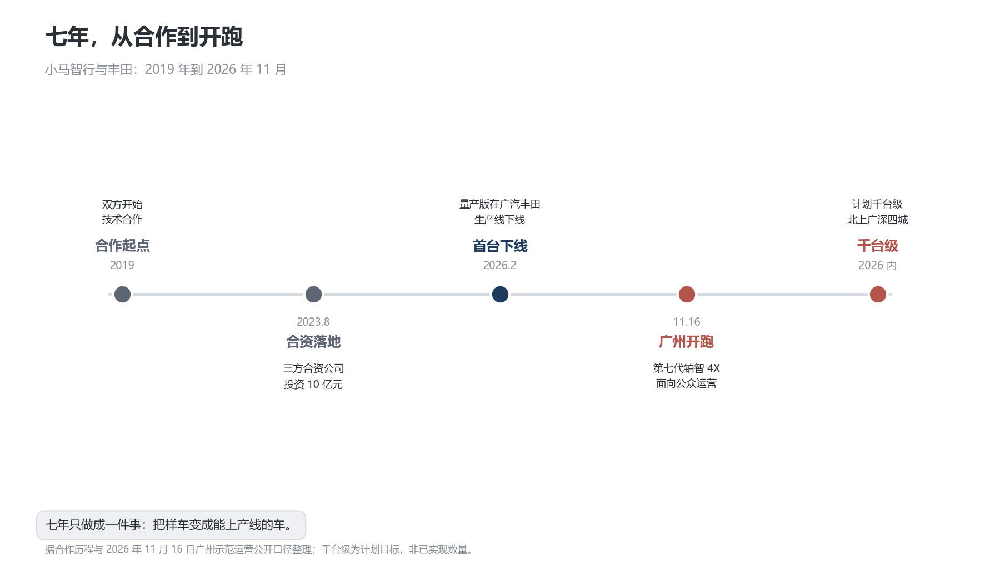
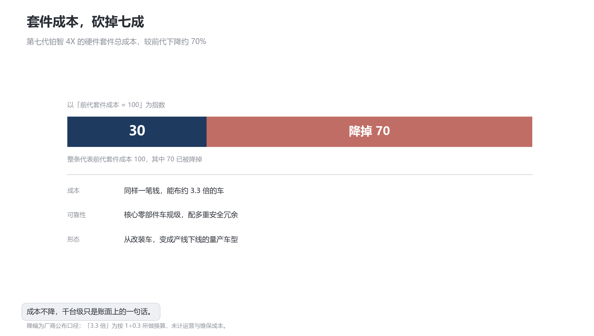
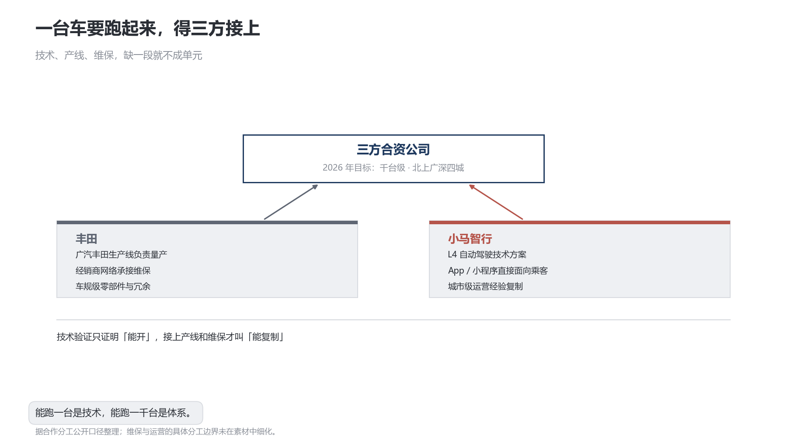

# 硬件成本降 70%，千台级 Robotaxi 要进北上广深：自动驾驶开始算经济账了

11 月 16 日，广州。第七代铂智 4X Robotaxi 开始示范运营，L4 级，面向公众开放，用 App 或小程序就能叫车。

新闻里有两个数字比“开跑”更值得看：硬件套件总成本较前代下降约 70%；三方合资公司计划 2026 年部署千台级，在北上广深四城运营。

一个讲成本，一个讲规模。合起来才是这次的重点。

## 一、70% 为什么是关键

Robotaxi 讲了很多年，卡住它的从来不只是技术。

早几代的方案是改装车：在原车上加装激光雷达、计算平台、各种传感器。这套东西贵，而且不是车规的——大批量上车，可靠性和寿命都成问题。

所以过去的商业模式算不过来：一辆车的改装成本高，折旧摊不掉，跑一趟的边际收益撑不起这套硬件的价格。

这次降 70%，等于把这道题的分子砍掉大半。同一笔钱，能布的车从一台变成三台多。

成本降到这个位置，“千台级”才从口号变成一道可以算的题。

## 二、不只是一辆车便宜了

更关键的是形态变了。

第七代是量产车型，不是改装件：在广汽丰田的生产线下线，核心零部件是车规级，还配了多重安全冗余。

这三个词听着枯燥，但它们决定了三件事——能不能批量造、坏了能不能修、出了事谁负责。

改装车时代，这三件事都没有答案。产线下来一辆，问题就少一半。

## 三、千台级 + 四城 + 维保，才叫“能复制”

单台能跑，和一千台能跑，是两码事。

一千台车分散在四个城市，每天要充电、要清洁、要处理剐蹭、要应对传感器故障。这些事没有产线和维保网络，靠一个技术团队是做不了的。

所以这次的分工值得看：丰田出产线和经销商网络做维保，小马智行出技术方案和城市级运营经验，合资公司负责把两边接起来。

这不是“技术公司找了个车厂代工”，是把一个运营单元拆成了三段，每段都有人负责。

技术验证的成功率，和一千台车每天不出事的成功率，不是一个指标。

## 四、七年，慢得合理

回头看时间线：2019 年开始合作，2023 年 8 月合资公司落地、投资 10 亿元，2026 年 2 月首台量产版下线，11 月 16 日广州开跑。

七年。这个速度在互联网行业算慢，在汽车行业算正常。

自动驾驶的商业化之所以慢，不是因为算法不够好，是因为它要同时穿过三道门：技术、产线、运营体系。任何一道没过，都形不成可复制的单元。

## 写在最后

从“测试”到“算账”，行业评价的刻度变了。

过去看的是接管率、路测里程、脱离次数——这些都是技术指标，衡量“它有多聪明”。

现在要看的是单车成本、单城复制周期、维保响应时间——这些是经营指标，衡量“它能不能养活自己”。

千台级、四城、维保闭环，三个条件同时具备，才第一次构成一个可以复制的模型。至于这个模型赚不赚钱，要等车真正跑满一年才知道。

**技术证明它敢开，成本决定它敢铺多少台。**

---

*事实来源：2026 年 11 月 16 日，小马智行与丰田合作研发并量产的第七代铂智 4X Robotaxi 在广州正式投入示范运营，面向公众开放 L4 级自动驾驶服务，用户通过小马智行 App 或小程序呼叫；硬件套件总成本较前代下降约 70%，核心零部件车规级并构建多重安全冗余；三方合资公司计划 2026 年部署千台级铂智 4X Robotaxi，在北上广深四城运营，运营维保依托丰田经销商网络与小马智行城市级运营经验分工。合作追溯至 2019 年；2023 年 8 月合资公司投资 10 亿元；2026 年 2 月首台量产版在广汽丰田生产线下线。以上据素材方提供的事实口径整理，本次未检索到可交叉核对的公开报道。“3.3 倍”为按 1÷0.3 所做换算，未计运营、维保与折旧；“改装车时代三件事都没有答案”“千台级需一年才能验证盈利”等为作者判断，非当事方表述。千台级为计划目标，非已实现数量；单车运营成本、定价与盈亏平衡点未在素材中披露。*