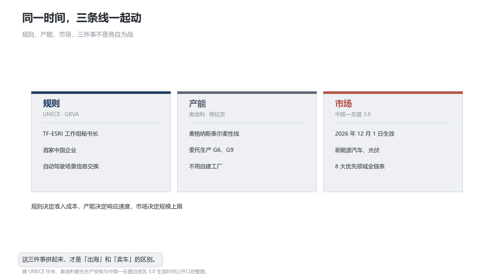
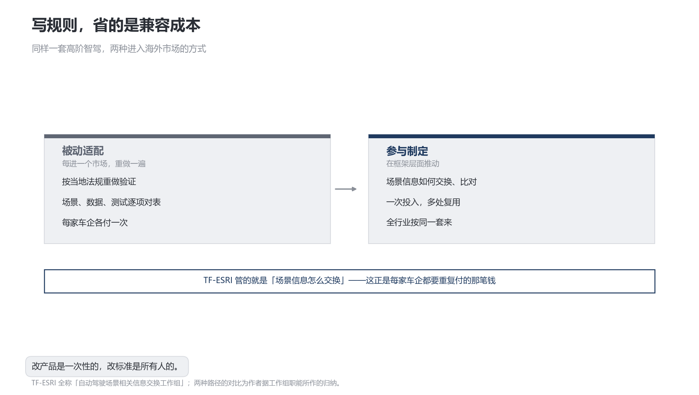
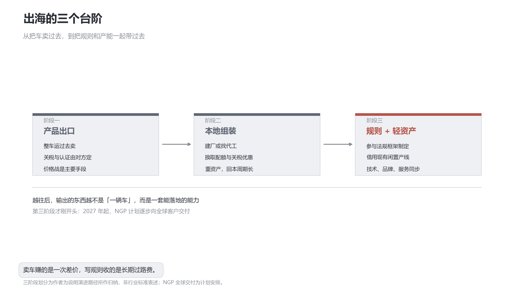

# 小鹏拿到联合国自动驾驶工作组秘书长席位：中国车企出海，不只卖车，开始写规则

近日，小鹏当选联合国欧洲经济委员会（UNECE）自动驾驶工作组（GRVA）新设“自动驾驶场景相关信息交换工作组”（TF-ESRI）秘书长。

头衔很长，但“首家在联合国自动驾驶法规核心框架下担任工作组秘书长的中国企业”这半句，才是重点。

同一时间还有两条线：小鹏通过麦格纳斯泰尔在奥地利格拉茨的柔性线，以委托生产方式本地化生产 G6、G9；中国—东盟自贸区 3.0 版升级议定书确认 2026 年 12 月 1 日生效。

三件事表面不相干，底下是同一件事：出海这件事，正在换算法。

## 一、秘书长席位，管的是什么

先说这个工作组管什么——自动驾驶场景相关信息的交换。

翻译成生意话：一套高阶智驾要进另一个国家，得先证明它在当地路况下是安全的。怎么证明？拿场景数据去比、去测、去对表。

这件事每个国家都要做一遍，每家车企也要做一遍。它不产生收入，但它是准入门槛，是绕不开的成本。

TF-ESRI 管的正是“场景信息怎么交换、怎么比对”。谁在这个框架里有位置，谁就能在规则写下来之前，把自家已经跑过的场景、已经验证过的方法放进去。

这不是特权，是省事——省的是“每进一个市场重新适配一遍”的那笔钱。

## 二、为什么“写规则”比“改产品”划算

对比一下两种进法。

被动适配：进一个市场，按当地法规重做一次验证，场景、数据、测试逐项对表。十个市场，做十遍。

参与制定：在框架层面推动场景信息怎么交换。一次投入，全行业按同一套来。

前者是每家车企各付一次，后者是所有人在同一张表上填。

当然，一个秘书长席位改变不了规则走向，它更像一张入场券——能坐在桌边，比在门外等着被通知要强。

## 三、奥地利那条线：产能的另一种解法

再看产能。

过去中国车企出海，要么整车运过去（吃关税），要么自建工厂（重资产、回本慢）。

小鹏选的是第三条：用麦格纳斯泰尔在格拉茨的现成柔性线，委托生产 G6、G9。

好处很直接——不用自己建厂，不用承担产线闲置风险，还能贴着欧洲市场交货。这一带本来就有大量闲置或利用率不足的产能，借比建便宜得多。

代价是控制力弱一些：产线不在自己手里，排产要看对方，工艺磨合也要时间。

配套的时间表是：2027 年起，NGP 逐步向全球客户交付。规则、产能、产品，三条线在同一个时间窗口里对齐。

## 四、东盟那条线：市场规则的另一种写法

第三条线是中国—东盟自贸区 3.0 版，2026 年 12 月 1 日生效。

值得注意的是它的框架：在绿色经济下推动新能源汽车、光伏合作，8 大优先领域贯穿研发、融资、生产、消费、回收全链条。

“全链条”这三个字有分量。以前的合作谈的是关税降几个点、配额给多少；这次谈的是从研发到回收的整条链怎么对接。

这对车企的意义在于：规则一旦按全链条写，进去的就不只是一辆车，还有配套的电池、充电、回收体系。

## 写在最后

把三件事并排放，规律就出来了。

产品出口，赚的是一次差价；本地组装，换的是配额和关税；参与规则，收的是长期的过路费。

中国车企出海，正在从“把车卖过去”，变成“把产能、技术、品牌、服务、产业生态一起带过去”。

这条路更难，也更慢。但它的天花板，比卖车高得多。

**卖车是一次性的，写规则是长期的。**

---

*事实来源：小鹏集团近日当选联合国欧洲经济委员会（UNECE）自动驾驶工作组（GRVA）新设“自动驾驶场景相关信息交换工作组”（TF-ESRI）秘书长，成为首家在联合国自动驾驶法规核心框架下担任相关工作组秘书长的中国企业；小鹏通过麦格纳斯泰尔在奥地利格拉茨的柔性生产线以委托生产模式进行 G6、G9 本地化生产，计划 2027 年起逐步向全球客户交付 NGP；中国—东盟自贸区 3.0 版升级议定书确认 2026 年 12 月 1 日正式生效，双方将在绿色经济框架下推动新能源汽车、光伏等重点领域合作，绿色贸易等 8 大优先领域贯穿研发、融资、生产、消费、回收全链条，并与中泰备忘录衔接。以上据素材方提供的事实口径整理，本次未检索到可交叉核对的公开报道。“被动适配／参与制定”两种路径的对比、三阶段划分、秘书长席位“是入场券而非特权”等为作者判断，非当事方表述；TF-ESRI 的具体职权范围、小鹏在其中的实际影响力，以及奥地利产线的产能规模与成本条款，均未在素材中披露。*

*注：本文所述“工作组秘书长”为 UNECE/GRVA 框架下的技术工作组职务，属标准制定流程中的协调角色，不等同于对法规内容的决定权。*