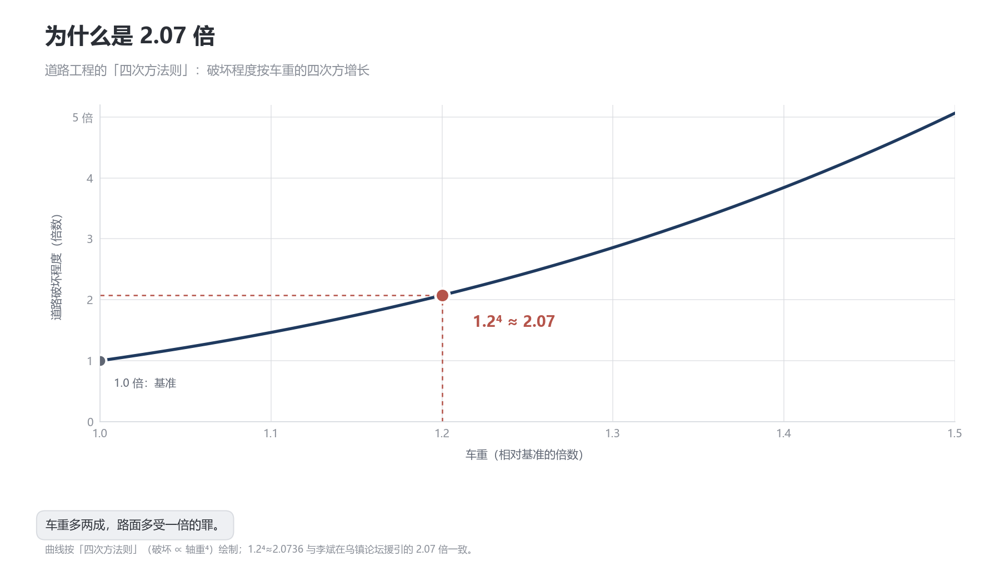
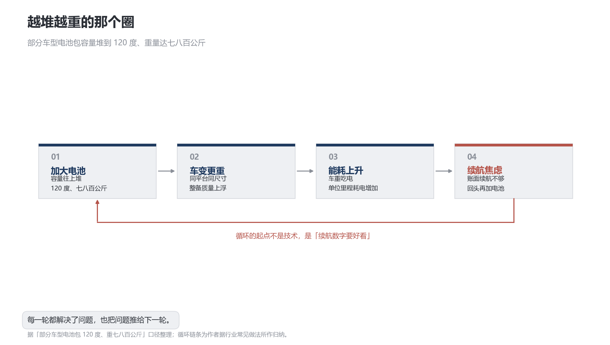
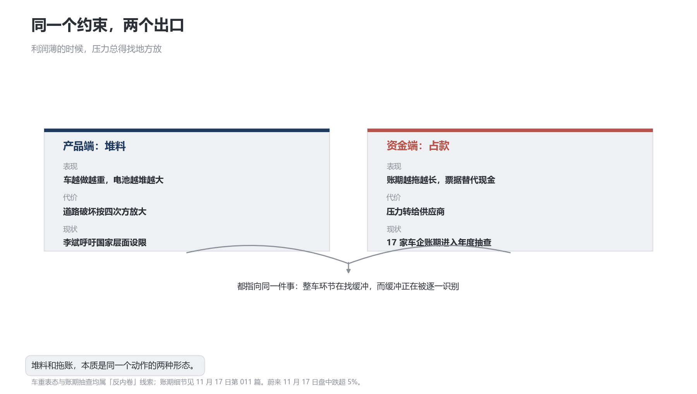

# 李斌呼吁给车重设限：车重 1.2 倍，道路破坏 2.07 倍，电动车“堆电池”该停了？

蔚来李斌在乌镇论坛上讲了一个建议：国家层面给车重设限。

他给的依据是一组反常识的数字：按道路工程的“四次方法则”，车重增加到 1.2 倍，对道路的破坏是 2.07 倍。

多两成重量，多一倍破坏。这个比例不合直觉，但它有出处。

这篇需要说明一句：李斌这个表态的时间，略早于本窗口。把它和 11 月 17 日蔚来因账款调研盘中跌超 5% 放在一起看，是两条线——一条在产品端，一条在资金端。

## 一、2.07 这个数字怎么来的

“四次方法则”不是什么新发明，它是道路工程里的经验规律：车辆对路面的破坏程度，大致与轴重的四次方成正比。

1.2 的四次方是 2.0736。所以车重涨两成，路面破坏翻一倍。这个数字不是估的，是算出来的。

四方的意思是：重量往上走一点，破坏不是跟着走一点，是加速往上冲。车重到 1.3 倍，破坏就是 2.86 倍；到 1.4 倍，3.84 倍。

这解释了为什么重车对路面的伤害从来被低估——人们按比例想问题，物理规律按次方走。

## 二、车为什么越来越重

电动车变重，最直接的原因是电池。

李斌提到，部分车型的电池包容量已经堆到 120 度，重量达到七八百公斤。七八百公斤是什么概念：一台紧凑型轿车的整备质量，也就一吨出头。

问题是这里有一个闭环。

电池加大会增重，车重会推高能耗，能耗高又显得续航不够，续航不够的标准答案又是再加电池。

每一轮都解决了当下的问题，也把问题推给下一轮。而这条链的起点，很多时候不是技术限制，是“续航数字要好看”。

## 三、这条线和账期是同一件事

把车重和账期并排放，会发现它们是同一个动作的两种形态。

产品端：配置往上堆，车越做越重——代价由道路、由公共设施承担，不体现在任何一张财报上。

资金端：账期越拖越长，票据替代现金——代价由供应商承担，也不体现在整车厂的报表里。

两者共同点是：**把成本转移给体系外的人**。利润薄的时候，这类转移会变多。

而现在的变化是，这两个方向都在被识别：车重被公开呼吁设限，账期已经进入 17 家车企的年度抽查。

## 四、设限这件事难在哪

呼吁容易，落地难。

难在三点。第一，标准怎么定——按整备质量划线，还是按轴重？前者简单，后者才对应真实的道路破坏。第二，电耗和续航的考核怎么配套——如果只限重不限续航，等于逼着车企在别处找补。第三，已经卖出去的车怎么办。

还有一层更现实的：车重是竞争的结果，不是原因。消费者要空间、要续航、要配置，这些都要重量。单限车重，可能只是把压力挤到别的地方去。

## 写在最后

李斌这个建议的真正价值，不在“要不要限”，而在于它把一个长期被忽略的外部成本摆到了台面上。

一辆车重两成，路面多受一倍罪——这笔账过去没人算，因为它是分散的、长期的、落在公共财政上的。车企的报表里没有这一项，所以堆料没有代价。

现在有人开始算了。至于算完之后是设限、是调整积分规则、还是什么都不做，那是下一步的事。

**把成本转移出去很容易，难的是让它转不出去。**

---

*事实来源：蔚来李斌在乌镇论坛上呼吁国家层面给车重设限，援引道路工程“四次方法则”——车重达到 1.2 倍，对道路的破坏为 2.07 倍；部分车型电池包容量堆到 120 度、重量达七八百公斤。该表态时间略早于本窗口，与 11 月 17 日蔚来因账款调研盘中跌超 5% 分属产品端与资金端两条线索。以上据素材方提供的事实口径整理，本次未检索到可交叉核对的公开报道。“1.2⁴=2.0736”“1.3 倍→2.86 倍、1.4 倍→3.84 倍”为按四次方法则所做换算；“堆料闭环”“车重与账期同属成本转移”“设限难在三点”等为作者判断，非当事方表述；四次方法则的适用前提（轴重、轴数、路面结构）在此未展开，实际道路损伤还受悬挂、轮胎、轴距等因素影响。*

*注：账期部分的细节（17 家车企、60 天、现金支付要求）见 11 月 17 日第 011 篇，本文不重复展开。*