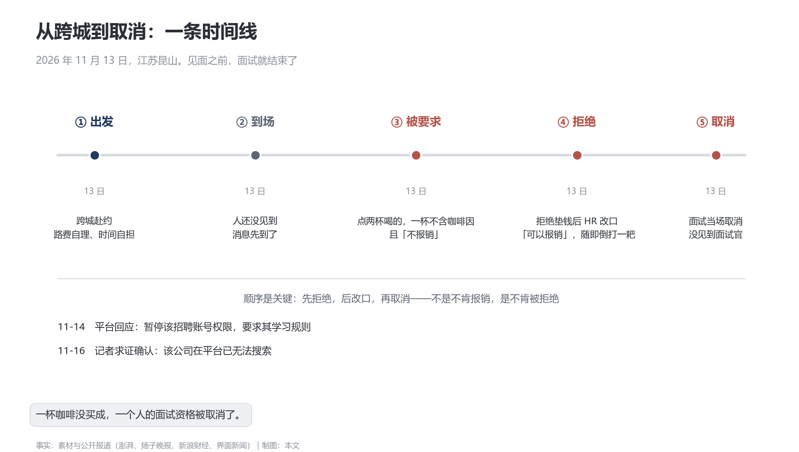
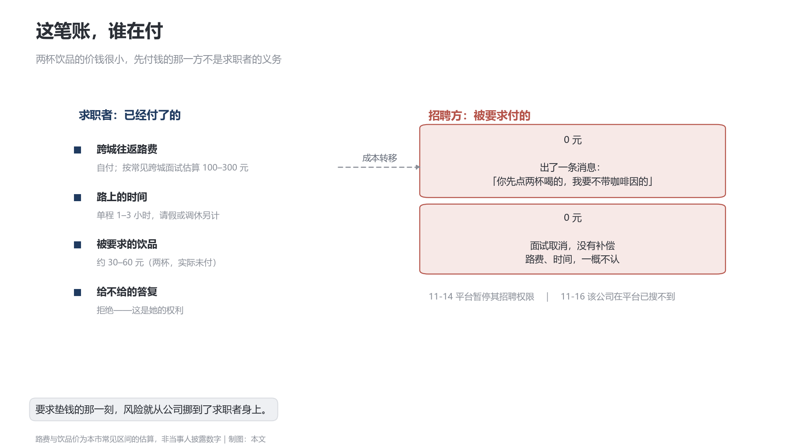
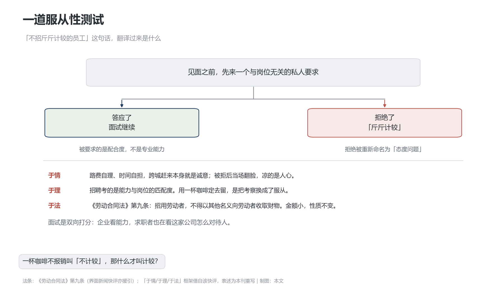

# 两杯咖啡，一个被取消的面试：不报销的要求，到底考的是什么

11 月 13 日，江苏昆山。一个人跑了很远的路去面试，到了，还没见到面试官，面试就结束了。

结束的原因是一杯咖啡——准确说，是两杯。

## 一、先把事情摆出来

据澎湃新闻、扬子晚报等报道：这位求职者通过 BOSS 直聘，对接了上海佐棠国际贸易有限公司在昆山的面试，11 月 13 日跨城赴约。人到场之后，HR 发来消息：

> 你先点两杯喝的，我要不带咖啡因的。

紧接着补了一句：不报销。

她拒绝了。然后 HR 改口：咖啡钱可以报销。再然后说了一句——"公司不招斤斤计较的员工"，面试当场取消。她连面试官的面都没见到。

事后她给公司发了投诉邮件，没有回复。她要求对方道歉，并赔偿路费。

## 二、顺序比金额重要

需要说明一处：涉事公司注册在上海，面试地点在江苏昆山。这两件事不矛盾，但写清楚，免得读者以为是跑去上海。

更要看清楚的是顺序：先提要求，被拒绝；被拒绝后才改口说可以报销；改口之后仍然取消面试，理由是"斤斤计较"。

如果是报销政策不清楚，那么对方说"可以报销"之后，这件事就该结束了。但它没结束。说明对方介意的从来不是那几十块钱，是"你居然拒绝了"。

一杯咖啡的钱，买的是一个测试：你会不会为了一个面试机会，先把自己的边界交出去。

## 三、"不招斤斤计较"这句话，翻译过来是什么

这句话是一个很好的钩子，因为它把因果说反了。

要求别人先垫钱、垫了还不报销，这是计较；被要求的人说一句"我不垫"，这是拒绝。把拒绝称作计较，等于要求对方连"拒绝"的权利都要放弃。真正的计较，是提出要求的那一方。

所以这不是"奇葩新闻"。它太眼熟了：填一张长到离谱的登记表、被问婚育和房贷、被暗示"年轻人态度要好一点"、被要求"先证明你的诚意"。形式各不相同，内核是同一个——面试还没开始，权力关系先摆好了。

面试本该是双向的。企业在挑人，求职者也在挑企业。但双向的前提，是双方还坐在同一张桌子上。一杯咖啡就把桌子掀了，这不是计较，是底线。

## 四、法律上这笔钱本来就收不得

这里有一条很硬的边界。《劳动合同法》第九条写得很清楚：用人单位招用劳动者，不得要求劳动者提供担保，或者以其他名义向劳动者收取财物。

金额小，性质不变。一杯咖啡三十块，和收三千块押金，踩的是同一条线。区别只在于，前者更容易被包装成"小事"。

界面新闻的快评把这件事定性为"权力错觉下的职场霸凌"，这个说法准确：HR 并不是在行使什么公司制度，她只是在行使"我能决定你去留"这个位置带来的便利。

## 五、平台的动作，和这家公司的账

11 月 14 日，BOSS 直聘回应：相关招聘者存在不合理要求，未对求职者给予平等尊重，违反平台规则公约，已暂停该招聘账号权限，并要求其认真学习规则。

11 月 16 日，记者向平台客服求证，得到的是同一口径；再上平台搜索，这家公司已经搜不到了。

另一边，公司公开电话处于关机状态，投诉邮件没有回复。

一笔几十块钱的账，最后变成账号被停、公司在平台上消失。这个结果不是"网友太凶"，是规则本来就在那儿，只是平时没人去碰。

## 六、同一周里，还有另一种算法

界面新闻那篇快评提到另一个案例：西安一家初创企业给每位来面试的人发 50 元交通补贴，被送上热搜。创始人说，自己早年求职吃过奔波的苦，知道一趟面试来回两三个小时不容易，50 元不多，就是一点心意。

后来的事有点意思：这家公司意外走红，销量涨了。

两杯咖啡，50 元补贴。金额差不了多少，方向完全相反。一个把成本推给来的人，一个把成本接过来。公众的反应说明了一件事：大家要的其实不多，就是被当成一个人，而不是一个来求人的资源。

## 七、真遇上了，怎么办

第一步，别急着反省。被要求垫钱、被临时加条件、被用"态度"施压，问题不在你身上，先把这句话在心里说一遍。

第二步，留证据。聊天记录别删，到场时间、车票、平台对话都留好；有条件的话，把对方的账号和公司名截下来。

第三步，走平台投诉。这类平台有明确的规则公约，这次的处理也证明投诉是有效的；同时可以向 12333（人社服务热线）咨询，涉及收取财物、扣押证件这类问题，属于劳动监察的关注范围。

第四步，别做的事：别为了一个面试机会先垫钱，别接受"先干活再谈钱"，也别单独去偏僻地点赴约。

---

一杯咖啡不报销，叫"不计较"；那什么才叫计较？

一家公司愿不愿意为几十块钱守规矩，往往就是它将来愿不愿意为工资、加班费、社保守规矩的预告。面试是双向选择，你在选它的时候，它也在用一杯咖啡的价格，给自己的管理方式标了价。

你面试时遇到过比"先点两杯咖啡"更离谱的要求吗？

---

*事实来源：2026 年 11 月 13 日，江苏昆山，求职者小王（化名）通过 BOSS 直聘对接上海佐棠国际贸易有限公司的面试，跨城到场后收到 HR 消息"你先点两杯喝的，我要不带咖啡因的"并明确不报销；拒绝后 HR 改口可报销，随即以"公司不招斤斤计较的员工"取消面试，求职者未见到面试官，事后投诉邮件未获回复，要求道歉并赔偿路费——据澎湃新闻、扬子晚报、点时新闻、新浪财经报道。11 月 14 日 BOSS 直聘回应已暂停该招聘账号权限并要求其学习规则；11 月 16 日记者向平台客服求证确认同一口径，该公司在平台已搜索不到。文中"注册在上海、面试在昆山"据上述报道；"跨城路费 100–300 元""两杯饮品 30–60 元"为常见区间估算，非当事人披露数字；西安企业 50 元交通补贴案例引自界面新闻快评；《劳动合同法》第九条原文为"用人单位招用劳动者，不得要求劳动者提供担保或者以其他名义向劳动者收取财物"。文中对"服从性测试""成本转移""双向选择"的分析为作者判断。*
