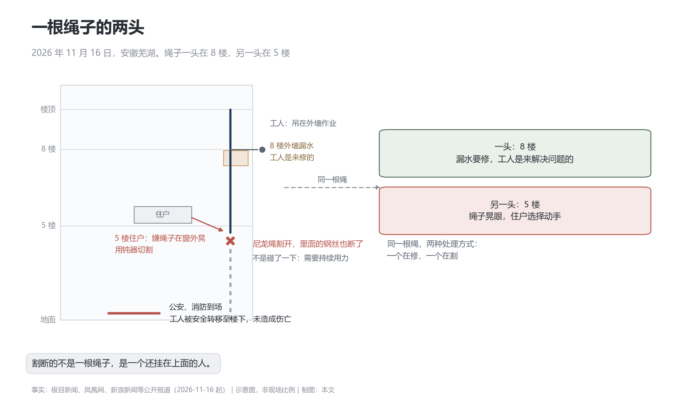
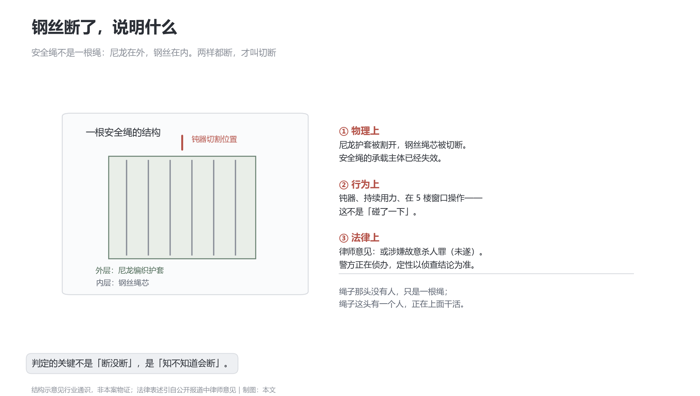
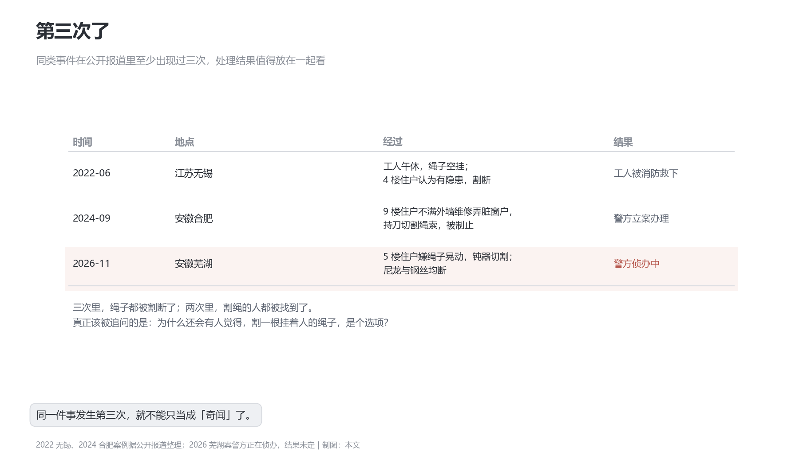

# 一根安全绳的两头：钢丝都断了，人还挂在半空

11 月 16 日，安徽芜湖。8 楼外墙漏水，工人吊着安全绳在外面修。5 楼住户嫌绳子在窗户前晃，拿钝器去割。尼龙绳割开了，里面的钢丝也断了。

工人还在半空。他自己打了 110 和 119，公安、消防到场，人被安全转移，没有受伤。物业通过监控排查，锁定是 5 楼一名住户所为。截至 11 月 17 日，辖区派出所表示正在处理。

## 一、一根绳子的两头

一头在 8 楼。工人在开发商售后施工队，干的是修漏水的活，人悬在室外，靠这根绳吊着。

另一头在 5 楼。住户看到的是一根在窗外晃动的绳。他觉得晃眼、觉得碍事，然后拿起了钝器。

同一根绳：一边在修，一边在割。

## 二、"钢丝都断了"说明什么

安全绳不是一根尼龙绳。外层是尼龙编织护套，内层才是承重的钢丝绳芯——外面那层耐磨，里面那层才真正拉住人。

现在两层都断了。

这说明不是"碰了一下"，是有人在固定位置持续用力，把一根专门吊人的绳子从外到内切断。钝器，意味着一下一下来。

对挂在半空的那个人来说，这意味着脚下什么都没有了。

## 三、法律上，这不是"邻里纠纷"

陕西恒达律师事务所高级合伙人赵良善在接受极目新闻采访时说，先要区分住户的主观认知：明知有人在高空作业仍去割绳，即便没坠落受伤，也涉嫌故意伤害罪（未遂）；若主观上追求死亡后果，涉嫌故意杀人罪（未遂）；若放任结果、危害不特定多数人，还可能涉嫌以危险方法危害公共安全罪。

即便不构成犯罪，也可依《治安管理处罚法》拘留、罚款；依《民法典》第 1165 条，还要赔偿安全绳损失，以及工人后续的惊吓、身体损害。

"未遂"说的是结果，不是性质——它只说明这次运气好。

## 四、这已经是第三次了

2022 年 6 月，江苏无锡，4 楼住户觉得空挂的绳子有隐患，割断，工人被消防救下。

2024 年 9 月，安徽合肥，9 楼住户不满外墙维修弄脏窗户，持刀割绳，被制止，警方立案。

2026 年 11 月，安徽芜湖，5 楼住户嫌绳子晃，用钝器割断尼龙与钢丝。

三次理由不同，动作一样：都没有找物业、找施工方，没有要求换时间、加防护，而是直接对绳子下手。

## 五、其实有很多别的选项

绳子晃到你家窗户，可以打物业电话要求调整作业时间，可以要求加装防护网，可以让绳子避开你家窗户，实在不行还能投诉到住建部门、街道。

这些都是在解决问题。割断它不是——割断的那一刻，你处理的不是"晃眼"，是一个人的命。

选择拿起钝器而不是拿起电话，这个选择本身就是答案。

## 六、如果你就是吊在半空的那个人

第一时间报警，这次工人做对了。作业前跟楼下打个招呼、把时间范围告知物业留个记录；绳子经过窗户时加防护或避开；发现有人动绳子，立刻停下降、抓稳、报警，别硬撑。事后报警之外，向物业、施工方、住建部门反映，人身受威胁或伤害的，依法索赔。

---

绳子晃到你家窗户，你可以投诉，可以找物业，可以要求换时间。

但你选择了割断它。

那一刀下去的时候，你在想什么？

这个问题，留给评论区。

---

*事实来源：2026 年 11 月 16 日，安徽芜湖通和世纪之光一期小区，开发商售后施工队的高空作业人员在外墙做防水维修，安全绳被割断；工人自行报警，公安、消防到场将其安全救下，未造成伤亡；物业称经监控排查系 5 楼一名住户所为；截至 11 月 17 日，辖区湾沚派出所表示此事正在处理中——据极目新闻（凤凰网转载）报道。律师意见引自该报道中赵良善的分析，案件定性以警方结论为准。同类案例：2022 年 6 月江苏无锡、2024 年 9 月安徽合肥，据公开报道整理。文中"外层尼龙护套、内层钢丝绳芯"为安全绳常见结构描述，非本案物证结论；"判断的关键是人还在不在上面"等分析为作者判断。*
