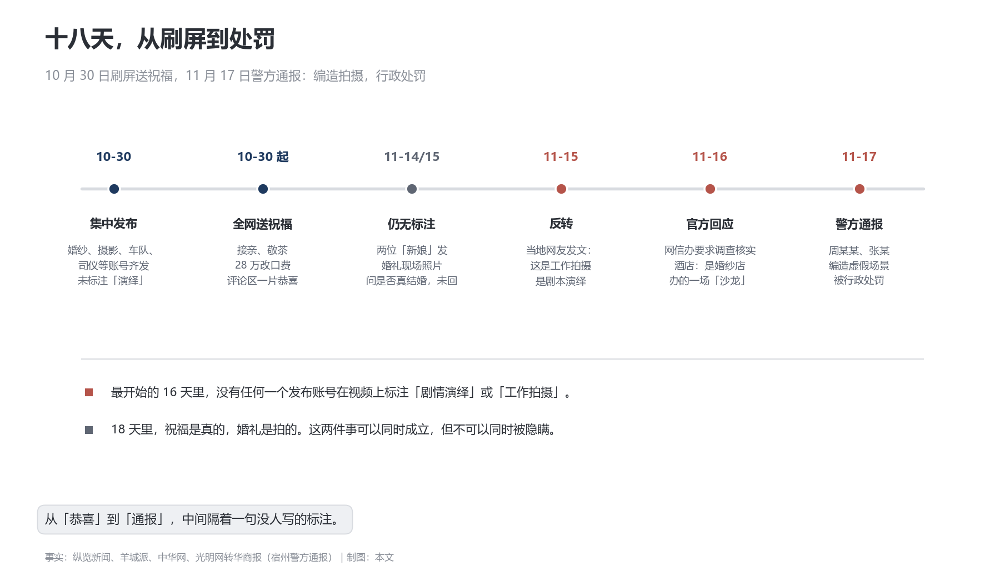
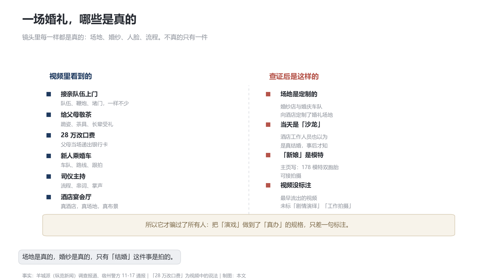
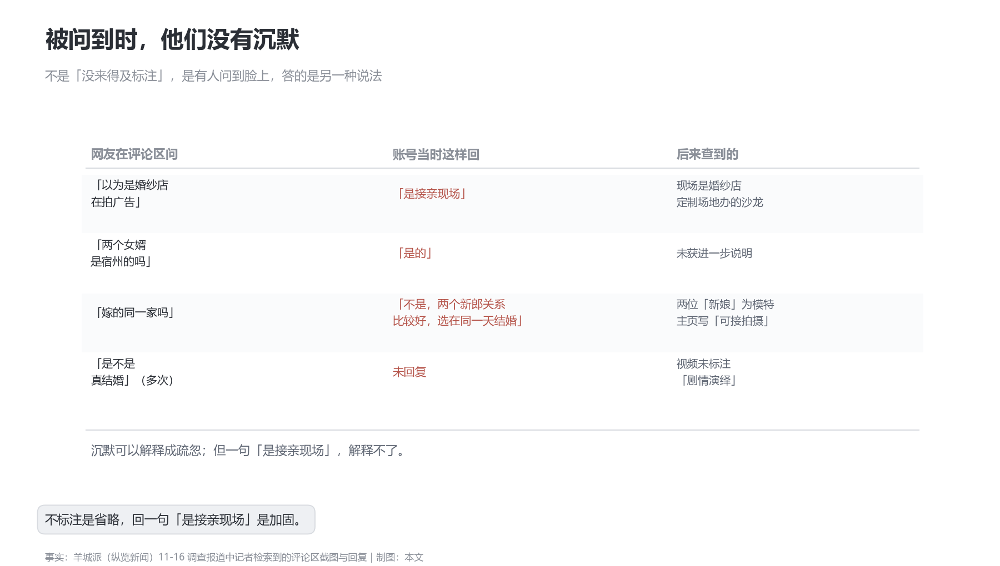

# 接亲、敬茶、28 万改口费：一场连酒店都以为是真结婚的婚礼

10 月 30 日，几段视频在短视频平台刷屏：安徽宿州，一对双胞胎姐妹同一天出嫁。接亲、敬茶、父母当场递出银行卡说是 28 万改口费、新人上婚车、司仪主持，评论区一片恭喜。

11 月 15 日，一位当地网友发文：这不是婚礼，是一场工作拍摄、剧本演绎。

11 月 17 日，宿州警方通报：网民周某某、张某为引流吸粉、博取关注，编造拍摄虚假场景，以剧本演绎形式制作虚构视频发布，扰乱公共秩序，已依据《治安管理处罚法》对两人作出行政处罚。

从"恭喜"到"通报"，中间隔了十八天。

## 一、它骗过的不只是网友

最扎人的细节不在视频里，在事后的采访里。

记者联系提供场地的酒店。工作人员说：是一家婚纱店和婚庆车队联系酒店定制的场地；婚礼当天，酒店工作人员自己也以为是真结婚，事后才知道，这是婚纱店办的一场"沙龙"。

连场地提供方都被骗了。这说明它不是随便摆个机位，是把规格做足了——真酒店、真布景、真车队、真流程。

一个东西能做到这个完成度，离"真"只差一件事：它自己说它不是真的。

## 二、差的这一件事，没人做

最早那批视频在 10 月 30 日、31 日集中出现，发布者多是婚纱、摄影、车队、主持人这些婚庆账号，没有标注"剧情演绎"或"工作拍摄"。11 月 14 日、15 日，两位"新娘"的账号又发了一组现场照片，配文里依然没有这几个字。

这十六天里，网友问过。记者检索到的截图显示：有人说"以为是婚纱店在拍广告"，账号回"是接亲现场"；有人问"两个女婿是宿州的吗"，回"是的"；有人问"嫁的同一家吗"，回"不是，两个新郎关系比较好，选在同一天结婚"。

这三句回复，比不标注严重得多。

不标注可以解释成疏忽。但有人问到脸上，答的是"是接亲现场"，那就是另一种行为：把质疑按回去。

## 三、她们算不算演员

姐姐的主页写着一句话：**178 模特双胞胎，可接拍摄**。

这行字本身没问题。模特接拍摄是正当工作，婚纱店找模特演一场婚礼来出片，比拍真婚礼更可控，这条产业链存在很久了。

新的不是"拍"，是把它包装成素人喜事，借"双胞胎同日出嫁"这个天然让人想祝福的设定去换流量。

所以问题不在她们是不是演员，在演的时候有没有告诉观众这是演的。

演员演戏不叫骗。演完戏说这是纪录片，才叫骗。

## 四、被消费的不是善心，是祝福

这跟前阵子"7 碗白米饭"的摆拍不太一样。

那条消费的是同情——你心疼了，所以转发。这条消费的是祝福——你替两个陌生姑娘高兴，打了四个字"新婚快乐"。

祝福是这世上最便宜的东西，不用花钱，不用出力。但它也最需要真诚：你祝福的那一刻，是真的在为一个跟你毫无关系的人高兴。

现在你被告知，那份高兴喂给了一场广告。

不是愤怒，是更难受的感觉——我被当成气氛组了。现场需要掌声，我就是那阵掌声。

## 五、定性，和真正的代价

通报用词很准：故意编造、虚假场景、扰乱公共秩序。这三个词顺带回答了一句常被拿来辩护的话——"拍个视频而已，至于吗"。

至于。因为平台上不只有你一个人在看。当素人喜事可以按剧本批量生产，下一个真结婚的人发视频，评论区第一句就会变成"这是不是演的"。

这才是真正的成本：不由拍的人付，由所有后来发真事的人付。

拍可以。婚纱店要出片，模特要接单，账号要涨粉，都不用羞于承认。体面的做法一直有：角标写"剧情演绎"，简介写"拍摄样片"，评论区置顶一句说明。

少的是本不属于你的祝福，多赚的是让人先误会、再发现、然后觉得自己傻。

---

十八天里，那些"新婚快乐"是真的，婚礼是拍的。

问题是：在没有标注的那段时间里，别人送出去的祝福，算什么？

---

*事实来源：10 月 30 日、31 日起，多段"安徽宿州双胞胎姐妹一同出嫁"视频传播，发布者多为婚纱、摄影、婚庆车队、主持人等婚庆行业从业者，视频呈现接亲、敬茶、父母给新郎银行卡称有 28 万元改口费、新人乘婚车、司仪主持等环节，最早流出的视频未标注"剧情演绎""工作拍摄"；11 月 14 日、15 日两位"新娘"账号发布婚礼现场照片，配文未见"工作拍摄"表述；11 月 15 日有当地网友发文指认系工作拍摄、剧本演绎；11 月 16 日宿州市委网信办表示已要求埇桥区委网信办调查核实；提供场地的酒店工作人员称，系婚纱店与婚庆车队定制场地，"婚礼"当天酒店员工也以为是真结婚，事后才知是婚纱店举办的一场"沙龙"；"姐姐"账号主页写有"178 模特双胞胎，可接拍摄"；评论区"是接亲现场""是的""不是，两个新郎关系比较好，选在同一天结婚"等回复据记者检索到的截图——以上据纵览新闻、羊城派调查报道及中华网、凤凰网转载。11 月 17 日宿州警方通报：网民周某某、张某为引流吸粉、博取关注，故意编造拍摄"宿州埇桥双胞胎同一天结婚"虚假场景，以剧本演绎形式制作虚构视频发布，扰乱公共秩序，公安机关依据《治安管理处罚法》对两人作出行政处罚——据光明网转华商报。通报未披露周某某、张某与婚纱店、婚庆车队的具体关系，本文未作推断；"28 万改口费"为视频中的说法，未见独立核实。文中关于"消费祝福""标注的意义"的分析为作者判断。*